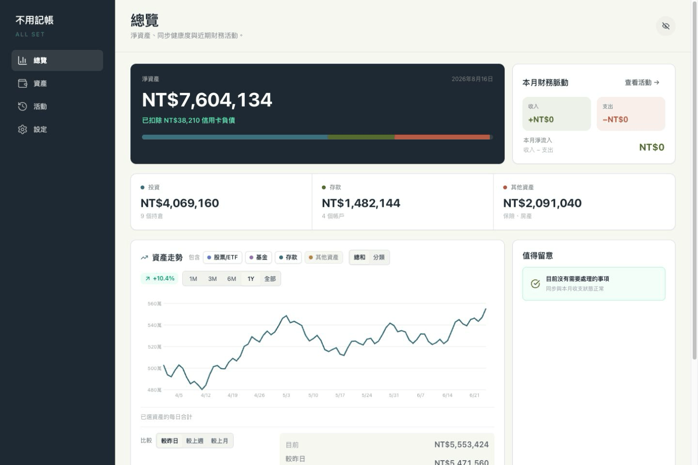
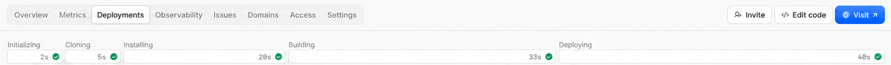

  

# 不用記帳

**ALL SET — 自動同步銀行、信用卡、投資與電子發票的自架個人財務整合工具。**

**可免費自架：** 所有功能都能在 [Cloudflare Workers Free Plan](https://developers.cloudflare.com/workers/platform/pricing/) 內使用，一鍵部署，不需要自行準備伺服器或升級付費方案；每日用量依免費額度而定，詳見[免費部署](#免費部署)。

## 主要功能

- **財務總覽**：一頁查看淨資產、歷史趨勢與本月收支。
- **帳戶與投資整合**：依機構集中查看存款、信用卡、貸款，以及股票、ETF、基金與加密貨幣持倉。
- **收支分析**：銀行、刷卡、投資與發票紀錄整理成同一條時間軸，可搜尋與篩選；銀行與信用卡交易可加上備註，例如記下轉帳或扣款的用途。
- **發票與交易配對**：電子發票與刷卡、轉帳交易合併顯示，不會重複計入支出。
- **自動分類**：可用 AI 將消費自動歸入餐飲、交通、購物、醫療等類別，也能自訂分類規則或手動修正。
- **其他資產**：手動記錄不動產、保險、交通工具等估值，一併計入淨資產。
- **現金收支**：銀行與發票抓不到的現金花費，可以直接告訴 AI 助理代為記錄，現金餘額計入淨資產；提款與現金支出不會重複計算。
- **排程同步**：定時自動同步，並查看每次新增的紀錄與資產變化。
- **繳款提醒**：總覽與推播提醒 3 天內要繳的信用卡與貸款；可設定扣款帳戶，餘額足夠時不提醒，不足時優先提醒。
- **手機與推播**：可加入手機主畫面，推播同步結果、信用卡與貸款繳款提醒，以及當天到期的定存。
- **AI 助理連線**：透過 MCP 讓 Codex、ChatGPT 等 AI 助理查詢淨資產、收支、持倉與繳款提醒，也能編輯分類與設定、觸發同步、記錄現金收支；網頁版「設定 → AI 助理」提供這個部署的連線網址與可複製的指令，完整設定見 [AI 助理連線（MCP）](docs/006-mcp.md)。

## 目前介面

以下畫面使用匿名 Demo 資料，取自目前版本。

| 桌面版總覽                                                                                                                         | 手機版總覽                                                                                                                                     |
| ---------------------------------------------------------------------------------------------------------------------------------- | ---------------------------------------------------------------------------------------------------------------------------------------------- |
|  |  |

| 資產清冊                                                                                                       | 活動分析                                                                                                           | 設定與資料來源                                                                                                           |
| -------------------------------------------------------------------------------------------------------------- | ------------------------------------------------------------------------------------------------------------------ | ------------------------------------------------------------------------------------------------------------------------ |
|  |  |  |

## 支援資料來源

| 資料來源          | 支援內容                                                                             | 登入與驗證                              |
| ----------------- | ------------------------------------------------------------------------------------ | --------------------------------------- |
| 電子發票載具      | 發票・品項明細                                                                       | App 登入                                |
| 集保 e 存摺       | 持倉・投資交易・存款（[交割帳戶支援銀行](https://epassbook.tdcc.com.tw/zh/g1.aspx)） | App 登入；首次可能需要 OTP              |
| 玉山銀行          | 存款・信用卡                                                                         | 網銀登入                                |
| 國泰世華銀行      | 存款・信用卡・貸款                                                                   | 網銀登入；額外驗證需人工處理            |
| 永豐行動銀行      | 存款・信用卡・貸款                                                                   | 網銀登入；AI 自動辨識驗證碼             |
| 台新銀行          | 存款・信用卡                                                                         | 網銀登入；AI 自動辨識驗證碼             |
| 中國信託銀行      | 存款・信用卡・貸款                                                                   | App API；App／Email 兩階段驗證          |
| 王道銀行          | 存款                                                                                 | App 登入；AI 自動辨識驗證碼             |
| 華南銀行          | 存款・信用卡                                                                         | 網銀登入；AI 自動辨識驗證碼             |
| 新光銀行          | 存款・信用卡                                                                         | App 登入                                |
| 第一銀行          | 存款・信用卡                                                                         | 網銀登入；AI 自動辨識驗證碼             |
| 凱基銀行          | 存款                                                                                 | 網銀登入；AI 自動辨識驗證碼             |
| 兆豐銀行          | 存款・信用卡・貸款                                                                   | App 登入；AI 自動辨識驗證碼             |
| 將來銀行          | 存款                                                                                 | 網銀登入；AI 自動辨識驗證碼             |
| 樂天國際銀行      | 存款・貸款                                                                           | 網銀登入；AI 自動辨識驗證碼             |
| 台北富邦銀行      | 存款・信用卡                                                                         | 網銀或信用卡會員登入；AI 自動辨識驗證碼 |
| 遠東商銀          | 存款・信用卡                                                                         | 網銀登入；AI 自動辨識驗證碼             |
| 聯邦 New New Bank | 存款・信用卡・貸款                                                                   | App API 登入                            |
| Binance           | 加密貨幣持倉                                                                         | 唯讀 API Key                            |
| MAX 交易所        | 加密貨幣持倉                                                                         | 唯讀 API Key                            |
| 彰化銀行          | 存款                                                                                 | 網銀登入；AI 自動辨識驗證碼             |
| 永豐金證券        | 台股・美股持倉・損益・投資交易（含豐存股）                                           | 帳密登入；首次憑證可能需生日與 OTP      |

「存款」含帳戶餘額與交易明細，「信用卡」含帳單與消費明細，「貸款」含餘額與還款條件；各銀行可取得的幣別與交易期間依其網銀或 App 提供的範圍而定。

## 使用限制

- 連接器依賴外部網頁、App API 與回應格式；資料來源改版後可能需要更新才能恢復同步。
- 系統不會繞過圖形驗證碼、OTP、裝置驗證等互動式安全機制；需要人工處理時會停止同步並顯示提示。
- 同步最多執行 10 分鐘；電子發票與集保包含 Queue 等待時間。停滯工作由排程恢復，也可在資料來源面板重試；逾時後需重新啟動同步。
- 部分銀行自動登入可能中斷你正在使用的官方 App 或網銀工作階段。
- 資料更新時間與完整性取決於外部服務，不應視為銀行、券商或財政部的即時正式對帳資料。
- Binance、MAX 請建立**只開啟讀取權限**的 API Key；兩者透過 Cloudflare Browser Run 同步，與瀏覽器型銀行共用每日免費額度。

## 免費部署

本專案使用的 Workers、D1、Queues、Workers AI 與 Browser Run 均提供免費額度。各項免費額度並非無限；超過服務限制時，相關功能可能暫停至額度重置。
啟用 AI 自動分類時，每天最多分類 2,000 筆活動（約佔 Workers AI 每日免費額度一半，其餘保留給驗證碼辨識），超過時隔天自動繼續。

### 部署前準備：註冊帳號

請先註冊並登入以下兩個帳號；已有帳號可直接登入：

- [Cloudflare 帳號](https://dash.cloudflare.com/sign-up)：用來部署網站、儲存金融資料與設定登入保護。
- [GitHub 帳號](https://github.com/signup)：用來存放部署用的程式碼。

### 步驟一：一鍵部署

點擊下方按鈕。Cloudflare 會在你的 GitHub 帳號建立新的 repository、自動建立 D1 Database，並部署至 Cloudflare Workers：

首次使用時，依畫面透過 **Git account → New Github Connection → Install & Authorize** 授權 Cloudflare 存取 GitHub。

確認 **Deploy command** 為 `npm run deploy`，關閉 **Enable Preview builds**，再開啟 **Protect with Cloudflare Access**，設定：

- **Scope：All traffic**，保護正式與預覽部署
- **Authentication policy：Cloudflare account**，限定你的 Cloudflare 帳戶成員登入
- **Session duration**：可保留預設 **24 hours**；想延長可選 **7 days**

確認後點擊 **Deploy**，頁面會自動跳轉至 **Builds**。登入驗證設定會自動取得，後續更新也會沿用。

### 步驟二：確認部署

1. 等該次 build 顯示成功後，點擊右上角的 **Visit** 開啟 Worker 的 `workers.dev` 網址；若未出現 **Visit** 按鈕，請先重新整理 Worker 頁面
2. 進入網站後，前往「設定 → 資料來源」，按「新增資料來源」選擇機構並設定連接器
3. 點擊同步以取得最新資料

部署後可[延長登入期限](docs/005-deployment.md#延長登入期限)。登入遇到問題或需要更新版本時，請參考[進階部署與更新](docs/005-deployment.md)。

## 本機開發

請依[本機開發指南](docs/005-deployment.md#本機開發)建立私人設定、指定開發用 D1 並啟動服務。提交變更前請見[專案驗證指令](AGENTS.md#提交與-pr-前必跑檢查)。

## 技術架構

前端使用 Svelte 5、TypeScript、Tailwind CSS 4 與 shadcn-svelte。

後端執行於 Cloudflare Workers，以 Hono 提供 API，並整合 D1、Access、Browser Run、Workers AI、Cron Triggers 與 Queues。

程式結構與開發約定請參考[後端架構](docs/002-backend-architecture.md)、[前端架構](docs/003-frontend-architecture.md)與[連接器開發](docs/004-connector-development.md)。

## 安全機制

- Cloudflare Access 是一般模式的登入閘道；Worker 會驗證 JWT 的簽章、issuer、audience 與有效期限。
- AI 助理透過 MCP 連線時同樣經 Cloudflare Access 登入（Managed OAuth），具有與網頁版相同的存取範圍，可編輯資料與觸發同步；查詢結果會送到該 AI 服務。
- 連接器帳密以自動產生或自行提供的金鑰進行 AES-GCM 加密，D1 只儲存密文。
- 目前不支援金鑰輪替；若刪除或更換 Cloudflare 中的金鑰，必須重新設定所有連接器。

## 免責聲明

本程式僅供個人研究與自用，未與臺灣集中保管結算所、財政部、金融監督管理委員會、各銀行或任何金融機構合作，亦未獲前述機構授權或背書。本程式所呈現之資料以您自行提供之憑證取得，作者不保證資料之即時性、正確性與完整性，亦不對因使用本程式所產生之任何直接或間接損失負責。請勿將本程式用於任何商業用途。

## License

本專案採用 [MIT License](LICENSE)，並保留原專案的著作權與授權聲明。

> 本專案以 [kevchentw/taiwan-fin-hub](https://github.com/kevchentw/taiwan-fin-hub) 為基礎發展而來。感謝原作者與貢獻者奠定專案基礎。
