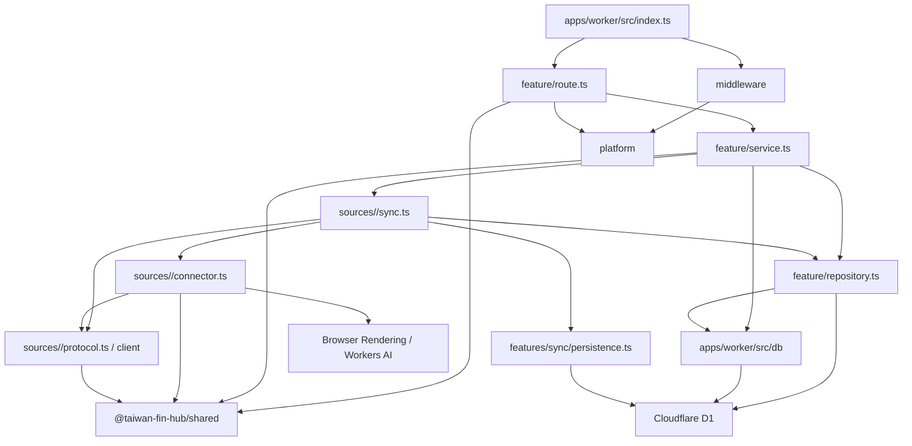
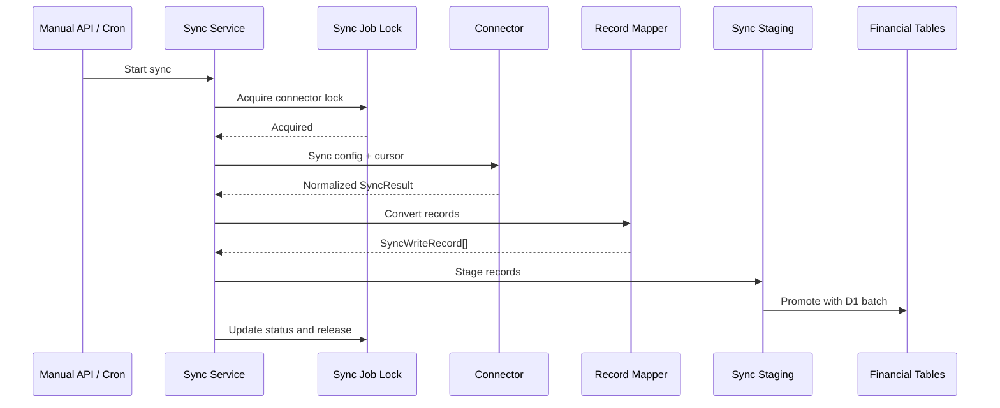
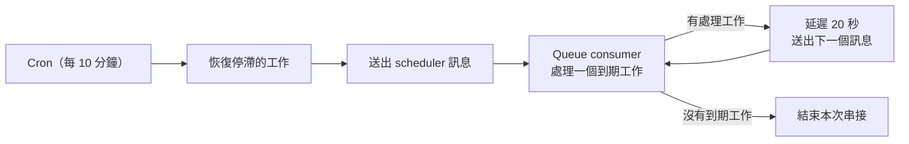

# 後端架構與維護約定

後端是單一 Cloudflare Worker：以 Hono 提供 API、D1 儲存資料，Browser Rendering 與 Workers AI 處理銀行登入及驗證碼，Cron Triggers 與 Queues 執行排程同步，Durable Objects 為部分銀行與交易所代發對外請求。

程式依業務功能分組（feature-oriented Vertical Slice Architecture）。修改某個功能時，通常只需要看 `features/<feature>/`；修改某個資料來源時看 `sources/<connectorId>/`。

## 目錄結構

```text
apps/worker/
├── src/
│   ├── index.ts      # Composition Root
│   ├── features/     # 依業務功能分組的 API 與商業流程，例如 bank、activity、sync
│   ├── sources/      # 各資料來源的登入、協定、解析與同步，一個來源一個目錄
│   ├── db/           # 跨 feature 共用的 D1 client、Drizzle schema 與查詢
│   ├── middleware/   # Access 身分與 connector ID 驗證
│   └── platform/     # Worker bindings、Hono 工具、加密、驗證與 Durable Object 代發
├── migrations/       # D1 schema 的唯一依據
├── schema-metadata.json
├── seeds/demo.sql
└── tests/            # 依 src 的目錄分組
shared/               # 前後端共用契約與純邏輯（@taiwan-fin-hub/shared）
```

`index.ts` 只負責組裝 middleware、routes、錯誤處理與靜態資源，並接收 Cloudflare scheduled event 與 Queue message batch。SQL、connector 實作與商業流程都不放在入口檔。

## 相依方向



- `route.ts` 不寫 SQL；`repository.ts` 不處理 Hono `Context`、HTTP status 或回應；`service.ts` 不回傳 Hono `Response`。
- `platform` 不依賴任何 feature。
- Feature 之間不引用彼此的 `route.ts`。需要整合多個功能時，由負責整合的 feature 呼叫各方的 service，例如 `activity` 讀取銀行交易、發票與投資成交後組成活動清單。新增跨 feature 呼叫前先確認方向，避免兩個 feature 互相呼叫。
- 不為了形式建立空的 service 或 repository，也不建立通用 `BaseRepository`。

可由 import 路徑判斷的邊界，由根目錄 `.oxlintrc.json` 的 `no-restricted-imports` 檢查，CI 會執行 `npm run lint`：

| 範圍                                | 不得引用                                                                                                                                    |
| ----------------------------------- | ------------------------------------------------------------------------------------------------------------------------------------------- |
| `platform/`                         | `features/`                                                                                                                                 |
| `features/`                         | 其他 feature 的 `route.ts`                                                                                                                  |
| `sources/<connectorId>/`            | 其他來源目錄                                                                                                                                |
| 來源的 `connector.ts`               | DB、Drizzle、feature，以及同來源的 `sync.ts` 與 repository                                                                                  |
| 來源的 `*protocol.ts`、`*client.ts` | Hono、Drizzle、Puppeteer、DB、`platform`（含 Worker `Env`）、feature、browser adapter，以及同來源的 `connector.ts`、`sync.ts` 與 repository |
| 根目錄 `shared/`                    | Hono、Drizzle、`@cloudflare/*`、Zod、`apps/`                                                                                                |

循環相依、repository 是否處理 `Context` 這類無法由路徑判斷的約定，由 code review 確認。oxlint 遇到同一檔案符合多個 override 時，後者會取代前者的同名規則，因此新增較細的 override 須帶上外層的限制。

同一份設定也以 error 啟用 `correctness` 類規則，並透過 `oxlint-tsgolint` 執行需要型別資訊的規則（例如 `no-floating-promises`）；`.svelte` 檔只套用不需型別資訊的規則。刻意的寫法以 `// oxlint-disable-next-line <rule> -- 原因` 個別標註，不放寬整條規則。

## Feature 內部結構

```text
features/<feature>/
├── route.ts       # HTTP adapter
├── service.ts     # use case 與商業流程
├── repository.ts  # 此 feature 的 D1 存取
└── 其他只屬於此 feature 的檔案
```

簡單查詢可以只有 `route.ts` 與 `service.ts`；沒有資料庫操作時不建立 `repository.ts`。

| 檔案            | 負責                                                                                                                                                          | 不負責                                                        |
| --------------- | ------------------------------------------------------------------------------------------------------------------------------------------------------------- | ------------------------------------------------------------- |
| `route.ts`      | 宣告路徑與 method、以 Zod 驗證 body／query／path、從 `Context` 取得 binding、呼叫 service、把預期錯誤轉成 status 與錯誤代碼、組裝回應與分頁 headers           | SQL、分類／計算／同步流程、connector 協定、大型資料轉換       |
| `service.ts`    | 組合 use case、商業驗證與計算、協調 repository／connector／其他 service、定義可預期的 error class、把 row 轉成 API 資料、管理時間／ID／加密／cursor／同步狀態 | 回傳 HTTP 回應                                                |
| `repository.ts` | 此 feature 的查詢與寫入（預設用 Drizzle），回傳 row、影響列數或存在性；需要原生 batch 時建立 `D1PreparedStatement` 交給 service 組合                          | 接收 `Context`、決定 status、呼叫外部 API、資料存取以外的流程 |

Service 可以直接接收 `D1Database` 或 `Env`，不需要 DI container。單純查詢不套用 DDD Aggregate、Value Object 或 Command Bus。SQL 放在使用它的 feature 附近，確實被多個 feature 共用時才移到 `db/`。

## 共用目錄

### `platform/`

Worker 與 HTTP 平台層：bindings 型別、Hono factory、API 錯誤回應、Demo 唯讀 middleware（`demoReadOnlyMiddleware`）、cursor 分頁、Zod validation hook、Access JWT 驗證，以及設定與加密工具。

連接器設定、推播訂閱與集保同步狀態的加密金鑰統一由 `platform/config.ts` 的 `configEncryptionKey` 取得。`CONFIG_ENCRYPTION_KEY=auto` 時使用部署程式產生的 `GENERATED_CONFIG_ENCRYPTION_KEY`，其他值視為自訂金鑰；缺少金鑰時直接失敗。初始化與復原限制見[部署文件](005-deployment.md#1-選擇加密金鑰)。

三個 Durable Object 為無法直接從 Worker 連線的服務代發請求：

| 物件                  | 代發對象                                                         | 原因                                                 |
| --------------------- | ---------------------------------------------------------------- | ---------------------------------------------------- |
| `MegabankEgress`      | 兆豐 App API                                                     | 提供固定的對外出口                                   |
| `FubonEgress`         | 台北富邦網銀的瀏覽器請求（CDP 攔截在 `sources/fubon/egress.ts`） | Browser Run 的對外連線會被銀行重設                   |
| `CryptoBrowserEgress` | Binance、MAX API                                                 | 交易所拒絕 Workers 的對外連線，改由 Browser Run 發出 |

`CryptoBrowserEgress` 本身要開 Browser Run，所以 `platform/crypto-browser-egress*.ts` 例外引用 `sources/` 根目錄的共用瀏覽器工具，但不引用任何具體來源。

### `middleware/`

- `accessMiddleware`：驗證 Cloudflare Access 身分，Demo 模式略過登入。
- `connectorContextMiddleware`：驗證 connector ID 並寫入 Hono variables。

Middleware 只處理跨功能的 request concern，不承擔 feature 的商業邏輯。

### `sources/`

每個資料來源一個目錄，依實際需要保留檔案：

| 檔案                                    | 負責                                                                               |
| --------------------------------------- | ---------------------------------------------------------------------------------- |
| `sync.ts`                               | 讀取並解密設定、處理 challenge、呼叫 connector，組合共用寫入流程與來源 repository  |
| `connector.ts`                          | 需要 Browser Rendering、Puppeteer、`AI` 或其他 binding 的取資料 adapter；不讀寫 D1 |
| `protocol.ts` 與 API client             | 設定 schema、外部協定、簽章與加密、parser、正規化，以及不需要 binding 的 connector |
| `repository.ts`、`authorizations.ts` 等 | 來源專用的資料修復、交易配對與存款生命週期                                         |
| `run-repository.ts`                     | 電子發票與集保的 durable run／item、進度、session 與處理 lease                     |

Protocol 與 client 不寫入資料庫。來源之間不引用彼此的內部實作；Worker 與測試直接引用來源檔案，不建立跨來源的匯出入口。

`sources/` 根目錄只放跨來源共用的能力，主要檔案如下：

| 檔案                                                                 | 用途                                                                                           |
| -------------------------------------------------------------------- | ---------------------------------------------------------------------------------------------- |
| `browser.ts`                                                         | 取得瀏覽器、容量錯誤、登入前頁面停滯復原與 session 清理                                        |
| `post-login-retry.ts`、`captcha-retry.ts`                            | 登入後步驟在同一 session 內重試；API 型來源的自動驗證碼重試                                    |
| `types.ts`、`financial-types.ts`                                     | 後端 `Connector`／`SyncResult`，以及正規化後的金融資料型別                                     |
| `sync-error.ts`                                                      | 來源錯誤宣告對外錯誤代碼的介面                                                                 |
| `sync-window.ts`、`credit-card-status.ts`                            | 同步回溯期間與信用卡狀態判斷                                                                   |
| `sync-progress.ts`                                                   | 同步階段回報                                                                                   |
| `config-registry.ts`                                                 | 各來源的設定 schema、設定頁 session 狀態判斷與身分欄位重設規則                                 |
| `deposit-source-registry.ts`                                         | 解析 `bank:<connectorId>:<帳號或末四碼>:...` 格式的存款 sourceId，供帳戶比對與集保交割帳戶連結 |
| `crypto-holdings.ts`、`crypto-prices.ts`、`crypto-browser-egress.ts` | 交易所共用的持倉正規化與 HMAC 簽章、MAX 公開報價、Browser Run 代發的瀏覽器端                   |

同步 handler 由 `features/sync/registry.ts` 組裝。瀏覽器重試的期限與停止條件見[連接器開發規範](004-connector-development.md#瀏覽器與重試)。

### `shared/`

前端與 Worker 都會用到的穩定契約與純邏輯，只從 `index.ts` 匯出，前後端一律從 `@taiwan-fin-hub/shared` 引用：

- `api/`：依 API resource 分檔的 HTTP 契約，包含全部錯誤代碼（`api/errors.ts`）。
- `activity/`：活動配對、去重、排序與資料組裝。
- 根層：connector catalog、匯率幣別規則（`exchange-rates.ts`）與近期繳款提醒（`payment-reminders.ts`）等。

Hono `Context`、D1 row 與 Puppeteer object 不放進共用契約；只有 Worker 使用的型別（例如 connector 正規化資料）留在 `apps/worker`。

允許值以 `as const` 陣列定義（例如 `SYNC_INTERVAL_MINUTES`、`CLASSIFICATION_RULE_OPERATORS`）：Worker 用來建立 Zod schema，前端用來產生選項，Zod schema 本身留在 Worker。Route 在回傳 JSON 處以 `satisfies` 檢查共用 response 契約。資料庫以一般文字或數字保存的欄位，契約維持 `string`／`number`，不宣稱比資料庫更嚴格的型別。

## D1 與 Drizzle

`db/` 只放真正跨 feature 的資料庫能力：

- `createDrizzle(binding)`：以當次 request 或 Queue invocation 的 D1 binding 建立 client，關閉 query 與 parameter logging，不建立跨 invocation 的全域 client。
- `schema/`：依業務領域描述資料表；schema 仍以 SQL migrations 為準。
- `sanitizeDatabaseError(error)`：在 log 與 API 邊界移除 SQL、綁定參數與 cause。
- 共用存取：connector 設定、加密設定與 sync cursor、sync job／排程／鎖，以及最新持倉查詢。

Feature 專用的查詢放在 feature 的 `repository.ts`，不要持續擴大 `db/index.ts`。

### 撰寫查詢

- 一般 CRUD、篩選與 JOIN 使用 Drizzle。TypeScript property 用 camelCase 並明確對應既有的 snake_case 欄位；回傳 shape 由 selection 或 mapper 維持，`$inferSelect` 不等於 runtime validation。
- 日期維持 TEXT 字串，金額、JSON 與 flag 的語意維持原樣。
- Drizzle 型別只留在 `db/` 與 Worker repository；`shared`、前端與來源的 protocol／client／connector 不依賴 ORM。直接 import Drizzle 的 workspace 自行宣告相依。
- 已有測試的穩定 SQL 不為了統一語法重寫。下列範圍保留參數化原生 SQL，並在呼叫處註明原因：

| 保留範圍                                         | 原因                                                                  |
| ------------------------------------------------ | --------------------------------------------------------------------- |
| staging JSON upsert、promotion 與 lifecycle 合併 | cursor、finalize 與 cleanup 必須在同一個 batch                        |
| 電子發票／集保 durable item 寫入與 create-or-get | item claim、JSON merge、計數、設定版本 CAS 與 partial unique 衝突處理 |
| 排程批次、通知 claim、報告寫入與財務 CTE         | 固定成員快照、通知發送權、報告修復與跨資產最新值計算                  |
| 資料來源解除連結與資料刪除                       | 同步中 guard、引用清理與刪除同一個 batch，筆數預覽共用範圍子查詢      |

- 修改上表範圍時，以 `persistence.test.ts`、`preference-fk-reconciliation.test.ts` 與 `drizzle-runtime.test.ts` 的隔離 D1 測試確認去重、使用者決定與回滾。
- Lease 的取得與續租使用單次條件 UPDATE，以影響列數判斷成功。不要拆成 SELECT 後 UPDATE，也不要以循序 await 或 `Promise.all` 取代原子 batch。
- 同一個 batch 不混用不相容的 Drizzle query object 與 `D1PreparedStatement`。
- 以日期 expression 篩選區間時，同時保留可走索引的原始欄位範圍條件，並以 `EXPLAIN QUERY PLAN` 確認。

### Migrations 與測試

Schema 與預設資料只透過 `apps/worker/migrations/` 管理，由 Wrangler 記錄套用狀態。不在 `GET` API 執行期間建表，不對正式環境使用 `drizzle-kit push`，也不導入 Drizzle Kit 的 migration 流程。Schema 語意維護在 `schema-metadata.json`，以 `npm run db:schema:docs` 產生 [`database-schema.md`](database-schema.md)；Demo 種子資料位於 `seeds/demo.sql`。

資料庫整合測試使用 `tests/helpers/d1.ts` 的 Miniflare D1，依序重播 migrations，不連線正式資料庫。測試聚焦資料完整性、安全與 batch 回滾，不為一般 CRUD、row shape 或排序逐項建檔。

### 交易引用與使用者決定

使用者對交易的決定（計入或排除、發票連結或保持分開、備註、分類）無法從銀行資料重建，合併或刪除交易時必須保留。

- `bank_transaction_preferences.transaction_id`、`invoice_transaction_preferences` 的 `invoice_id`／`transaction_id`，以及 `bank_transactions` 的 `transfer_peer_id`、`matched_transaction_id` 都是 `NO ACTION` FK。不使用 CASCADE 或 SET NULL，避免刪除時悄悄抹掉決定，或改變待入帳的可見性與定存計算。
- `classification_overrides.target_id` 與 `ai_classifications.transaction_id` 以文字保存交易 ID，不設 FK。
- 合併交易時，在同一個 promotion batch 先移轉偏好與引用，再刪除舊交易。共用流程 `features/sync/transaction-merge.ts` 只合併雙向唯一對應、且發票配對、計算偏好與分類覆寫不衝突的交易；無對應、有歧義或有衝突時保留原交易與設定。分類覆寫會移轉，AI 結果不移轉，新 ID 由下一次近期掃描重新判斷。
- 交易備註存於 `bank_transaction_preferences.note`。偏好衝突時依 `PREFERENCE_COPY_ON_CONFLICT`：目標已有的計算選擇優先，沒有才補上來源的；備註內容不同時以換行合併保留。
- 授權入帳時，`card-authorization-write.ts` 把備註搬到目標交易並清除來源備註，因為既有配對會在之後的同步重送，複製會把使用者刪掉的舊內容加回去；計算選擇照舊複製。
- `excluded_from_calculation` 為 NULL 表示使用者沒有選擇。只寫備註的偏好列不得影響預設排除、互轉與退款配對，判斷時看欄位值，不看偏好列是否存在。
- 一般 promotion 以同一個 statement 寫入交易與 transfer peer。若把相依交易拆成不同 statements，須先寫入被引用的交易；同一個 batch 不保證可以任意排列。

## HTTP Request 流程

```text
Request (/api)
  → accessMiddleware            # Cloudflare Access JWT
  → demoReadOnlyMiddleware      # Demo 模式只允許唯讀 method
  → connectorContextMiddleware  # 只用於 /connectors/:connectorId/*
  → feature route → service → repository / connector
  → JSON response
```

非 `/api` 路徑由 `ASSETS` binding 提供前端靜態檔案。

### Request 驗證

外部輸入以 Zod 4 驗證：

```ts
api.post(
  "/example",
  zValidator(
    "json",
    requestSchema,
    validationHook("INVALID_REQUEST", "Request data is invalid."),
  ),
  async (c) => {
    const input = c.req.valid("json");
    return c.json(await executeUseCase(c.env.DB, input));
  },
);
```

- Body、query 與有格式限制的 path parameter 分別使用 `zValidator("json" | "query" | "param", ...)`；query 也可使用共用的分頁 parser。
- 未驗證的輸入不得傳入 service 或 SQL。
- 驗證失敗回傳穩定的錯誤代碼，client 不依賴 Zod 的錯誤文字。

### 錯誤格式

```json
{
  "success": false,
  "error": {
    "code": "ERROR_CODE",
    "message": "Human-readable message."
  }
}
```

**預期錯誤**，例如找不到資源、重複、connector 尚未設定、需要 OTP 或 CAPTCHA、同步已在執行、外部服務暫時無法使用，由 service 拋出明確的 error class，route 再映射成固定的 status 與錯誤代碼。

來源錯誤需要固定代碼或 `needs_user_action` 狀態時，讓錯誤類別實作 `sources/sync-error.ts` 的 `toSyncError()`，宣告 status、代碼、`Retry-After` 秒數，以及是否需要使用者處理；子類別沒有覆寫時沿用父類別。沒有實作的錯誤代碼一律為 `SYNC_FAILED`，是否需要使用者處理由 `isUserActionError` 依訊息判斷。`classifySyncError` 只直接處理同步流程本身的錯誤，不逐一引用來源錯誤。

所有錯誤代碼宣告在 `shared/api/errors.ts`。`jsonError` 與 `validationHook` 只接受 `ApiErrorCode`，同步錯誤分類、sync job 與手動 run 的錯誤代碼只接受 `SyncErrorCode`。新增或改名代碼時先改共用型別，前端依代碼接續流程的比對會在型別檢查時一併驗證。

**未預期錯誤**交給全域 `api.onError`：完整錯誤寫入 Worker log，client 只收到 `INTERNAL_ERROR`。

- 回應不得包含原始 exception、stack trace、SQL 或敏感的 connector 回應。
- 帳號、Cookie、token、OTP 與解密後的設定不得寫入 log。
- 只有已知且確認不含敏感資料的 connector 錯誤，才回傳整理過的訊息。

### 分頁

持續增加的列表使用 cursor-based keyset pagination：

```http
GET /api/activity?limit=50&cursor=<opaque-cursor>
```

回應維持原本的 JSON，另以 `X-Has-More: true` 與 `X-Next-Cursor` headers 表示下一頁；沒有下一頁時不回傳 cursor。

- `limit` 預設通常為 50，上限 100。
- Cursor 是不透明值，前端不解析也不自行產生。
- 排序欄位組合必須穩定且唯一。新 API 不使用 `offset` 分頁。
- `GET /api/bank` 帶月份區間（`month` 或 `from`、`to`）時預設回傳整段，供網頁版配對與統計；同時帶 `limit` 或 `cursor` 時改為區間內分頁，讓 MCP 能在回應大小上限內讀完交易較多的月份。

### MCP 端點

`/mcp` 掛在 Composition Root，與 `/api` 共用同一個 Access Application 與 JWT 驗證，但不經過 `/api` 的 Demo 唯讀 middleware：

```text
Request (/mcp)
  → accessMiddleware
  → features/mcp/route.ts       # Demo 模式回 404、檢查 Origin
  → 無狀態 MCP handler          # 每個 request 建立新的 McpServer
```

- **寫入一律經過 `/api`**：`features/mcp/api.ts` 以同一個 Worker 內的 `api.fetch` 呼叫，只轉送 Access 身分（`Cf-Access-Jwt-Assertion`、`Cookie`），由 `/api` 的 Access、Demo 唯讀與 Zod 驗證再把關一次。不得在 MCP 另寫繞過 `/api` 的寫入工具。
- **讀寫分成不同工具**：`query_api` 只送 GET，標示 `readOnlyHint`；`call_api` 只接受 POST、PUT、PATCH、DELETE，標示 `destructiveHint`，讓 AI 助理只在寫入時要求確認。`record_manual_transactions` 呼叫 `POST /manual-transactions` 並沿用該 route 的 Zod schema，只新增或更新記錄，因此標示 `destructiveHint: false`。`sync_sources` 逐一呼叫各來源不帶 body 的 `/connectors/<id>/sync`，交由 Queue 背景執行。
- **端點說明**：`list_api_endpoints` 由 `api.routes` 產生清單，說明文字維護在 `features/mcp/api.ts` 的 `ENDPOINT_NOTES`。新增或修改 API 時同步更新，缺少說明時 `tests/features/mcp/api-tool.test.ts` 會失敗。
- **回應大小**：`query_api` 的回應超過 `API_RESPONSE_MAX_CHARS` 時只回 `RESPONSE_TOO_LARGE` 與分頁 headers；寫入的回應一律完整回傳。

查詢工具在 `features/mcp/service.ts` 沿用既有 service 與 `shared/` 計算，不另寫查詢或金額邏輯：

| 工具                       | 沿用的計算                                                                                                                    |
| -------------------------- | ----------------------------------------------------------------------------------------------------------------------------- |
| `get_financial_overview`   | `sync/reports` 的 `calculateCurrentFinancialSnapshot`，淨資產公式與總覽頁相同                                                 |
| `list_accounts`            | `bank` 的 `getBankAccounts` 與 `manual-assets`                                                                                |
| `list_investment_holdings` | `investments` 的最新持倉，排除來源沒有持倉時寫入的零值佔位列                                                                  |
| `get_monthly_cash_flow`    | `activity` 的 `getActivityItemsInRange` 與 `shared/activity/flow.ts` 的收支加總；帶 `from`、`to` 時一次讀取整段區間再逐月加總 |
| `search_activity`          | `activity` 的 `searchActivity`，分頁 cursor 與 `GET /activity/search` 相同；關鍵字可省略（須帶 `from`），分類以顯示名稱篩選   |
| `get_upcoming_payments`    | `notifications` 的 `loadPaymentReminders`                                                                                     |
| `get_sync_status`          | `sync/scheduling` 的 `getSyncJobs`，只列已設定的來源                                                                          |

- 查詢工具的帳號只留末四碼，不回傳內部 ID、`raw_payload` 與來源設定；`search_activity` 的手動記錄例外附上 `manualTransactionId`，供 AI 助理修改或刪除。`query_api` 與 `call_api` 回傳與網頁版相同的完整回應。
- 活動標題與 App 畫面相同，銀行沒有提供摘要時可能是交易附言；帳號遮蔽由各來源在正規化時負責。
- `get_monthly_cash_flow` 前後各多讀一個月再以活動日期篩選，讓跨月的發票與刷卡配對結果與活動頁一致。
- 工具錯誤只回通用訊息，細節經 `sanitizeDatabaseError` 處理後寫入 log。讀取失敗不得以空結果代替，避免 AI 誤判為沒有資料。

Managed OAuth 設定與客戶端連線步驟見 [AI 助理連線指南](006-mcp.md)。

## 銀行交易與帳戶

### 分類順序

`features/bank/service.ts` 回傳交易時，依下列優先順序決定分類：

1. 分類覆寫與使用者規則。使用者明確設為計入的交易也不參與下一步的自動判斷。
2. 年費減免沖銷（`auto_offset`）與跨帳戶轉帳配對（`auto_transfer`），兩者都排除計算。
3. 系統規則。
4. 退費配對：未分類或只有 AI 結果的退費，沿用原消費的分類（`auto_refund`）。
5. AI 分類，只補上前面都判斷為未分類（`fallback`）的交易。
6. 未分類。

### 系統分類與規則

系統分類與規則由 migration 維護，`seeds/demo.sql` 需同步。系統規則只收錄適用多數使用者與銀行的摘要模式；只在單一帳戶看到的格式，交給使用者規則或手動分類。

| 摘要模式                 | 分類                                                           |
| ------------------------ | -------------------------------------------------------------- |
| 信用卡繳款入帳           | 轉帳並排除計算；字樣與 `calculation-service.ts` 的預設排除一致 |
| 消費折抵與回饋           | 回饋，優先於其他收入與生活繳費規則                             |
| 電子支付儲值、加值與提領 | 轉帳；透過電子支付付款給商家不適用                             |
| Uber Eats                | 餐飲，優先於交通規則的 uber 關鍵字                             |
| 捐款關鍵字               | 捐款                                                           |
| 超商、超市與量販店       | 購物，不論購買品項，優先於店名中的車站或餐飲字樣               |

「回饋」（`reward`）與「捐款」（`donation`）是系統分類。新增時，既有的同名自訂分類會併入，分類覆寫與規則改指向系統分類。

### 退費配對

`features/bank/refund-matching.ts` 把信用卡的正數商家交易對回原消費。條件如下：

- 同一張卡與幣別，原扣款在退費前 90 天內，且金額不小於退費。
- 同一商家：店名相同，或共用至少 4 字且達較短店名 60% 的連續字串。比對前先移除常見電子支付與金流前綴（如 LINE Pay、全支付、街口、綠界、藍新），避免同一支付管道下的不同店家被配對。
- 摘要含折抵、回饋、減免、紅利、點數、年費、繳款、扣繳、入帳或還款的正數交易不算退費；已排除計算的扣款不作為原消費。
- 部分退費與分次退費可對到同一筆扣款。多筆候選時，金額相同者優先，再取最近的一筆。原消費可能不在當頁或當月，因此另查退費所在信用卡 90 天內的扣款。

配對成功後，原本未分類的退費沿用原消費的分類並標記 `refund: true`；已有覆寫或規則分類時，只有與原消費同分類才標記，否則仍視為收入。標記為退費的交易計入支出側並扣減該分類支出，前端計算見[前端架構](003-frontend-architecture.md#信用卡退費)。

同卡、同幣別、同商家、同一天且金額完全相同的一買一退（例如取消訂單，或綁卡驗證的暫時授權，含待入帳）一對一配對，兩筆都排除計算。任一筆有分類覆寫、使用者規則或手動設為計入時不配對。

### AI 自動分類

使用者可在「設定 → 分類」啟用，預設停用。程式位於 `features/classification`：`ai-classifier.ts` 組成 Workers AI Clef（`@cf/cloudflare/clef-flash`）請求並解讀回答，`ai-service.ts` 負責設定、掃描與每日用量，`ai-repository.ts` 存取 `ai_classification_settings` 與 `ai_classifications`。

- **套用**：只補上未分類的交易，優先順序見[分類順序](#分類順序)。停用後不再分類新的活動，已保存的結果繼續套用，直到使用者清除。
- **送出內容**：日期、帳戶類型、方向、金額、幣別、摘要、交易對象，以及配對發票的賣方與品項。選項是系統分類（定義在 `SYSTEM_CATEGORY_DESCRIPTIONS`）與自訂分類名稱；支出不提供只用於收入的系統分類，入帳只提供收入、轉帳、投資類系統分類與自訂分類。回答只採用請求提供的選項，最高機率低於 0.35 時保存為無法判斷（`category_id` 為 NULL）。
- **掃描對象**：目前未分類且有文字可判斷的交易，依月份由新到舊以 `getBankRange` 讀取，與活動頁相同地去重並配對發票。待入帳交易也會分類；已配對而隱藏的待入帳紀錄不送出。入帳紀錄不繼承授權的 AI 結果，依自己的商店名稱另行判斷，因此一筆刷卡約使用 2 次呼叫。
- **重新判斷**：已由 AI 分類的交易不重判，使用者清除結果後回補才會重新分類。無法判斷的交易只在送出內容的雜湊改變時（例如晚到的發票）重試。
- **近期掃描**：啟用時只記錄 `enabled_at` 與當下的資料浮水印，不立即掃描。之後每次 Cron 比對交易、發票與發票配對的最新 `updated_at`，有變化才掃描含當月的最近 3 個月，只處理 `created_at` 不早於 `enabled_at` 的交易，以及回補時判斷為無法判斷者。
- **回補**：只由使用者啟動，從當月處理到最早的交易月份，不受 `enabled_at` 限制。同一時間只有一個掃描。
- **掃描識別碼**：每次開始近期掃描或回補都產生新的 `scan_id`，停用與清除會先清空它（清除時先清空再刪除結果）。結果與進度只在 `scan_id` 相符時寫入，不符時該掃描立即停止，不覆寫較新的回補、清除或停用。每日呼叫次數以累加更新，不受識別碼影響。
- **Queue**：以 `run-ai-classification` 訊息在 `SYNC_QUEUE` 執行，每次 invocation 最多 25 次呼叫、6 個月份，未完成時延遲 1 秒串接。進度存在 D1；訊息失敗時直接 ack，由 Cron 恢復閒置超過 5 分鐘的掃描。
- **用量**：每日最多 2,000 次呼叫（每次約 2.5 neurons，約佔 Workers AI 每日免費額度一半，其餘保留給驗證碼辨識）。達上限或收到 `3036`（免費額度用完）時暫停到 UTC 隔日 00:00，再由 Cron 繼續；暫時性錯誤等 Cron 恢復；其他錯誤保存為無法判斷，避免重複重試。
- Demo 模式不啟動掃描，訊息直接 ack。

### 信用卡與貸款扣款帳戶

信用卡與貸款可指定一個扣款帳戶，讓繳款提醒判斷可用餘額是否足夠（判斷規則見 `shared/payment-reminders.ts` 與[前端架構](003-frontend-architecture.md#繳款提醒)）。採用順序為手動設定、銀行提供、推測。

- **手動設定**：存於 `bank_account_payment_accounts`，`payment_account_id` 為 NULL 表示明確「不指定」。指定的帳戶已不存在或不再符合條件時退回銀行資料。兩個帳戶 ID 都不設 FK，帳戶被移除或合併時視為未設定，不阻擋同步資料清理，也不以 CASCADE 悄悄刪除設定。
- **銀行提供**：connector 以 `BankAccount.autopayAccount` 回報銀行頁面揭露的自動扣繳帳戶，寫入 `bank_accounts` 的 `autopay_status`（`enabled`／`none`）、`autopay_bank_code`、`autopay_account_last4` 與 `autopay_account_source_id`，只保存銀行代碼、末四碼與自家存款 sourceId，不保存完整帳號。本次未取得（`undefined`）時整組保留，有明確結果（含未設定）時整組覆寫，避免新舊銀行代碼與末四碼混用。只在唯一時自動對應：有 sourceId 時精準比對，否則須同時符合銀行代碼與末四碼。
- **推測**：銀行完全沒有提供扣款資料（`autopay_status` 為 NULL）時，以同一資料來源唯一的同幣別可扣款帳戶推測（`inferred`），有多個候選就不推測。銀行明確顯示未設定，或提供的帳戶對不到時也不推測，避免誤用其他帳戶的餘額而隱藏提醒。
- **條件**：扣款帳戶不能是信用卡、貸款、定存或儲值帳戶，且須與款項同幣別或為台幣帳戶（外幣帳單常由台幣帳戶換匯扣繳）。推測只使用同幣別帳戶。
- **API**：`PUT /api/bank/accounts/:id/payment-account`（`{ paymentAccountId: string | null }`）寫入手動設定，同路徑的 `DELETE` 改回銀行資料。對象不是有效的信用卡或貸款時回 `BANK_ACCOUNT_NOT_FOUND`（404），扣款帳戶不符合條件時回 `INVALID_PAYMENT_ACCOUNT`（400）。`/api/bank/accounts` 與 `/api/bank` 的信用卡與貸款附上 `paymentAccountId`、`paymentAccountSource`（`manual`／`bank`／`inferred`）與 `bankAutopay`，不回傳銀行資料的內部欄位。

### 手動記錄的現金帳戶

銀行與發票抓不到的現金收支由 `features/manual-transactions` 寫入。入口只有 `POST /api/manual-transactions`（MCP 的 `record_manual_transactions` 也呼叫它）與 `DELETE /api/manual-transactions/:id`；網頁版只提供刪除。

- **資料模型**：不新增資料表。現金是一般的 `bank_accounts` 列（`id = manual:cash`、`connector_id = manual`、`account_type = stored_value`、TWD），第一次寫入時才建立。`manual` 不在 connector catalog 中，常數位於 `shared/api/manual-transactions.ts`，判斷手動記錄一律比對 `connector_id`。這個帳戶照常出現在資產、總覽與淨值，`stored_value` 本來就不是扣款帳戶候選。
- **交易**：寫入 `bank_transactions`，`source_id` 為呼叫端的 `externalId`（省略時為 UUID），`id` 為 `manual:<source_id>`。既有的 `UNIQUE (connector_id, account_id, source_id)` 讓相同 `externalId` 重送時更新同一筆；`raw_payload` 只保存 `type`。
- **餘額**：沒有獨立來源。每次寫入或刪除，都在同一個 D1 batch 最後重建這個帳戶的 `bank_balance_snapshots`：每個有記錄的日期一列，餘額為到當天為止的累計，因此補記過去日期或重建歷史淨值時也讀得到當時的現金；記錄全部刪除後保留一列 0。帶 `balance` 時由 SQL 算出差額並補一筆「餘額調整」，差額為 0 時不寫入。這些 statement 需要原子性與 set-based 的 `INSERT ... SELECT`，因此使用原生 SQL。

類型決定金額正負與計算偏好（`bank_transaction_preferences.excluded_from_calculation`）：

| type           | 金額 | 計算偏好                | 互轉配對                       |
| -------------- | ---- | ----------------------- | ------------------------------ |
| `expense`      | 負   | 0（明確計入）           | 不參與，避免與同日同額交易誤配 |
| `income`       | 正   | 0（明確計入）           | 不參與                         |
| `transfer_in`  | 正   | 1（排除）               | 參與，例如與 ATM 提款配成互轉  |
| `transfer_out` | 負   | 1（排除）               | 參與，例如把現金存入銀行       |
| 餘額調整       | 差額 | 1，並手動分類為「轉帳」 | 不參與（手動分類擋下配對）     |

ATM 提款因此不會和之後的現金支出重複計算：現金轉入與銀行提款配成 `auto_transfer`，兩邊都不計入收支。沒有配到時（例如跨日），現金這一側仍排除，銀行那一側維持原本的計算方式，由使用者自行排除。

- **分類**：`categoryId` 只適用於收支，寫入 `classification_overrides`；省略時走一般規則。現金移動會移除既有的手動分類，否則會擋下互轉配對。分類不存在時回 `CATEGORY_NOT_FOUND`（404），整批不寫入。
- **刪除**：只作用於 `connector_id = manual` 的交易，其他回 `MANUAL_TRANSACTION_NOT_FOUND`（404）。同一個 batch 先移除分類覆寫、AI 分類與交易偏好；已連結的發票配對刪除（發票回到自動配對），「保持分開」的決定保留但清掉交易引用；最後刪除交易並重算餘額。
- **存款歷史**：寫入或刪除後以 `rebuildBankDepositHistory` 重算最早受影響日期（更新日期時包含原日期）到今天（台北日期）的存款歷史，最多往回 31 天；更早的補記由 `/history/net-worth/rebuild-bank` 重建。失敗只記錄 log，不讓呼叫端誤以為需要重送。
- **發票配對**：自動配對（`shared/activity/matching.ts`）略過排除統計的手動記錄，也就是現金移動與餘額調整，否則同日同額的發票會跟著排除統計。手動支出照常自動配對，使用者仍可手動連結任何一筆。
- **活動**：`source` 維持 `bank`，另以 `ActivityItem.manual` 標示；來源篩選的 `manual` 由 `shared/activity/filter.ts` 處理，收支加總、發票配對與分類統計都沿用銀行交易的邏輯。

## 投資持倉與淨值走勢

- **最新持倉**：先取每個來源的最新完整快照，已知券商、帳戶、市場與資產類型再跨來源選擇權威快照，同日以直接券商優先。API、總覽、匯率清單與金融快照共用這個選擇。識別不完整的持倉保留在原來源範圍，不依名稱或代號猜測合併。各 connector／asset type 的最新日期由 `db/investment-positions.ts` 以一次 GROUP BY 取得，不逐列執行 MAX 子查詢。
- **數值**：`cost_basis` 與 `unrealized_pnl` 保存來源原幣數值，不加進淨資產；市值、現金與損益欄位可保留小數。`empty:*` 帳戶快照 marker 讓賣出後的零庫存能取代較舊的集保持倉。
- **台股走勢**：`GET /api/history/net-worth/chart` 把集保的台股 `stock` 與直接券商的 `tw_stock` 合併為同一個 `tw-stock` 序列：集保有資料的日期以集保為準，集保最後一天之後或未連接集保時才用券商台股（同日相加）。前端逐序列沿用前值，分成兩個序列會把集保舊值與券商新值重複相加。

### 股票投入成本

同一支 API 另輸出股票投入成本（`assetType = stock_cost`、`source = cost`，台幣），不另外儲存讀模型：

- **台股**：以直接券商最新快照的台股成本為基準，依成交往回推，扣掉之後的買進金額、加回之後賣出部位的原始成本（`raw.realizedCost`），每個成交日一點，形成階梯序列；最早成交以前沿用回推到的成本。賣出的原始成本缺漏或為 0（券商查不到）時停止往前推。
- **海外**：取快照日的來源成本，以目前匯率換算，從海外市值進入走勢那天起計入。海外市值只從開始寫入那天累積，沒有歷史股價可回補，因此更早的日期改依海外成交（`raw.market` 不是 `TW`）累加買進金額，回推到買進日。成交必須能完整解釋海外市值第一個點的成本（容許 1% 內的四捨五入與手續費差距）才回補；有海外賣出、缺金額或匯率，或有成交以外取得的持股時不回補，不猜測買進時間。
- **尚無市值的成本**：有回補時另輸出 `stock_cost_unvalued`（與 `stock_cost` 同日逐點，海外市值進入走勢那天起為 0）。前端計算未實現損益時先從成本扣除這部分，只比較市值線涵蓋的持股，台股損益照常計算。
- **不輸出的情況**：集保有不屬於直接券商帳戶的持股、最新快照有缺成本的持倉，或外幣缺少匯率時不輸出成本，避免市值與成本的範圍不一致。

## 匯率更新

- **幣別清單**：`features/exchange-rates` 取得 USD、JPY、EUR，加上有效銀行與信用卡帳戶、最新投資持倉與手動資產的其他幣別（帳戶讀最新餘額，手動資產讀最新估值）。清單與更新流程共用 `shared/exchange-rates.ts`：排除 TWD、NAN 等非有效貨幣代碼並去重，只略過實際金額為 0 的資產，不把外幣四捨五入後再判斷。`GET /api/exchange-rates/currencies` 回傳這份清單，不依賴前端資產列表的分頁。
- **寫入**：外部來源以 TWD 為基準，儲存時取倒數作為原幣換算 TWD 的匯率，並使用來源的更新時間。來源沒有提供的額外幣別保留既有匯率；來源回傳無效匯率或預設幣別缺值時不寫入。匯率以單一 D1 batch upsert，不清空整張表；`GET /api/exchange-rates` 回傳所有已儲存的幣別。

## 讀取 API 效能

線上讀取的耗時主要來自 D1 往返與冷啟動，個別查詢通常只要數毫秒，因此優先減少每頁請求數與循序的 D1 往返，再處理查詢本身。`wrangler.app.toml` 已開啟 `observability.traces`，可在 Workers trace 檢視 D1 與對外 fetch 的耗時。

- 只需帳戶與餘額的頁面使用 `GET /api/bank/accounts`，不載入交易、轉帳配對與分類。
- 資料來源卡片的設定狀態沿用 `/api/sync-jobs` 的 `configured`，開啟連接器詳情時才讀取 `/api/connectors/:connectorId/settings`。
- 銀行交易分類時，分類規則與第一輪查詢並行，當頁的分類覆寫、轉帳候選與退費候選也並行；只有頁面外的候選需要再查一次覆寫。退費候選依信用卡帳戶走 `idx_bank_transactions_account_posted_date`，只在當頁有信用卡正數交易時查詢。
- Cloudflare Access 公鑰只快取在 isolate 記憶體（Access 後方的 Worker 無法使用 Cache API），同一 isolate 的並行請求共用同一次下載與匯入後的金鑰。

### 發票配對的讀取範圍

- 自動配對只在同一天；跨日配對一定是使用者手動建立，存於 `invoice_transaction_preferences`。手動連結的交易限於發票日前 14 天（`MANUAL_INVOICE_MATCH_MAX_EARLY_DAYS`，網購等出貨後才開立發票）到其後 45 天，跨日須同額。
- `GET /api/activity/invoice-mappings` 接受與其他區間 API 相同的 `from`／`to` 月份。跨日配對的活動以交易日期呈現，所以讀取區間內，以及區間結束後 14 天內發票的決定；未帶區間時回傳全部。
- 活動搜尋與 `getActivityItemsInRange` 依日期讀取後，以 `loadLinkedCounterparts` 依 linked 紀錄補讀不在本批的另一端，不靠放寬日期範圍。前端遇到區間內發票連結到區間前的交易時，以 `GET /api/bank/transactions?ids=`（可重複、最多 100 個）補讀。補讀的資料只供配對；搜尋以發票命中時一併回傳其連結交易的日期，活動仍只在交易日期呈現一次。

## Connector 同步架構

共用同步流程位於 `features/sync`，各來源的實作位於 `sources/<connectorId>`。追查同步問題時，依入口閱讀：

| 入口             | 閱讀順序                                                                                                                                                          |
| ---------------- | ----------------------------------------------------------------------------------------------------------------------------------------------------------------- |
| 一般銀行手動同步 | `features/sync/route.ts` → `manual-sync.ts` → `registry.ts` → `sources/<connectorId>/sync.ts`，再看該來源的 connector／protocol 與 `features/sync/persistence.ts` |
| 排程同步         | `features/sync/scheduling/queue.ts` → `scheduler.ts`                                                                                                              |
| 電子發票、集保   | 來源的 `sync.ts` 與 `run-repository.ts`                                                                                                                           |



`features/sync` 的主要檔案：

| 檔案                                                            | 責任                                                                                                                                                                              |
| --------------------------------------------------------------- | --------------------------------------------------------------------------------------------------------------------------------------------------------------------------------- |
| `route.ts`                                                      | 手動同步與 challenge API。依 registry 的 `manualSyncConnectorIds` 迴圈註冊 `POST /connectors/:id/sync`，以來源宣告的 `syncBody` 驗證接續參數；電子發票與集保保留各自的 Queue 路由 |
| `registry.ts`                                                   | 從 catalog 驗證 scope，dispatch 各來源的 sync 與 challenge handler。電子發票與集保標記 `dedicatedSyncRoute`，拒絕單次同步                                                         |
| `manual-sync.ts`、`manual-run-repository.ts`                    | 一般手動同步的鎖、狀態更新與報告修復；背景手動同步的排入、執行與 run 狀態轉換                                                                                                     |
| `error-response.ts`、`errors.ts`                                | 同步錯誤轉為 status、錯誤代碼、脫敏訊息與 `Retry-After`，HTTP 回應與背景 run 結果共用；使用者操作判定與 log 脫敏                                                                  |
| `config.ts`、`connector-state.ts`、`connector-repository.ts`    | 讀取並加密設定，區分公開偏好、敏感 session 與安全 cursor；設定版本 guard 與跨來源帳戶關聯                                                                                         |
| `lock.ts`、`execution.ts`、`run-state.ts`                       | Lease 與 heartbeat、同步期限、失鎖取消與 D1 owner guard，以及 durable run 的停滯與重試狀態                                                                                        |
| `record-mapper.ts`、`persistence.ts`                            | 把 `SyncResult` 轉成 write record，經 staging table 與 D1 batch 寫入正式資料表                                                                                                    |
| `card-authorization-matching.ts`、`card-authorization-write.ts` | 信用卡授權與入帳明細的共用配對、配對保存與使用者設定移轉                                                                                                                          |
| `transaction-merge.ts`、`card-reconciliation.ts`                | 舊交易合併與單卡摘要帳戶修復，保留使用者偏好、分類與發票關聯                                                                                                                      |
| `crypto-holdings-write.ts`                                      | 交易所當天完整持倉快照：設定版本 guard、刪除同 connector 當天持倉、寫入新列與淨資產歷史在同一 batch                                                                               |
| `scheduling/`                                                   | 排程設定 API、到期工作選取、Queue producer／consumer、預設排程批次與停滯恢復                                                                                                      |
| `reports/`                                                      | 金融快照、報告查詢與修復、活動變化擷取與明細                                                                                                                                      |

- Route 與 scheduler 透過 runtime registry dispatch，不新增 connector-specific switch。
- 各來源直接引用 `features/sync` 的 record mapper 與 persistence，不經由 `manual-sync.ts` 匯出，也不依賴其他來源。
- 來源專用的配對、存款生命週期與舊資料修復放在來源目錄，例如 `ctbc/authorizations.ts`、`hncb/repository.ts`、`nextbank/deposits.ts`、`obank/time-deposits.ts`。信用卡授權配對與各銀行的協定細節見[連接器開發規範](004-connector-development.md#信用卡交易階段與共用配對)。
- 來源專用測試與 fixtures 位於 `apps/worker/tests/sources/<connectorId>`，跨來源的資料完整性測試位於 `tests/features/sync`。

## 同步鎖與排程

### 同步鎖

同一個 connector 的所有同步共用一把 canonical connector lock，因此手動與排程、全部與部分 scope、CAPTCHA preparation 與正式同步都不會重疊。取得失敗時回報「已有同步執行中」。

|            | 一般同步               | 電子發票、集保（durable run）                                    |
| ---------- | ---------------------- | ---------------------------------------------------------------- |
| Lease      | 10 分鐘，每 5 分鐘續租 | 10 分鐘，每 5 分鐘續租，跨 invocation 保留                       |
| 整體期限   | 自開始執行起 10 分鐘   | 自建立 run 起 10 分鐘，包含 Queue 等待與所有分段；續租不延長期限 |
| 每段 lease | 無                     | 3 分鐘，每分鐘續租，以 owner 區分每次 delivery                   |
| 釋放       | 在 `finally` 釋放      | 成功寫入或失敗結案時釋放                                         |

CAPTCHA preparation 的 lease 與期限都是 3 分鐘；來源既有的較短期限仍然適用。

- 續租只允許未過期的 owner。續租失敗或到期時，透過 AbortSignal 停止等待、關閉仍連線的 Browser session，並中止電子發票與集保的 HTTP 請求。
- `execution.ts` 為本次 invocation 包裝 D1 binding，所有寫入與 batch 都在同一個 transaction 前置 owner 與期限 guard，durable chunk 另核對 chunk owner。失鎖時整個 batch 回滾，所以遲到完成的外部請求也無法寫入 D1。不要改成只在寫入前單獨查鎖。

### 排程設定

- 每週排程可選一到七天，共用同一個台北時間的開始時間。`sync_jobs` 與 `sync_schedule_settings` 的 `preferred_weekdays` 保存星期 JSON 陣列；NULL 時沿用舊的 `[preferred_weekday]`，舊設定不需重新儲存。API 要求至少一天、不可重複，並排序為 0 到 6。
- `nextSyncRunAt` 取勾選星期中嚴格晚於現在的最近時間，一般同步與電子發票、集保結案共用。
- 繼承預設排程（`schedule_mode = inherit`）的工作，頻率、時間與星期一律讀取 `sync_schedule_settings`；工作列上保存的排程欄位只是切回自訂排程時的初始值。因此新 connector 的 migration 用欄位預設值建立 job，也不會偏離預設排程。更新預設排程只重算繼承的工作。

### Cron 與 Queue



- Queue consumer 使用 batch size 1 與 concurrency 1，每次 invocation 最多處理一個 connector，讓每個 connector 擁有獨立的 Worker CPU、subrequest 與執行時間額度。是否到期由 D1 的 sync job 狀態判斷。
- 20 秒間隔避免連續啟動 Browser session 撞上 Browser Run 的取得頻率限制，也讓下一個工作不必等到下一次 Cron。初始的 Cron kick 不延遲。同一個工作內的瀏覽器取得與重試另見[連接器開發規範](004-connector-development.md#瀏覽器與重試)。
- 每個工作使用獨立的 run ID，log 為結構化 JSON，包含 connector、scope、trigger、status 與 duration。

執行結果的處理：

- 成功後更新下次執行時間。
- 需要 OTP、CAPTCHA 或重新登入時記為 `needs_user_action`，保留原本的下次執行時間。這種工作不會被挑選，時間可能停在過去。
- 其他錯誤記為 `failed`，並更新下次執行時間。
- 手動同步失敗（含中斷後由恢復流程結案）時，若下次執行時間已過，就推進到下一個排程時段，避免工作離開 `needs_user_action` 後在非排程時段觸發整輪預設排程。未過期的時間保留。
- 失敗時一併寫入 `last_error` 與 `last_error_code`（`classifySyncError` 的代碼，成功時清空），前端回到頁面時依代碼接續驗證碼、OTP 等流程。
- 所有來源首次同步成功時，若排程仍關閉便在同一筆成功更新中開啟，以更新前的 `last_success_at IS NULL` 判斷首次成功。曾成功過的來源保留使用者的開關，失敗或等待驗證不會自動啟用。

### 停滯恢復

每次 Cron 先執行恢復，20 秒的 scheduler 串接不重複執行。

- 電子發票與集保 run：沒有有效 chunk lease 且 3 分鐘未更新的補送 continuation；超過整體期限的先以 owner guard 結案。有效的 chunk lease 不會被 Cron 中止。
- 背景手動同步：排隊超過 30 分鐘以 `SYNC_QUEUE_TIMEOUT` 結案；running 但已沒有有效 connector lock 的以 `SYNC_INTERRUPTED` 結案。已結案超過 7 天的 run 會被清除。
- 一般同步的過期殘留鎖標記為失敗並清除，保留最後成功時間。
- 單一 run 的恢復失敗只記錄 log，不阻擋其他 run 與 scheduler。

### Demo 模式

Demo 模式（`DEMO_MODE`）不執行背景同步：Cron 不送出 scheduler 訊息，Queue consumer 不處理任何訊息，避免以啟用 Demo 前已儲存的憑證登入外部服務。scheduler 與 AI 分類訊息直接 ack；電子發票、集保分段訊息與背景手動同步訊息以 1 小時延遲重新送出，保留 continuation。關閉 Demo 後會重新檢查進行中的 run，已超過整體期限的會結案，需要重新啟動同步；期間 session 過期或設定變更時可能需要重新驗證。

### 預設排程批次

使用預設排程的工作以「一輪一批次」執行，讓推播能彙整整輪結果：

1. 沒有進行中的批次，且至少一個繼承工作到期時，以單一 D1 batch 建立批次，固定快照當下所有啟用且不需使用者處理的繼承工作。
2. 每次 invocation 從尚未完成的固定成員中挑選一個未鎖定、不需使用者處理的工作。同一輪已完成的成員不再執行，新啟用的工作等下一輪。
3. 結果在釋放 connector lock 前寫入成員，避免重複的 Queue 訊息遺漏結果。停用、改為自訂排程或進入 `needs_user_action` 的非執行中成員會被略過。
4. 所有成員都有結果或被略過時，以條件式更新取得一次推播發送權並關閉批次，下一輪才能建立。建立新一輪時，清理超過 30 天的已結案批次。

手動同步不改寫進行中的批次成員；自訂排程逐工作推播。手動完整同步成功後，可修復最近一筆已結案報告中同一 connector 的 `failed` 或 `needs_user_action` 結果：保留原完成時間、記錄 `recovered_at`，並一次性累加新增筆數、更新報告的 after-snapshot。同步式手動流程在開始前固定可修復的批次，避免改到執行期間才結案的新一輪；集保的部分 scope 同步不修復 `all` 的批次結果。

## 分段與背景同步

### 電子發票分段同步

電子發票不在單一 invocation 內擷取所有品項明細，改以 `einvoice_sync_runs`／`einvoice_sync_run_items` 作為 durable work queue。品項明細一律同步，沒有可選的偏好。

- 手動或排程建立 run 後 enqueue `run-einvoice-chunk`。每段最多 claim 35 張發票明細並以 set-based 寫入完成，仍有工作就 enqueue 下一段。
- 每次 delivery 以獨立 UUID 作為 chunk owner。處理明細時每五張也續租一次；續租不更新業務進度時間。
- 全部 item 成功後，才把 items 當作 staging，以固定五個 set-based statements promotion 並更新 cursor。這個 batch 以設定版本 CAS 防止憑證更新的競態，`promoted_at` 讓 promotion 前後的重送都冪等。之後的 finalize 更新 `sync_jobs`、排程批次結果與通知。
- 暫時錯誤交給 Queue retry；session 失效時清除後重新初始化。需要使用者處理或重試耗盡時，結案為 `needs_user_action` 或 `failed`，不寫入部分明細。
- 建立 run 後的初始寫入或首次 enqueue 失敗時，補償結案並清鎖。重試既有 run 會重新 enqueue；手動重試可補送既有的排程 run，保留原 trigger 與批次。逾時且沒有有效 chunk lease 的舊 run 先結案，再建立新 run。
- 成功與失敗的 finalize 同時核對 canonical owner 與 chunk owner，並在同一個 batch 更新結果與釋放鎖。

### 背景手動同步

一般銀行的手動同步以 `manual_sync_runs` 保存狀態，不依附發起的 HTTP request。電子發票與集保使用各自的分段流程，不建立這種 run。

- 不帶使用者輸入的 `POST /api/connectors/<id>/sync` 由 `startQueuedManualSync` 建立或取得該來源唯一的 queued／running run，enqueue `run-manual-sync` 後回傳 202 與 run ID。訊息只帶 run ID，不含憑證、OTP、驗證碼或 session。Enqueue 失敗時以 `cancelQueuedManualSync` 結案並回報錯誤。
- 帶驗證碼、OTP、中信驗證動作或國泰 `otpChannel` 的接續同步，仍在 request 內以 `withManualSyncLock` 執行，因為這些輸入必須接回同一次登入，且不能放進 Queue 訊息。
- 該來源的 connector lock 有效時（排程、CAPTCHA preparation 或其他手動同步），建立 run 的條件式 INSERT 不寫入並回報 `SYNC_ALREADY_RUNNING`；已有背景手動 run 時回傳該 run。其他來源的排程不阻擋；Queue 不保證 FIFO，手動訊息通常會在排程的 20 秒間隔中被處理。
- Consumer 以 run ID 作為 owner 取得鎖後，才把 run 轉為 running。若排入後被其他同步搶先取得鎖，run 以 `cancelled`／`SYNC_ALREADY_RUNNING` 結案，不等待，也不釋放對方的鎖。重送的訊息遇到非 queued 的 run 直接 ack，不會再次登入銀行。
- 10 分鐘期限從取得鎖開始計算，不含排隊時間。執行時仍為 `trigger = manual`，需要驗證碼或 OTP 的來源可主動發送；結案為 `needs_user_action` 時保存錯誤代碼，供使用者回來處理。
- 只有登入前 Browser Run 容量不足、且等待時間在 30 分鐘排隊上限內時才放回 queue，最多三次，不記為 sync job 失敗；每日額度這類較長的等待直接以容量錯誤結案。放回 queued 到釋放自己的鎖之間，重送訊息與排隊逾時清理都不會結案此 run。其他錯誤一律結案，不自動重試銀行登入。
- 結束後沿用一般手動同步的狀態更新與報告修復，釋放鎖後依推播偏好送出結果通知。

### 集保分段同步

- 手動 API 與排程由 `startTdccSyncRun` 建立或取得 active run，再 enqueue `run-tdcc-chunk`。`tdcc_sync_runs` 保存 scope、設定版本、加密認證與 session，`tdcc_sync_run_items` 保存銀行與投資交易的分頁工作及結果。同一 connector 的 `all`、`investments`、`bank`、`trades` 共用 active run 限制與 canonical lock。
- 手動 run 在 Queue 中可主動寄送 OTP，需要互動時以 `needs_user_action` 與 `last_error_code` 結案；排程不主動寄送。帶 OTP 的手動請求在 request 內初始化，讓驗證碼錯誤立即回報，並取得獨立的 run lease，避免與同一 run 的 Queue delivery 同時登入。排入同步的回應不代表資料已經完成，前端須追蹤 sync job 狀態。
- 每段取得 owner-scoped run lease、更新 connector lock，最多 claim 一個分頁 item 並以 claim token 更新；仍有 pending 或 processing 工作時 enqueue 下一段。`finally` 只釋放該 owner 的 run lease。重試與停滯恢復沿用電子發票的判斷。
- 分頁結果完成後彙整，透過 `sync_write_staging` 寫入正式表。寫入前檢查設定版本，並在 promotion batch 更新 connector 狀態、cursor 與 sync job；`promoting`、`promoted_at` 標記 promotion 與 finalize 的進度。
- Connector lock 保留到報告結果寫入與 run 成功結案。失敗結案、sync job、排程結果、staging 清理與清鎖使用同一個 owner guard batch。非預設批次的電子發票與集保 run 結案時，依推播偏好送出通知。

### 同步進度與狀態

- 一般同步由 `createSyncExecution` 以 `AsyncLocalStorage` 提供 `reportSyncProgress`（`sources/sync-progress.ts`）：開始時為 `login`，connector 登入成功開始取資料時回報 `fetching`，`persistStagedSyncWrite` 開始寫入時回報 `saving`。階段以 owner 條件寫入 `sync_jobs.lock_phase`，取得與釋放鎖時清空；寫入失敗只記錄 log，不影響同步。
- **新增 connector 時，須在登入成功後呼叫 `reportSyncProgress("fetching")`**，否則取得資料期間畫面會停在「正在登入」。
- `GET /api/sync-jobs` 以有效的 connector lock、電子發票與集保的 active run，或 queued 背景手動 run 判斷 `running`，並提供 `runId`、`phase`、`lastProgressAt`、`retryAfterSeconds`、`lastErrorCode`，以及各來源最近一筆背景手動 run（`manualRun`）。
- `phase` 在排隊中的背景手動 run 為 `queued`，一般同步為 `lock_phase`，舊鎖沒有階段時為 `processing`；durable run 的 `stalled` 表示可以補送。有效 chunk lease 的剩餘時間是最短重試等待，不是預估完成時間。一般同步的 `lastProgressAt` 可能來自 heartbeat，durable run 則不把 lease 續租當成進度。

## 同步資料寫入

Connector 不直接寫入金融資料表。同步 service 依序執行：

1. 把 connector 回應正規化成共用契約。
2. 以 `record-mapper.ts` 產生 `SyncWriteRecord`。
3. 分批寫入 `sync_write_staging`。
4. 以單一 D1 batch 把 staging records promote 到正式資料表，同一批次執行必要的 lifecycle reconciliation、cursor 更新與 staging 清理。

這樣不會出現資料已更新但 cursor 未更新，或 cursor 已前進但資料尚未寫完的情況。

- **沒有信用卡**：銀行確認無卡時，connector 仍回傳正常的 `SyncResult`，支援存款者回傳存款，信用卡專用來源回傳空結果。空結果照常執行設定與 cursor 的 finalize，排程記為成功；不刪除既有的信用卡歷史，也不建立新的零餘額快照。無卡判斷留在 connector，共用 service 不得把未知的信用卡錯誤改成成功。各銀行的判斷依據見[連接器開發規範](004-connector-development.md#無信用卡情境)。
- **帳戶改寫**：快照、交易、帳單與投資交易的 `id` 由寫入當下的帳戶與來源識別組成，conflict columns 包含 `account_id`。Lifecycle reconciliation（例如 `card-reconciliation.ts` 把單卡摘要帳戶併回實體卡）可以改寫既有列的 `account_id` 並保留 `id`，讓偏好、分類與發票引用不受影響。Promotion 前會把 staging 中同 `id` 的 payload 改用目前的 `account_id`，讓來源再次送出舊帳戶資料時更新同一列。改寫 `source_id` 等其他組成 `id` 的欄位不在此範圍，需另行處理重送衝突。
- **待入帳授權**：已配對到入帳明細的授權保留在 `bank_transactions`，以 `matched_transaction_id` 記錄關係。活動、搜尋、發票配對候選與收支統計排除 `status = 'pending'` 且 `matched_transaction_id IS NOT NULL` 的列。來源不再回傳的未配對授權仍保留並顯示。各銀行的配對方式見[連接器開發規範](004-connector-development.md#信用卡交易階段與共用配對)。

新增同步 entity 時，同時更新 `SyncEntityType`、promotion order、table／columns／conflict columns、record mapper 與 D1 migration；涉及四類核心風險時擴充既有測試。

## 排程同步活動明細

總覽的「最近一次排程同步」沿用預設排程報告。展開資料來源時，才載入本次新增活動、已入帳與補上發票的明細；一般手動同步與自訂排程沒有獨立報告。

- **擷取**：`sync_activity_runs` 在取得同步鎖後登記 run ID 與固定批次。`activity-capture.ts` 與 staging promotion 共用原生 D1 batch，在寫入前辨識新增紀錄與既有的未配對授權，在 lifecycle reconciliation 後保存已入帳關係與標準化快照；不以 `updated_at` 判斷內容變化。電子發票以相同的設定版本 guard 保存新發票快照，集保沿用 promotion 與鎖的 run ID。手動完整同步在開始時固定可補救的報告，只有補救 CAS 成功才發佈明細。
- **整理**：`reports/activity-detail-service.ts` 在報告結案與手動補救後，以同日候選與既有的活動配對規則建立展示快照。交易與發票合併呈現，已配對授權與已入帳交易只出現一次，所以活動筆數可能與新增筆數不同。
- **凍結**：快照不含 raw payload 或憑證，完成後不受後續同步影響；寫入時在同一個 batch 檢查 materialized 狀態，較晚完成的重試不會補入已凍結的快照。整理失敗不會讓成功的同步變成失敗，scheduler 下次 invocation 會重試。
- **讀取**：`GET /api/sync-reports/:batchId/activities` 一次回傳所有來源的明細，以各來源的 `recoveredAt ?? completedAt` 固定版本。只有完整的明細可見：舊報告回傳 legacy，尚未完成回傳 pending，不存在的報告回傳 404。報告 30 天清理時一併清除明細。

新增資料筆數維持原本的定義，不追蹤任意欄位的修改歷史。

## 同步結果通知

推播位於 `features/notifications/`：`route.ts` 提供設定、裝置訂閱、偏好與測試通知 API，`service.ts` 負責 VAPID、訂閱加密、派送與失效 endpoint 清理，`repository.ts` 存取訂閱與偏好並查詢到期定存，`payload.ts` 產生通知內容，`deposit-maturity.ts` 判斷當天到期的定存。

- 排程同步與背景手動同步在更新 `sync_jobs` 後才呼叫通知；request 內的接續同步由畫面直接顯示結果，不另行推播。
- 通知是 best-effort，失敗只記錄 log，不得把成功的同步改成失敗。瀏覽器訂閱 payload 以設定加密金鑰保存。
- 通知內容不含金額、帳號末碼、差額等金融明細。

### 繳款與定存提醒

預設排程批次的摘要推播附上近期繳款提醒（偏好 `paymentDue`，預設開啟），不另外送出繳款推播。判斷沿用 `shared/payment-reminders.ts` 的 `collectPaymentReminders`，與總覽一致。

- 最多列兩筆，例如「國泰世華信用卡明天到期」。狀態未確定或已過期限時加註「請確認是否已繳」，貸款加註「請確認餘額」。扣款帳戶餘額不足時寫成「台新銀行帳戶餘額可能不足以扣繳國泰世華信用卡」；夠扣而隱藏的提醒不列入。
- 同步成功時，標題改為「同步完成，N 筆繳款即將到期」並導向總覽；有失敗或需處理時沿用原標題，提醒放在內文。
- 使用者關閉同步狀態通知時，只有今天或明天到期、扣款未完成、餘額不足或已過期限的提醒會讓推播照樣送出，此時不帶出已關閉的同步狀態。是否送出只依當下資料判斷，不記錄已提醒的帳單。
- 手動同步與自訂排程的逐工作推播不附繳款提醒，避免同一天重複。批次成員都被略過而沒有同步結果時，只送緊急的繳款或定存提醒，不寫成同步完成。
- 讀取帳戶或帳單失敗只記錄 log，照常送出原本的同步摘要。

同一則摘要也附上台北時間今天到期的定存（同受 `paymentDue` 控制），例如「王道銀行 2 筆定存今天到期」，一律視為緊急，同步成功通知關閉時也會送出。到期當天才被同步標為 `inactive_at` 的定存仍會列入；提前解約，或已自動續存並換成新到期日的定存不會提醒。目前只有提供 `maturity_date` 的王道、將來、聯邦會產生定存提醒。

## 解除連結資料來源

`features/connectors` 提供 `DELETE /api/connectors/:connectorId/settings` 解除連結，`?deleteData=true` 時一併刪除資料；確認畫面先以 `GET /api/connectors/:connectorId/data-summary` 取得會刪除的筆數。設定狀態只看 `connector_settings` 是否存在，因此刪除後來源回到「新增資料來源」清單，排程也不再挑選。

- **同步中不處理**：與 `GET /api/sync-jobs` 的 `running` 相同（有效的 connector lock、電子發票與集保的 active run、排隊中的背景手動 run）時回 `SYNC_ALREADY_RUNNING`（409）。Worker 無法中斷執行中的 invocation，因此不取消同步；batch 第一個 statement 以無效 JSON 的 guard 再檢查一次，避免檢查後才開始的同步寫回資料。
- **只解除連結**：刪除 `connector_settings`（含加密帳密、session 與 cursor）、電子發票與集保 run（保存憑證與 session 副本）與背景手動 run，`sync_jobs` 回到新來源的狀態（關閉排程、清除鎖與最近結果），首次同步成功後再自動開啟。已同步的資料、同步報告與活動明細保留。
- **刪除資料**：範圍為該來源的 `connector_id`，帳戶下的交易、餘額與帳單另以 `account_id` 納入。交易引用依[交易引用與使用者決定](#交易引用與使用者決定)處理，規則與刪除手動記錄相同：其他來源交易的 `transfer_peer_id`／`matched_transaction_id` 清空，「保持分開」的發票決定保留但清掉交易引用，已連結的發票回到自動配對；交易偏好、分類覆寫與 AI 結果刪除。扣款帳戶設定涉及這些帳戶時刪除（改回銀行資料，重新連結時不會悄悄恢復），其他來源合併到這些帳戶的 `canonical_account_id` 清空，該來源下次同步時重新比對。另刪除該來源的淨資產歷史、報告活動明細（含資料快照）與排程批次結果；批次的資產前後總額跨來源加總，保留不動。
- **存款歷史**：`source = bank` 的存款歷史是所有銀行的合計，在同一個 batch 以 `bankDepositHistoryRebuildStatements` 重算。起日取被刪帳戶與解除合併帳戶中最早的餘額日期，因為解除合併的帳戶改為計入存款，較早的日期也會變動；規則與 `calculateBankDepositValue` 相同；早於剩餘最早餘額的日期移除。以單一 statement 計算，不逐日查詢，免費方案的每次請求查詢數限制下也能完成。
- 所有步驟與憑證刪除位於同一個 D1 batch，依外鍵順序排列；任一步失敗時整批回滾。

## 新增一般功能

1. 建立 `apps/worker/src/features/<feature>/`，在 `route.ts` 宣告 API 與 Zod schema。
2. 有商業流程時建立 `service.ts`，有 SQL 時建立 `repository.ts`。
3. 在 `apps/worker/src/index.ts` 註冊 routes。
4. Schema 有變更時新增 D1 migration。
5. 判斷是否引入四類核心風險，必要時擴充既有測試。

有實際重複或替換需求時才抽出 interface。

## 新增 Connector

依[連接器開發規範的新增流程](004-connector-development.md#新增流程)操作。Connector 回傳的 `raw` 只供診斷與未來 migration 使用，主要功能不得依賴未正規化的原始回應。

## 測試與驗證

提交前從 repo root 執行格式、lint、型別與此次變更適用的核心測試：

```bash
npm run format:check
npm run lint
npm run typecheck
npm run test:backend
npm run test:unit
```

影響前端主要流程時執行 `npm run test:e2e`；建置設定或相依變更時執行 `npm run build`。

自動測試只保留四類核心保障：

| 保障         | 主要驗證                                                                                                                                              |
| ------------ | ----------------------------------------------------------------------------------------------------------------------------------------------------- |
| 金融數字     | 已確認來源語意的 parser fixture 與前端金額計算：欠款／溢繳符號、幣別、未知值、配對去重                                                                |
| 資料完整性   | 隔離 D1 的同步重送、pending → posted、使用者決定保留、失敗回滾與 cursor 原子更新                                                                      |
| 憑證與授權   | 真實加密與 JWT 驗章、公開資料與錯誤不含秘密、設定變更清除 session、舊同步不能覆蓋新憑證或資料；另保留部署 secrets、上游同步不覆蓋使用者變更的少量案例 |
| 主要操作流程 | Web E2E 的資產、銀行驗證、活動排除、發票配對與失敗重試，每個流程選一個 viewport                                                                       |

`test:backend` 執行 Worker 核心測試、資料庫錯誤處理測試與部署／Git 安全案例，connector parser 也由它執行。Web unit test 只保留金融計算，UI 互動以少量 E2E 驗證。

新增測試前，先說明它防止的使用者錯誤結果與獨立的預期來源，並優先擴充現有案例。同一個行為選一個主要驗證層，不追求 coverage、測試數量，或每個函式、每個分支都有測試。一般 CRUD、轉送、固定文字與樣式、銀行 DOM 與事件順序、已完成的歷史 migration 不另建回歸測試。核心測試通過不等於所有銀行的登入與帳務都已驗證，型別檢查、建置與適用的實際操作仍須完成。
