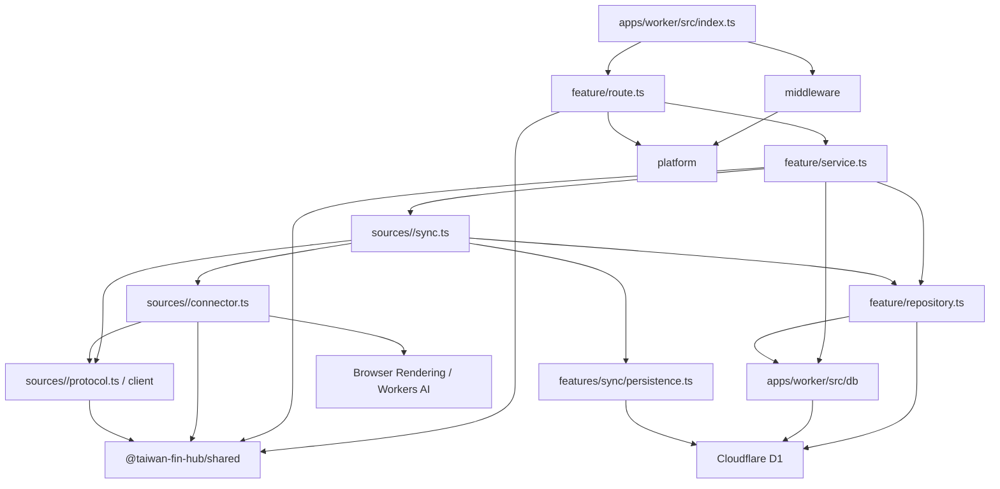
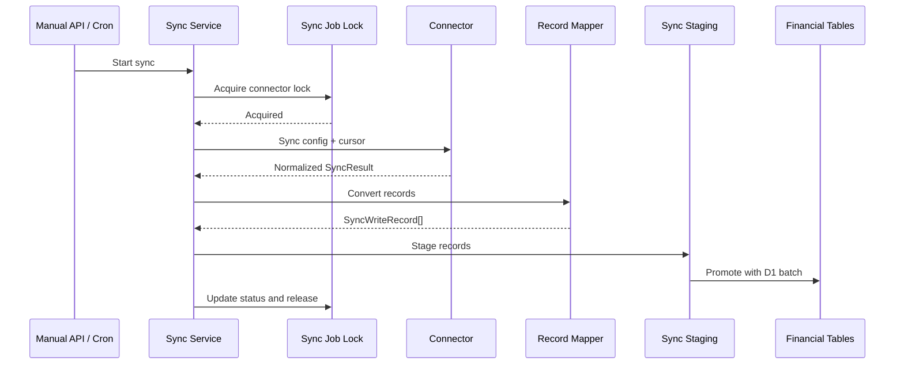

# 後端架構與維護約定

後端執行於 Cloudflare Workers，使用 Hono 提供 API，並透過 Cloudflare D1、Browser Rendering、Workers AI、Cron Triggers、Queues 與 Durable Objects 完成資料儲存、銀行登入、驗證碼辨識、排程同步及兆豐的固定出口。

目前後端採用 **feature-oriented Vertical Slice Architecture**。程式依業務功能分組，而不是將所有 Controller、Service、Repository 分別集中在全域目錄。

`apps/worker/src/index.ts` 是 Composition Root，只負責：

- 建立 Hono application。
- 註冊全域 middleware。
- 組裝各 feature routes。
- 設定統一錯誤處理。
- 提供前端靜態資源。
- 接收 Cloudflare scheduled event 與 Queue message batch。

入口檔不得放置 SQL、connector 實作或具體商業流程。

## 整體結構

```text
apps/
├── web/
└── worker/
    ├── src/
    │   ├── index.ts
    │   ├── features/
    │   │   ├── activity/
    │   │   ├── bank/
    │   │   ├── classification/
    │   │   ├── connectors/
    │   │   ├── dashboard/
    │   │   ├── exchange-rates/
    │   │   ├── investments/
    │   │   ├── invoices/
    │   │   ├── manual-assets/
    │   │   ├── net-worth/
    │   │   ├── notifications/
    │   │   ├── ocr/
    │   │   └── sync/
    │   │       ├── manual-sync.ts
    │   │       ├── scheduling/
    │   │       └── reports/
    │   ├── sources/
    │   │   ├── types.ts
    │   │   ├── config-registry.ts
    │   │   ├── browser.ts
    │   │   └── <connectorId>/
    │   ├── db/
    │   │   └── schema/
    │   ├── middleware/
    │   └── platform/
    ├── migrations/
    ├── schema-metadata.json
    ├── seeds/
    └── tests/
        ├── sources/
        ├── db/
        ├── features/
        ├── helpers/
        ├── middleware/
        └── platform/

shared/
├── package.json
├── tsconfig.json
├── index.ts               # 唯一匯出入口
├── connector-catalog.ts
├── exchange-rates.ts
├── api/                   # 前後端 HTTP 契約，依 API resource 分檔
│   ├── errors.ts
│   ├── bank.ts
│   ├── classification.ts
│   ├── connectors.ts
│   ├── dashboard.ts
│   ├── notifications.ts
│   ├── sync.ts
│   └── sync-reports.ts
└── activity/              # 活動配對、去重、排序與資料組裝的純邏輯
    ├── types.ts
    ├── list.ts
    ├── flow.ts
    ├── filter.ts
    ├── items.ts
    └── matching.ts
```

npm workspaces 僅保留 Web、Worker 與根目錄的 `shared/`。`shared/` 以 `@taiwan-fin-hub/shared` 提供跨前後端共用的型別、契約與純邏輯。資料庫與連接器是 Worker 內部模組，共用相依宣告與型別檢查；透過目錄維持資料存取、外部協定與平台 adapter 的責任分工。

## 相依方向



基本原則：

- `route.ts` 不直接撰寫 SQL。
- `repository.ts` 不處理 HTTP request、status code 或 Hono `Context`。
- `service.ts` 不回傳 Hono `Response`。
- feature 不得依賴其他 feature 的 `route.ts`。
- 跨 feature 的 service 呼叫應保持明確，避免形成循環相依。
- 不為了符合形式而建立空的 Service 或 Repository。
- 不建立通用 `BaseRepository` 或過度抽象的資料存取層。

## Feature 內部結構

複雜 feature 通常採用以下結構：

```text
features/<feature>/
├── route.ts
├── service.ts
├── repository.ts
└── 其他只屬於此 feature 的檔案
```

不是每個 feature 都必須包含全部三個檔案。簡單查詢可以只有 `route.ts` 與 `service.ts`；沒有資料庫操作時不需要建立 `repository.ts`。

### `route.ts`

HTTP adapter，負責：

- 宣告 API path 與 HTTP method。
- 定義 request schema。
- 使用 Zod 驗證 body、query 與 path parameters。
- 從 Hono `Context` 取得 binding、parameter 與已驗證資料。
- 呼叫 service。
- 將預期的 service error 轉換成 HTTP status 與穩定 error code。
- 組裝 response 與 pagination headers。

不應負責：

- 直接執行 SQL。
- 實作分類、計算或同步流程。
- 處理 connector protocol。
- 執行大型資料轉換。

### `service.ts`

Use case 與商業流程層，負責：

- 組合一個完整 use case。
- 執行商業驗證與計算。
- 協調 repository、connector 與其他 service。
- 控制資料同步流程。
- 定義可預期且可由 route mapping 的 error class。
- 將 repository row 轉換成 API 所需資料。
- 管理時間、ID、加密、cursor 與同步狀態。

Service 可以直接接受 `D1Database` 或 `Env`，不需要額外建立 Dependency Injection container。

若程式只是單純資料查詢，應維持簡單，不需要套用 DDD Aggregate、Value Object 或 Command Bus。

### `repository.ts`

Feature 專用的 D1 存取層，負責：

- 集中該 feature 使用的資料存取。
- 一般 CRUD 與查詢組合預設使用 `apps/worker/src/db` 的 Drizzle schema／client。
- 執行 query、insert、update、delete 與 upsert。
- 回傳 database row、affected row count 或存在性結果。
- 在仍需原生 statement 時，建立供 service 組合的 `D1PreparedStatement`。

過渡期 repository／service 仍接受 `D1Database`，在 repository 內呼叫 `createDrizzle(binding)`，不另建 DI container，也不建立跨 request／Queue invocation 的全域 client。TypeScript property 使用 camelCase，並明確對應既有 snake_case 欄位；回傳給 service／API 的 shape 由 selection 或 mapper 維持，不把 `$inferSelect` 當成 runtime validation。

複雜 expression、CTE、條件 upsert、跨檔案組成的原生 D1 batch，或轉換後無法保留語意的路徑，可繼續使用參數化 raw SQL，並在呼叫處註明原因。同一 batch 不得混用不相容的 Drizzle query object 與 `D1PreparedStatement`。

Repository 不應：

- 接收 Hono `Context`。
- 回傳 HTTP response。
- 決定 HTTP status code。
- 呼叫外部銀行或政府 API。
- 包含與資料存取無關的商業流程。

SQL 應放在使用它的 feature 附近。只有確實被多個 feature 共用的資料存取能力，才放入 `apps/worker/src/db`。

## 共用目錄責任

### `apps/worker/src/platform/`

Cloudflare Worker 與 HTTP 平台層，目前包含：

- Worker bindings 與 Hono binding types。兆豐 App API 的對外請求由 `MegabankEgress` 轉送，物件定義見 `platform/megabank-egress-object.ts`。台北富邦網銀的瀏覽器請求由 `FubonEgress` 代發（Browser Run 出口遭銀行重設連線），物件定義見 `platform/fubon-egress-object.ts`，CDP 攔截位於 `sources/fubon/egress.ts`。
- Hono factory。
- API error response。
- Demo 唯讀模式。
- Cursor pagination 工具。
- Zod validation hook。
- Cloudflare Access JWT 驗證。
- 設定與加密工具。

連接器設定、推播訂閱與集保同步狀態的加密金鑰統一由 `platform/config.ts` 的 `configEncryptionKey` 取得。`CONFIG_ENCRYPTION_KEY=auto` 使用部署 script 保存的 `GENERATED_CONFIG_ENCRYPTION_KEY`，其餘值沿用自訂金鑰；缺少必要的金鑰時直接失敗，詳細初始化與復原限制見[部署文件](005-deployment.md#1-選擇加密金鑰)。

`platform` 不得依賴任何具體 feature。

### `apps/worker/src/middleware/`

跨 route 的 HTTP middleware：

- `accessMiddleware`：驗證 Cloudflare Access 身分；Demo 模式略過登入。
- `demoReadOnlyMiddleware`：Demo 模式只允許安全的唯讀 method。
- `connectorContextMiddleware`：驗證 connector ID，並寫入 Hono variables。

Middleware 應只處理跨功能的 request concern，不應承擔 feature 商業邏輯。

### `apps/worker/src/sources/`

各銀行、集保與電子發票以資料來源為目錄歸屬。維護一家銀行時，在 `sources/<connectorId>/` 查找它的同步、登入、API client、解析與資料修復；依實際需要保留檔案，不要求每個來源有同一套檔案。

- `sync.ts`：讀取及解密設定、處理 challenge、呼叫 connector，組合共用 persistence 與來源 repository。
- `connector.ts`：需要 Browser Rendering、Puppeteer 或 Worker binding 的外部取資料 adapter；可以使用 `BROWSER` 或 `AI`，不直接讀寫 D1。
- `protocol.ts` 與 API client：設定 schema、外部協定、signing／encryption、parser、response normalization，以及不需要 Worker binding 的 connector。
- `repository.ts`、`authorizations.ts` 等：來源專用的資料修復、交易配對與存款生命週期。
- `run-repository.ts`：電子發票與集保的 durable run／item、進度、session 與處理 lease。

實體目錄集中不改變相依邊界：`sync.ts` 可依賴 connector、protocol、client、repository 與明確的共用 service；protocol／client 不得依賴 Hono、D1、Worker `Env`、adapter 或同步流程，也不得直接寫入資料庫。來源之間不引用彼此的內部實作。

`sources` 根目錄只保留跨來源使用的能力：`browser.ts` 管 browser acquisition、capacity 錯誤、登入前頁面停滯復原與有期限的 session 清理，`sync-error.ts` 定義來源錯誤宣告對外錯誤代碼的介面，`types.ts` 定義後端 `Connector`／`SyncResult`，`financial-types.ts` 定義 connector 正規化後的金融資料（`BankAccount`、`BankTransaction`、`CreditCardBill`、`Invoice` 等），`sync-window.ts`、`credit-card-status.ts` 與 `captcha-retry.ts`（API 型來源的自動驗證碼重試）提供共同 policy／判斷。`config-registry.ts` 直接引用各來源的純 schema、設定頁 session 狀態判斷與身分欄位重設規則，供設定 feature 使用；`deposit-source-registry.ts` 依 `bank:<connectorId>:<帳號或末四碼>:...` 約定解析直接存款 sourceId（王道等格式例外引用來源 protocol），供銀行顯示、帳戶比對與集保交割帳戶連結使用，直接存款銀行代碼由共用 catalog 的 `bankCode` 宣告；同步 handler 仍由 `features/sync/registry.ts` 組裝。Worker 與測試直接引用來源檔案，不建立跨來源的實作匯出入口。

Browser 登入前復原最多三次嘗試，只包住頁面與驗證碼準備；OCR、送出登入與資料查詢留在來源 adapter，政策細節見 `docs/004-connector-development.md`。

### `shared/`

前端與 Worker 共用的穩定契約及純邏輯，包括：

- `ConnectorId` 與支援清單。
- API success/error contract。
- API 錯誤代碼：同步錯誤 `SyncErrorCode` 與其他 `GeneralApiErrorCode`，合併為 `ApiErrorCode`。
- 銀行與信用卡帳單 API response contract。
- 設定頁的排程、連接器設定狀態與分類規則 API response contract，以及排程間隔、分類規則欄位與比對方式的允許值。
- 活動配對、去重、排序與資料組裝。
- 近期繳款提醒（`payment-reminders.ts`）：總覽「值得留意」與預設排程推播共用同一套到期、繳款狀態與扣款帳戶餘額判斷。

不得將 Hono `Context`、D1 row 或 Puppeteer object 放入共用契約。

只有前端與 Worker 都使用的內容才放進 `shared/`；只被 Worker 使用的型別（例如 connector 正規化資料）留在 `apps/worker`。

`index.ts` 是唯一匯出入口，前後端一律從 `@taiwan-fin-hub/shared` 引用，不直接引用內部檔案，因此 `shared/` 內部可自由調整檔案位置。HTTP 契約放在 `api/`，依 API resource 分檔，與前端 `data/` 的分組對應；活動純邏輯放在 `activity/`；connector catalog 與匯率幣別規則留在根層。銀行、排程、連接器設定、分類與發票配對 route 以 `satisfies` 在 JSON 回傳處檢查共用 response 契約；此契約描述現有 JSON 的 nullable 欄位與帳單數值 flag，與 connector 的正規化資料及 repository row 各自獨立。

允許值以 `as const` 陣列放在 `shared/`（例如 `SYNC_INTERVAL_MINUTES`、`CLASSIFICATION_RULE_OPERATORS`），Worker 以這些陣列建立 Zod 驗證，前端以同一陣列產生選項；Zod schema 本身留在 Worker。資料庫以一般文字或數字保存的欄位（如分類規則的 `field`／`operator`、排程的 `intervalMinutes`），response 契約維持 `string`／`number`，不宣稱比資料庫更嚴格的型別。

### `apps/worker/src/db/`

真正跨 feature 使用的 D1 基礎能力，目前主要包括：

- `createDrizzle(binding)`：以當次 request／Queue 的 D1 binding 包成 Drizzle client，關閉 query／parameter logging。不是連線池或 DbContext。
- `schema/`：依業務領域描述現有業務表；SQL migrations 仍是 schema 權威。
- Connector settings（Drizzle CRUD，保留既有 ID、建立時間與 sync cursor）。
- `sanitizeDatabaseError(error)`：在設定存取、API 與通知 log 邊界移除 Drizzle query error 的 SQL、綁定參數及 cause。
- 加密設定與 sync cursor 狀態。
- Sync job、schedule 與 lock。

Drizzle 型別只留在 DB 與 Worker repository 層。`shared`、前端及來源的 protocol／client／connector 不依賴 ORM。日期維持既有 TEXT string，金額與 JSON／flag 語意不因導入而改寫。

Feature-specific 查詢應放在 feature 的 `repository.ts`，而不是持續擴大 `apps/worker/src/db/index.ts`。一般 repository 以 Drizzle 為預設寫法；sync job、run／item、排程、通知批次及報告的一般讀取，以及同步 lease 與獨立 run 狀態更新已使用 Drizzle。selection 維持既有 row shape、排序與 LEFT JOIN null；staging promotion 與 durable item 寫入的 statement composition 保留整組原生 D1 batch。

分類 repository 已轉換為 Drizzle；規則重排維持單一 batch，保留 NOCASE 分類唯一性、系統規則保護與 override conflict target。invoices、investments 與 bank 的一般列表／明細查詢已轉換為 Drizzle，保留游標分頁、LEFT JOIN null、pending／posted 可見性與 TEXT 日期邊界；銀行交易日條件維持可使用 `idx_bank_transactions_transaction_day`。dashboard、net-worth、activity 與 bank calculation／search 聚合已轉換為 Drizzle，保留計算值、跨來源去重、TEXT 日期與 activity search CTE；同步 lease／run 狀態更新以 Drizzle 保留單次條件 UPDATE 與 affected rows 判斷；staging promotion 保留原生 batch 的順序、計數 offset、finalize／cursor／cleanup 原子邊界。保留 SQL 的範圍與測試見下方維護約定。

資料庫 schema 與預設資料必須透過：

```text
apps/worker/migrations/
```

管理，不得由 `GET` API 在執行期間自動建立，也不得對正式環境使用 `drizzle-kit push`。隔離 D1 整合測試以 Miniflare／workerd binding 按順序重播 migrations，不連線正式資料庫。

Schema 文件語意維護於 `apps/worker/schema-metadata.json`，以 `npm run db:schema:docs` 重新產生 `docs/database-schema.md`；Demo 種子資料位於 `apps/worker/seeds/demo.sql`。資料庫測試位於 `apps/worker/tests/db/`，由 `npm run test:backend` 一併執行。

### Drizzle 與原生 SQL 維護約定

一般 CRUD、篩選與 JOIN 優先使用 Drizzle；不為統一語法重寫已有測試的穩定 SQL。
複雜 CTE、window function、set-based upsert 或跨檔案組合的 D1 batch，
以可讀性與保留原子性為準，保留原生 SQL 並註明理由。

| 保留範圍                                            | 原因與驗證重點                                                                                                                                                              |
| --------------------------------------------------- | --------------------------------------------------------------------------------------------------------------------------------------------------------------------------- |
| staging JSON upsert、promotion 與 lifecycle 合併    | cursor／finalize／cleanup 必須在同一 batch。`persistence.test.ts`、`preference-fk-reconciliation.test.ts`、`drizzle-runtime.test.ts` 以隔離 D1 驗證去重、使用者決定與回滾。 |
| einvoice／TDCC durable item 寫入與 create-or-get    | 保留 item claim、JSON merge、計數、設定版本 CAS 及 partial unique conflict 處理。以共用 lease 與發票 promotion 核心案例驗證並行與重送。                                     |
| schedule／notification batch／report 寫入及財務 CTE | 保留固定成員快照、notification claim、報告修復及跨資產最新值／缺幣計算；不因統一語法改變這些行為。                                                                          |

Lease acquisition／renewal 維持單次條件 UPDATE 與 affected rows 判斷，
不得拆成 SELECT 後 UPDATE；不得用循序 await 或 Promise.all 取代原子 batch。
查詢調整須保留 expression index 的可用性；涉及查詢效能時以 EXPLAIN QUERY PLAN 確認。

SQL migrations 是 schema 權威，由 Wrangler 管理套用與 migration ledger；
不導入 Drizzle Kit 生成／套用 migration 流程，也不另維護 schema 比對測試。
Schema 修改時依實際影響驗證 migration 與 FK、CHECK、generated column、unique 等約束。

Drizzle repository 整合測試使用 `apps/worker/tests/helpers/d1.ts` 的 Miniflare／workerd D1，
聚焦資料完整性、安全與 batch 回滾，不為一般 CRUD、row shape 或排序逐項建檔。
直接 import Drizzle 的 workspace 應自行宣告相依，不依賴 npm hoisting。

### 交易與發票偏好的參照完整性

`bank_transaction_preferences.transaction_id` 與
`invoice_transaction_preferences` 的 `invoice_id`／`transaction_id` 使用 FK，
刪除策略為 `NO ACTION`。合併資料須在同一 batch 先移轉或明確處理偏好，再刪除舊資料；
不得以 CASCADE 或自動清空交易 ID 抹除 linked／separate 決策。
`classification_overrides.target_id` 與 `ai_classifications.transaction_id` 以文字保存交易 ID，不設 FK；
交易合併時分類覆寫由 `transaction-merge.ts` 移轉，AI 結果不移轉，新 ID 由下一次近期掃描重新判斷。
玉山 lifecycle shadow、永豐及華南 legacy 比對共用 `transaction-merge.ts`：
僅合併雙向唯一對應且發票配對、計算偏好、分類覆寫不衝突的交易。
在同一 promotion batch 移轉偏好與交易引用後才刪除舊交易，保留決策及時間；
兩端相同的計算／分類偏好保留新版既有資料。無對應、配對歧義或偏好衝突時，
保留原交易及設定；華南亦不再直接清除沒有對應的 legacy 資料。

0045 套用前須唯讀查核以下三種孤兒引用（包含 separate 的非 NULL transaction_id）：

```sql
SELECT 'bank_transaction_preferences.transaction_id' AS reference, COUNT(*) AS orphan_count
FROM bank_transaction_preferences p
WHERE NOT EXISTS (SELECT 1 FROM bank_transactions t WHERE t.id = p.transaction_id)
UNION ALL
SELECT 'invoice_transaction_preferences.invoice_id', COUNT(*)
FROM invoice_transaction_preferences p
WHERE NOT EXISTS (SELECT 1 FROM invoices i WHERE i.id = p.invoice_id)
UNION ALL
SELECT 'invoice_transaction_preferences.transaction_id', COUNT(*)
FROM invoice_transaction_preferences p
WHERE p.transaction_id IS NOT NULL
  AND NOT EXISTS (SELECT 1 FROM bank_transactions t WHERE t.id = p.transaction_id);
```

有孤兒引用時先檢視來源與使用者決策，不自動刪除或補造父資料。
0045 以完整複製保留偏好及時間；有違規時 migration transaction 失敗回滾。
遠端套用前另確認 0044 的 NULL PK 前置條件、備份及隔離升級驗證。

### 交易自關聯

0046 為 `bank_transactions.transfer_peer_id` 與 `matched_transaction_id` 新增
指向同表 `id` 的 `NO ACTION` FK，並新增 transfer peer 索引；matched transaction
原有 partial unique index 保留。允許 NULL 與自我引用，不使用 CASCADE／SET NULL，
避免刪除父交易時改變 pending 可見性或定存計算排除。

Migration 在同一 transaction 暫存並重建兩張引用交易的 preferences 表，
保留所有交易、偏好、時間、generated column 及原有索引。孤兒引用會使升級回滾，
不自動補造父交易或清空配對。套用前備份並唯讀查核：

```sql
SELECT 'transfer_peer_id' AS reference, COUNT(*) AS orphan_count
FROM bank_transactions t
WHERE t.transfer_peer_id IS NOT NULL
  AND NOT EXISTS (SELECT 1 FROM bank_transactions p WHERE p.id = t.transfer_peer_id)
UNION ALL
SELECT 'matched_transaction_id', COUNT(*)
FROM bank_transactions t
WHERE t.matched_transaction_id IS NOT NULL
  AND NOT EXISTS (SELECT 1 FROM bank_transactions p WHERE p.id = t.matched_transaction_id);
```

一般 transaction promotion 以同一 statement 寫入交易及 transfer peer；永豐在
promotion 後更新授權配對，中信刪除副本前處理 matched reference，共用合併流程先移轉
兩種引用。未來若將相依交易拆成不同 statements，須先寫入被引用交易，
或在同一 batch 明確延後 FK 檢查並驗證回滾；同一 batch 本身不保證可任意排列。

## HTTP Request 流程

所有 API 掛載在 `/api`：

```text
Request
  → Cloudflare Access middleware
  → Demo read-only middleware
  → Connector context middleware（適用時）
  → Feature route
  → Feature service
  → Repository / Connector
  → JSON response
```

非 `/api` 路徑交由 `ASSETS` binding 提供前端靜態檔案。

## Request 驗證

外部輸入應優先使用 Zod 4 驗證：

```ts
api.post(
  "/example",
  zValidator(
    "json",
    requestSchema,
    validationHook("INVALID_REQUEST", "Request data is invalid."),
  ),
  async (c) => {
    const input = c.req.valid("json");
    return c.json(await executeUseCase(c.env.DB, input));
  },
);
```

約定：

- JSON body 使用 `zValidator("json", ...)`。
- Query string 使用 `zValidator("query", ...)`，或共用 pagination parser。
- 有固定集合或格式限制的 path parameter 使用 `zValidator("param", ...)`。
- 不得將未驗證的 request body 直接傳入 service 或 SQL。
- Client 不應依賴 Zod 的原始錯誤文字；API 應回傳穩定 error code。

## API 錯誤格式

API error 統一為：

```json
{
  "success": false,
  "error": {
    "code": "ERROR_CODE",
    "message": "Human-readable message."
  }
}
```

錯誤處理分為兩類：

### 預期錯誤

例如：

- Resource not found。
- Duplicate resource。
- Connector 尚未設定。
- OTP 或 CAPTCHA 需要人工處理。
- 同一 connector 已有同步工作執行中。
- 外部 connector 暫時無法使用。

Service 應使用明確的 error class 表示，route 再映射成固定 HTTP status 與 error code。
來源錯誤需要穩定代碼或使用者處理狀態時，由錯誤類別實作 `sources/sync-error.ts` 的 `SourceSyncErrorSource`，以 `toSyncError()` 宣告 HTTP status、代碼、`Retry-After` 秒數，以及同步結果是否為 `needs_user_action`；子類別未覆寫時沿用父類別的分類。未實作的錯誤代碼為 `SYNC_FAILED`，狀態由 `isUserActionError` 依錯誤訊息判斷。`classifySyncError` 與 `isUserActionError` 只直接處理同步流程本身的錯誤，不逐一引用來源錯誤。

所有錯誤代碼集中宣告於 `shared/api/errors.ts`。`jsonError`、`validationHook` 只接受 `ApiErrorCode`；`classifySyncError`、`SyncFailureInput` 與手動同步 run 的結案只接受 `SyncErrorCode`，讀出 sync job 與 run 的 errorCode 時也標為同一型別。新增或改名代碼須先修改共用型別，前端依代碼接續流程的比對會在型別檢查時一併驗證。

### 未預期錯誤

未被 route 處理的錯誤交由全域 `api.onError`：

- 在 Worker log 記錄完整錯誤。
- Client 固定收到 `INTERNAL_ERROR`。
- 不得回傳原始 exception、stack trace、SQL 或敏感 connector response。
- 帳號、Cookie、token、OTP 與解密後 config 不得寫入 log。

只有已知且確認不包含敏感資料的 connector 錯誤，才可將經整理的 message 回傳給 client。

## Pagination

大型且持續新增的資料列表使用 cursor-based keyset pagination：

```http
GET /api/activity?limit=50&cursor=<opaque-cursor>
```

規則：

- `limit` 預設通常為 50。
- `limit` 最大值為 100。
- `cursor` 是不透明值，前端不得解析或自行產生。
- 查詢必須使用穩定且唯一的排序欄位組合。
- 不再為新 API 增加 `offset` pagination。

回應維持既有 JSON 資料格式，並使用 headers：

```http
X-Has-More: true
X-Next-Cursor: <opaque-cursor>
```

只有 `X-Has-More` 為 `true` 時，才需要回傳 `X-Next-Cursor`。

## 銀行交易分類與退費

`features/bank/service.ts` 回傳交易時依序決定分類：年費減免沖銷（`auto_offset`）、
跨帳戶轉帳配對（`auto_transfer`），其餘沿用 `classification/service.ts` 的分類覆寫與規則結果。

系統分類與規則由 migration 維護，Demo 種子資料（`seeds/demo.sql`）需同步。「回饋」（`reward`）與「捐款」（`donation`）為系統分類；
新增時既有同名自訂分類會併入，分類覆寫與規則改指向系統分類。可由摘要確定分類的模式使用系統規則：
信用卡繳款入帳（轉帳，排除計算）、消費折抵與回饋（回饋，優先於其他收入與生活繳費規則）、
電子支付儲值、加值與提領（轉帳；透過電子支付付款給商家不適用）、Uber Eats（餐飲，優先於交通規則的 uber 關鍵字）、捐款關鍵字，
以及超商、超市與量販店一律歸購物（不論購買品項，優先於店名中的車站或餐飲字樣）。
信用卡繳款入帳的字樣與 `calculation-service.ts` 的預設排除計算一致。
系統規則需適用多數使用者與銀行；只在單一帳戶看到的摘要格式不新增系統規則，交由使用者規則或手動分類處理。

`features/bank/refund-matching.ts` 將信用卡的正數商家交易對回原消費：同一張卡與幣別、
同一商家（店名相同，或共用至少 4 字且達較短店名 60% 的連續字串）、原扣款在退費前 90 天內且金額不小於退費。
比對店名前先移除常見電子支付與金流前綴（如 LINE Pay、全支付、街口、綠界、藍新），避免同一支付管道下的不同店家被配對；
共用字串門檻讓收單前綴、商家類別或城市與國別後綴不同的同一店名仍可配對，但不會只因共用通用字詞而配對。
部分退費與分次退費可對到同一筆扣款；同時有多筆候選時，金額相同者優先，再取最近的一筆。
摘要含折抵、回饋、減免、紅利、點數、年費、繳款、扣繳、入帳或還款的正數交易不視為退費；
已排除計算的扣款也不作為原消費。

配對成功時：

- 退費原本未分類：沿用原消費的分類，來源為 `auto_refund`，並標記 `refund: true`。
- 退費已有分類覆寫或規則分類：只有與原消費同分類時才標記 `refund: true`；分類不同時尊重既有分類，仍視為收入。

同一張卡與幣別、同一商家、同一天且金額完全相同的一買一退（例如取消訂單或綁卡驗證的暫時授權，含待入帳）一對一配對，
兩筆都排除計算；部分退費或跨日退費仍以上述方式扣減分類支出。任一筆有分類覆寫、使用者規則或手動設為列入計算時不配對。
月份區間已包含同日的兩筆，因此不另外查詢。

標記為退費的交易計入支出側並扣減該分類支出，不計入收入；前端計算方式見 `docs/003-frontend-architecture.md` 的「活動金額顯示」。
原消費可能不在當頁或當月，因此會另外查詢退費所在信用卡在 90 天內的扣款作為候選。

## AI 自動分類

使用者可在「設定 → 分類」啟用 AI 自動分類，預設停用。實作位於 `features/classification`：
`ai-classifier.ts` 組成 Workers AI Clef（`@cf/cloudflare/clef-flash`）請求與解讀回答，
`ai-service.ts` 負責設定、掃描與每日用量，`ai-repository.ts` 存取 `ai_classification_settings` 與 `ai_classifications`。

- **套用順序**：分類覆寫 → 使用者規則 → 系統規則 → 年費沖銷與帳戶互轉 → AI → 未分類。
  `bank/service.ts` 只以 AI 結果補上規則判斷為 `fallback` 的交易，來源為 `ai`；退費配對優先於 AI 結果。
  停用後不再分類新的活動，已保存的結果繼續套用，直到使用者清除。
- **判斷依據**：系統分類的定義維護於 `SYSTEM_CATEGORY_DESCRIPTIONS`，自訂分類以名稱作為選項；
  支出不提供只用於收入的系統分類，入帳只提供收入、轉帳與投資類系統分類及自訂分類。
  送出日期、帳戶類型、方向、金額、幣別、摘要、交易對象與配對發票的賣方及品項；最高機率低於 0.35 時保存為無法判斷（`category_id` 為 NULL）。
  回答中只採用請求提供的選項。
- **掃描**：處理目前為 `fallback` 且有文字可判斷的交易，依月份由新到舊讀取 `getBankRange`，與活動頁相同地去重並配對發票。
  待入帳交易也會分類，讓入帳前即可顯示；已配對到其他交易而隱藏的待入帳紀錄不送出。
  配對時 AI 結果不移轉到入帳紀錄，入帳紀錄依其商店名稱另行判斷，因此一筆刷卡約使用 2 次呼叫。
  已由 AI 分類的交易不會重新判斷，使用者清除 AI 分類結果後再回補才會重新分類。
  無法判斷的交易在送出內容的雜湊改變時（例如晚到的發票）才重試，未變更時不重複呼叫。
  啟用時只記錄 `enabled_at` 並以當下資料浮水印為基準，不啟動掃描。
  近期掃描涵蓋含當月的最近 3 個月：每次 Cron 比對交易、發票與發票配對的最新 `updated_at`，資料改變時啟動；
  只處理 `created_at` 不早於 `enabled_at` 的交易，以及回補時判斷為無法判斷者，啟用前的其他紀錄不會自動送出。
  過往紀錄回補只由使用者啟動，從當月處理到最早的交易月份，不受 `enabled_at` 限制。同一時間只有一個掃描。
- **掃描識別碼**：每次開始近期掃描或回補都產生新的 `scan_id`，停用與清除結果會先清空它（清除時先清空再刪除結果）。
  AI 結果與掃描進度只在 `scan_id` 仍相符時寫入；不符時該掃描立即停止，不覆寫較新的回補、清除或停用狀態。
  每日呼叫次數以累加更新，不受掃描識別碼影響。
- **Queue**：掃描以 `run-ai-classification` 訊息在 `SYNC_QUEUE` 執行，每次 invocation 最多 25 次 AI 呼叫、6 個月份，未完成時以 1 秒延遲串接。
  進度保存在 D1；訊息失敗時直接 ack，由 Cron 恢復閒置超過 5 分鐘的掃描。
- **用量**：每日最多 2,000 次呼叫（每次約 2.5 neurons，約佔 Workers AI 每日免費額度一半，保留給驗證碼辨識）。
  達到上限或 Workers AI 回傳 `3036`（免費額度用完）時暫停到 UTC 隔日 00:00，由 Cron 繼續；暫時性錯誤留待 Cron 恢復；其他錯誤保存為無法判斷，避免重複重試。
- Demo 模式不啟動掃描，訊息直接 ack。

## 信用卡與貸款扣款帳戶

信用卡與貸款可指定一個扣款帳戶，供繳款提醒判斷可用餘額是否足夠（判斷規則見 `shared/payment-reminders.ts` 與前端文件「總覽繳款提醒」）。

- 銀行提供：connector 以 `BankAccount.autopayAccount` 回報銀行頁面揭露的自動扣繳帳戶，寫入 `bank_accounts` 的 `autopay_status`（`enabled`／`none`）、`autopay_bank_code`、`autopay_account_last4` 與 `autopay_account_source_id`。只保存銀行代碼、末四碼與以自家存款相同算法得出的 sourceId，不保存完整帳號。來源本次未取得時（`undefined`）整組保留；有明確結果（含未設定）時整組覆寫，避免新舊銀行代碼與末四碼混用。
- 自動對應只在唯一時採用：有存款 sourceId 時精準比對；否則需同時符合銀行代碼與末四碼。對不到或不只一個候選時不帶入，由使用者手動指定。
- 銀行完全沒提供扣款資料（`autopay_status` 為 NULL）時，以同一資料來源（同銀行）唯一的同幣別可扣款帳戶推測（`inferred`）；有多個候選時不推測。銀行明確顯示未設定，或提供的帳戶對不到時也不推測，避免誤用其他帳戶的餘額而隱藏提醒。
- 手動設定存於 `bank_account_payment_accounts`，優先於銀行資料；`payment_account_id` 為 NULL 表示明確「不指定」。指定的帳戶已不存在或不再符合條件時，退回銀行資料。此表的兩個帳戶 ID 都不設 FK：帳戶被移除或合併時視為未設定，不阻擋同步資料清理，也不以 CASCADE 悄悄刪除使用者設定。
- 扣款帳戶須是非信用卡／貸款／定存／儲值的帳戶，且與款項同幣別或為台幣帳戶（外幣帳單常由台幣帳戶換匯扣繳）；銀行提供的扣款帳戶也依此比對，推測則只用同幣別帳戶。`PUT /api/bank/accounts/:id/payment-account`（`{ paymentAccountId: string | null }`）寫入手動設定，`DELETE` 同路徑移除手動設定、改回銀行資料；對象不是有效的信用卡或貸款時回 `BANK_ACCOUNT_NOT_FOUND`（404），扣款帳戶不符合條件時回 `INVALID_PAYMENT_ACCOUNT`（400）。
- 帳戶 API（`/api/bank/accounts`、`/api/bank`）的信用卡與貸款附上 `paymentAccountId`、`paymentAccountSource`（`manual`／`bank`／`inferred`）與 `bankAutopay`；銀行資料的內部欄位不回傳。

## 讀取 API 效能

線上讀取耗時主要來自 D1 往返與冷啟動，個別查詢的執行時間通常只有數毫秒。
因此優先減少每頁請求數與循序 D1 往返，再處理查詢本身。
`wrangler.toml` 已開啟 `observability.traces`，可在 Workers trace 檢視 D1 與對外 fetch 的耗時。

- 只需帳戶與餘額的頁面使用 `GET /api/bank/accounts`，不載入交易、轉帳配對與分類。信用卡帳戶另附 `recentCards`：以一次 GROUP BY 取近 90 天交易出現過的卡號末四碼與卡名（同一末四碼採最近一次有卡名的名稱），依最近使用排序；只供顯示，不是完整卡片清單。
- 資料來源卡片的設定狀態沿用 `/api/sync-jobs` 的 `configured`；開啟連接器詳情時才讀取 `/api/connectors/:connectorId/settings`。
- `GET /api/activity/invoice-mappings` 接受與其他區間 API 相同的 `from`／`to` 月份。發票與交易必須同一個台北日才能連結，因此頁面只讀取區間內發票的決定；未帶區間時回傳全部。
- 銀行交易分類時，分類規則與第一輪查詢並行，當頁交易的分類覆寫、轉帳候選與退費原消費候選並行；只有頁面外的候選需要再查一次覆寫。退費候選依信用卡帳戶走 `idx_bank_transactions_account_posted_date`，只在當頁有信用卡正數交易時查詢。
- 各 connector／asset type 的最新持倉統一使用 `db/investment-positions.ts`，以一次 GROUP BY 取得最新日期，不逐列執行 MAX 子查詢。
- Cloudflare Access 公鑰只在 isolate 記憶體快取；Access 後方的 Worker 無法使用 Cache API。同一 isolate 的並行請求共用同一次下載與匯入後的金鑰。
- 以日期 expression 篩選區間時，需同時保留可走索引的原始欄位範圍條件，並以 EXPLAIN QUERY PLAN 確認。

## Connector 同步架構

共用同步管理位於 `features/sync`，各來源實作位於 Worker 根層的 `sources`：

```text
apps/worker/src/features/sync/
apps/worker/src/sources/
```

目錄依同步管理與資料來源分組：

```text
sync/
├── route.ts                   # 手動同步與 challenge API
├── error-response.ts          # 同步錯誤轉 API 錯誤代碼
├── manual-sync.ts             # 手動同步的鎖、結果狀態與報告修復
├── manual-run-repository.ts   # 背景手動同步 run 狀態轉換
├── registry.ts                # 來源 dispatch 與 scope 驗證
├── types.ts
├── config.ts
├── connector-state.ts
├── connector-repository.ts
├── lock.ts
├── errors.ts
├── record-mapper.ts
├── persistence.ts
├── transaction-merge.ts
├── card-reconciliation.ts
├── scheduling/
│   ├── route.ts               # 排程設定與工作狀態 API
│   ├── service.ts             # 排程設定 use case
│   ├── repository.ts          # 排程設定與 sync jobs 存取
│   ├── scheduler.ts           # 到期工作選取與執行
│   ├── queue.ts               # Queue producer／consumer 與重試
│   └── batch-repository.ts    # 預設排程一輪的固定成員與結案
└── reports/
    ├── route.ts               # 最近報告與活動明細 API
    ├── repository.ts          # 金融快照、報告查詢與修復
    ├── activity-capture.ts    # 寫入前後的活動變化 journal
    ├── activity-detail-service.ts
    └── activity-detail-repository.ts

sources/
├── browser.ts
├── types.ts
├── config-registry.ts
├── deposit-source-registry.ts # 直接存款來源的 sourceId 解析
├── sync-error.ts              # 來源錯誤的對外錯誤代碼介面
├── sync-window.ts
├── captcha-retry.ts
├── credit-card-status.ts
├── esun/
│   ├── sync.ts                # 玉山同步 use case
│   ├── connector.ts           # 銀行登入、session 與資料擷取
│   ├── protocol.ts            # 純設定 schema
│   ├── portal.ts              # 銀行頁面擷取與解析
│   ├── authorizations.ts      # 待入帳／已入帳銜接
│   └── repository.ts          # 玉山專用舊資料修復
├── sinopac/
│   ├── sync.ts
│   ├── connector.ts
│   ├── protocol.ts
│   ├── deposit-protocol.ts
│   ├── authorizations.ts
│   ├── matching.ts
│   └── repository.ts
├── taishin/
│   ├── sync.ts
│   ├── connector.ts
│   ├── protocol.ts            # 信用卡與設定協定
│   ├── deposit-protocol.ts    # 臺外幣活存查詢與正規化
│   └── authorizations.ts      # 跨次授權配對與舊版已入帳 ID 相容
├── einvoice/
│   ├── sync.ts                # 電子發票 Queue 分段同步
│   ├── protocol.ts
│   ├── api.ts
│   ├── v2-client.ts
│   ├── invoice-data.ts
│   └── run-repository.ts      # durable run／item 與處理 lease
├── tdcc/
│   ├── sync.ts                # 集保 Queue 分段同步
│   ├── protocol.ts
│   ├── epassbook-client.ts
│   └── run-repository.ts
└── <其他銀行>/
    ├── sync.ts
    ├── protocol.ts
    └── 來源專用 connector／client／輔助檔案
```

根目錄共用檔案的責任如下：

| 檔案                                             | 責任                                                                                                                                                                                                                                                                               |
| ------------------------------------------------ | ---------------------------------------------------------------------------------------------------------------------------------------------------------------------------------------------------------------------------------------------------------------------------------- |
| `route.ts`                                       | 手動同步 API 與 request validation：一般來源依 registry 的 `manualSyncConnectorIds` 迴圈註冊 `POST /connectors/:id/sync`，以來源宣告的 `syncBody` 驗證接續參數；電子發票與集保保留各自的 Queue 路由。同步錯誤回應交由 `error-response.ts`。                                        |
| `error-response.ts`                              | 將同步錯誤分類為 HTTP status、錯誤代碼、脫敏訊息與 `Retry-After`；來源錯誤讀取其 `toSyncError()`，HTTP 回應與背景 run 結果共用同一份分類。                                                                                                                                         |
| `manual-sync.ts`                                 | 一般銀行手動同步的 lock、狀態更新與已結案排程報告修復協調；也負責背景手動同步的排入與 Queue 執行。                                                                                                                                                                                 |
| `manual-run-repository.ts`                       | `manual_sync_runs` 的建立／取得 active run 與條件式狀態轉換；轉為 running 前必須持有 canonical connector lock。                                                                                                                                                                    |
| `registry.ts`                                    | 從共用 catalog 驗證 scope，dispatch 單次同步與 challenge handler，並提供一般手動同步來源、接續參數 schema（`syncBody`）、有 challenge 的來源清單與驗證碼失敗代碼供 route 註冊；電子發票與集保標記 `dedicatedSyncRoute`，其 `run` 明確拒絕單次同步，入口必須使用各自的 Queue 流程。 |
| `types.ts`                                       | 同步 scope、scope 常數與 outcome 型別。                                                                                                                                                                                                                                            |
| `config.ts`、`connector-state.ts`                | 取得設定、加密敏感欄位，區分公開偏好、敏感 session 與安全 cursor。                                                                                                                                                                                                                 |
| `connector-repository.ts`                        | 共用設定／cursor 寫入、設定版本 guard 與跨來源帳戶關聯；銀行專用修復放在來源目錄。                                                                                                                                                                                                 |
| `lock.ts`、`errors.ts`                           | 共用 lease／heartbeat、使用者操作判定與錯誤訊息／log 脫敏。                                                                                                                                                                                                                        |
| `execution.ts`、`run-state.ts`                   | 每次同步的期限、失鎖取消、D1 owner guard，以及 durable run 的停滯／重試狀態。                                                                                                                                                                                                      |
| `record-mapper.ts`、`persistence.ts`             | 將 connector result 轉成 write record，透過 staging table 與 D1 batch 寫入正式資料表。                                                                                                                                                                                             |
| `card-authorization-matching.ts`                 | 依正規化的帳戶、卡片、消費日、幣別與正負金額，按穩定順序逐一配對授權與明細；不依賴 D1 或來源協定。                                                                                                                                                                                 |
| `card-authorization-write.ts`                    | 共用配對保存、可靠時刻與分類／排除／發票移轉；合併歷史候選、排除既有關係，晚到的舊識別更新已建立的目標。                                                                                                                                                                           |
| `transaction-merge.ts`、`card-reconciliation.ts` | 共用舊交易合併與單卡摘要帳戶修復；保留使用者偏好、分類與發票關聯。                                                                                                                                                                                                                 |

Worker 的 `sources/<connectorId>/sync.ts` 負責設定解密、connector 呼叫與同步資料寫入；單次銀行流程也處理互動式 challenge，override 型別與來源 colocate。`ctbc/authorizations.ts` 管信用卡授權合併，`hncb/repository.ts` 管華南舊交易／帳戶修復，`nextbank/deposits.ts` 與 `obank/time-deposits.ts` 管存款生命週期。共用同步管理留在 `features/sync`，來源之間共用的外部取資料工具留在 `sources` 根目錄。

中信的固定裝置識別、銀行發出的裝置 seed 與短期兩階段登入暫存只保存於加密設定。
`ctbc/sync.ts` 以設定版本 CAS 在初始化前保存裝置 ID、首次握手後登入前保存 seed；
後續同步在握手前還原同一 seed。手動 App 核准／Email OTP 接回同一工作階段；排程遇到驗證只保存狀態
並標記 `needs_user_action`，不輪詢或主動寄送 OTP。完成登入清除暫存，查帳後登出。
保存行銀裝置識別與 seed 不等同設備綁定或網銀信任瀏覽器登記，App 核准僅接續當次登入。
promotion 的設定版本 guard 與金融資料、授權合併、cursor 在同一 D1 batch；
登入期間設定變更時整組回滾。公開 API 只顯示驗證狀態、方式與期限，協定及驗收限制見連接器文件。

玉山、台新、永豐、中信、第一銀行、華南與兆豐提供來源的卡片識別後，使用共用 `card-authorization-matching.ts`：同帳戶、同卡、台灣時區同消費日、同幣別同額同方向的群組，依授權時刻與 `sourceId`、明細的 `sourceId` 順序逐一分配，每筆明細只配一次，不比店名。兩側筆數不等時只配可對應的筆數，其餘持續顯示；既有配對與被占用的目標不重新分配。核心可先執行來源提供的雙向唯一可靠識別比對；雙方授權碼明確不同時，禁止金額 fallback。永豐精確配對後仍以來源策略處理外幣／調整金額。

交易只保留 `pending`／`posted`，不新增已出帳狀態；帳單明細沿用原本補抓／更新用途，帳單摘要仍計算負債。`card-authorization-write.ts` 在同一 promotion batch 保存配對、補可靠時刻及移轉使用者設定，目標既有決定優先，發票衝突保留。第一銀行、華南、兆豐直接使用共用 preparation；玉山、台新、永豐與中信維持來源適配與舊 ID 相容。玉山先把即時授權接到未入帳歷史明細，再接正式入帳，依序移轉時刻與設定；中信保留原授權 ID 並完成合併，發票衝突時不刪除交易。來源差異與尚未提供待入帳資料的銀行見連接器文件。

台新由 `deposit-protocol.ts` 查詢臺外幣活存，與信用卡完整授權／未出帳／帳單合併後交給共用 mapper。原 pending 列持續保存，以共用可見性規則排除重複計算。來源 `sync.ts` 將配對、偏好與發票移轉、canonical 帳戶關聯、金融資料 promotion 及 cursor 放在同一 D1 batch，並以既有同步鎖及原憑證版本保護。銀行協定與真實帳戶驗收限制見連接器文件。

各來源直接引用同一來源目錄的 protocol／adapter，以及 `features/sync` 的共用 record mapper、persistence，不經由 `manual-sync.ts` 匯出，也不互相依賴其他來源。電子發票與集保的 `sync.ts`／`run-repository.ts` 管理 durable Queue 流程，集保不再保留另一套單次同步實作。目錄調整不改變驗證、session、cursor 與 D1 promotion／finalize 的原子邊界。

閱讀一般銀行手動流程時，依序看 `features/sync/route.ts` → `manual-sync.ts` → `registry.ts` → `sources/<connectorId>/sync.ts`，再查看同一來源的 connector／protocol 與共用 `features/sync/persistence.ts`。排程流程從 `features/sync/scheduling/queue.ts` → `scheduler.ts` 開始；電子發票與集保則直接看來源的 `sync.ts` 和 `run-repository.ts`。來源專用測試與 fixtures 位於 `apps/worker/tests/sources/<connectorId>`；跨來源的同步資料完整性測試留在 `tests/features/sync`。

同步資料流：



## 同步鎖與排程

每週排程可選擇一至七個星期，所有執行日共用同一個台北開始時間。
`sync_jobs` 與 `sync_schedule_settings` 的 `preferred_weekdays` 保存星期 JSON 陣列；
NULL 時在 repository selection 沿用 `[preferred_weekday]`，舊單日設定不需重新儲存。
API 驗證星期不可重複、至少一天，並按 0 至 6 排序；舊版單日輸入仍可使用。
`nextSyncRunAt` 從勾選星期找出嚴格晚於目前時間的最近執行時間，
一般同步及電子發票／集保結案皆使用相同計算。更新預設排程只重算繼承來源；
Cron、Queue 與預設批次的執行方式維持既有流程。

同一個 connector 的不同同步 scope 共用 canonical connector lock，避免以下工作重疊：

- 手動同步與排程同步。
- 全部同步與部分同步。
- CAPTCHA preparation 與正式同步。

目前同步 lock：

- 一般同步與 durable run 的 connector lease 為 10 分鐘；CAPTCHA preparation 維持 3 分鐘。
- 執行期間每 5 分鐘續租。
- 一般同步自執行開始最多 10 分鐘；電子發票與集保自 run 建立起最多 10 分鐘，包含 Queue 等待與所有分段，heartbeat 不延長整體期限。CAPTCHA preparation 最多 3 分鐘，來源既有的較短期限仍適用。
- 續租只允許未過期的 owner。續租失敗或達到期限會透過 AbortSignal 停止等待，關閉仍連線的 Browser session，並中止電子發票／集保 HTTP 請求；未支援取消的外部請求即使遲到完成，也不能寫入 D1。
- `execution.ts` 為本次 invocation 包裝 D1 binding，所有 prepared write 與 batch 都在同一 transaction 前置 canonical owner／有效期限 guard；durable chunk 另核對 chunk owner。正式金融資料、設定／cursor、同步結果與報告皆使用受保護的 binding。失鎖時整個 batch 回滾，不能只在寫入前單獨查鎖。
- 一般同步工作完成或失敗後必須在 `finally` 釋放。durable run 的 connector lock 跨 invocation 維持，由成功寫入或失敗結案流程釋放；每段另有 owner-scoped run lease。
- Lock acquisition 失敗時回傳或記錄「已有同步執行中」，不得平行執行同一 connector。

每次 10 分鐘 Cron kick 先恢復停滯的電子發票／集保 run：沒有有效 chunk lease 且 3 分鐘未更新者補送 continuation，超過整體期限者先以 owner guard 結案。有效 chunk lease 不會被 Cron 中止；該 invocation 自行受執行期限限制。背景手動同步排隊超過 30 分鐘者以 `SYNC_QUEUE_TIMEOUT` 結案，running 但已沒有有效 connector lock 者以 `SYNC_INTERRUPTED` 結案。一般同步的過期殘留鎖會標記失敗並清除，保留最後成功時間。單一 run 的恢復失敗只記錄 log，不阻擋其他 run 與 scheduler kick；20 秒的 scheduler 串接不重複執行恢復。

Cron trigger 向 `SYNC_QUEUE` 送出 scheduler 啟動訊息。Queue consumer
每次 invocation 最多處理一個 connector，完成後若確實處理了工作便以 20 秒延遲送出下一個訊息，
避免連續啟動 Browser session 時撞上 Browser Run 的 acquisition rate limit；下一次 consumer
invocation 因此不必等待下一個 10 分鐘 Cron，且擁有獨立的 Worker CPU、subrequest 與執行時間額度。
初始 Cron kick 不延遲。Queue consumer 使用 batch size 1 與 concurrency 1，維持 connector
逐一執行。是否到期仍由 D1 sync job 狀態判斷；沒有可執行工作時 consumer 不再送出訊息，
結束本次串接。

這段 20 秒延遲只作用於不同 Queue 工作之間。同一個 connector invocation 的首次
Browser session 取得與登入頁復原重開，皆由共用 browser adapter 處理 acquisition
限流等待與額度重查；重開前須確認舊 session 已關閉。首次建立遇到 `503` 後重試
收到暫時性 `429`，也會依 `Retry-After`（缺少有效 header 時預設 20 秒）等待後補試，
每輪最多三次取得嘗試。登入準備每輪最多 60 秒、共用總預算 180 秒；
額度查詢、取得瀏覽器與限流等待都算入總預算，來源原有較短期限與取消 signal 仍優先適用。

Demo 模式（`DEMO_MODE`）不執行背景同步：Cron 不送出 scheduler 啟動訊息，Queue consumer
不處理任何訊息，避免啟用 Demo 前殘留的訊息繼續以已儲存的憑證登入外部服務。scheduler 啟動訊息
與 AI 自動分類訊息直接 ack；電子發票與集保分段訊息及背景手動同步訊息則以 1 小時延遲重新送出以保留 continuation，關閉 Demo 後會
重新檢查進行中的 durable run；已超過整體期限者結案，需要重新啟動同步。若期間 session 過期或設定變更，仍可能需要重新驗證。

電子發票不在單一 connector invocation 內擷取所有品項明細。它使用
`einvoice_sync_runs` / `einvoice_sync_run_items` 作為 durable work queue：手動或排程
建立 run 後 enqueue `run-einvoice-chunk`，每個 Queue invocation 最多 claim 並取得 35
張發票明細，並以 set-based D1 寫入完成整批；仍有 pending work 時再 enqueue continuation。品項明細一律同步，並非
`public_config`、HTTP request 或 catalog 可選的 `fetchDetails` 偏好。

電子發票 run 與 item 都以 owner-scoped rolling lease 防止 Queue delivery 重送時平行處理。
每次 delivery 使用獨立 UUID 作為 chunk owner；3 分鐘 chunk lease 每分鐘續租，明細處理也每五張續租，續租不更新業務進度時間。
只有全部 item 成功後，service 才把 durable run items 當作 staging source，以固定五個
set-based D1 statements promotion 至正式表並更新 cursor；這個 batch 以設定版本 CAS 防止
憑證更新競態。後續 finalize path 更新 `sync_jobs`、排程批次結果與通知；`promoted_at` 讓
promotion 前後的重送皆可冪等。
暫時錯誤由 Queue retry，session 失效會清除 session 後重新初始化；需要使用者操作或重試
耗盡才將 run 結案為 `needs_user_action` 或 `failed`，不寫入部分完成的明細。
建立 run 後的初始狀態寫入或首次 Queue enqueue 失敗會補償結案並清鎖；重試既有 run 會重新 enqueue，不會只回傳 202 而沒有 continuation。手動重試可補送既有排程 run，保留原 trigger 與批次。逾時且無有效 chunk lease 的舊 run 先結案，再建立新 run。成功／失敗 finalize 同時核對 canonical owner 與 chunk owner／無有效 chunk lease，並在同一 batch 更新結果與釋放鎖。

### 背景手動同步

一般銀行的背景手動同步以 `manual_sync_runs` 保存狀態，讓同步不依附發起的 HTTP request。
不帶使用者輸入的 `POST /api/connectors/<id>/sync` 由 `startQueuedManualSync` 建立或取得該來源
唯一的 queued／running run，再 enqueue `run-manual-sync`，回傳 202 與 run ID；訊息只帶 run ID，
不含憑證、OTP、驗證碼或 session。enqueue 失敗時以 `cancelQueuedManualSync` 結案並回報錯誤，
不留下沒有 Queue 訊息的 run。電子發票與集保沿用各自的分段流程，不建立此 run。

帶驗證碼、OTP、中信驗證動作或國泰 `otpChannel` 的接續同步仍在 request 內以
`withManualSyncLock` 執行：這些輸入必須接回同一次登入工作階段，且不得放入 Queue 訊息。

手動同步不排在同一來源的其他同步之後：該來源的 connector lock 有效時（排程、CAPTCHA
preparation 或其他手動同步），建立 run 的條件式 INSERT 不寫入並回報 `SYNC_ALREADY_RUNNING`；
已有背景手動 run 時回傳該 run。其他來源的排程不阻擋手動同步；Queue 不保證 FIFO，
手動訊息通常會在排程串接的 20 秒間隔中被處理。

Queue consumer 以 run ID 作為 owner 取得 canonical connector lock，取得鎖後才把 queued run
轉為 running；排入後才被其他同步搶先取得鎖時，run 以 `cancelled`／`SYNC_ALREADY_RUNNING`
結案，不再等待，也不釋放對方的鎖。重送的訊息遇到非 queued run 直接 ack，不會再次登入銀行。10 分鐘執行期限從取得鎖開始計算，
不含排隊時間；仍以 `trigger = manual` 執行，需要驗證碼或 OTP 的來源可主動發送，
結案為 `needs_user_action` 時保存錯誤代碼供使用者回來處理。

只有 Browser Run 容量不足（登入前），且等待時間仍在 30 分鐘排隊上限內，才會放回 queue，最多三次，且不記錄為 sync job 失敗；每日額度這類更長的等待直接以容量錯誤結案。
放回 queued 到釋放自己 lock 之間，重送訊息與排隊逾時清理都不會結案此 run，交由替代訊息接續。
其他錯誤一律結案，不自動重試銀行登入。結果與 sync job 狀態、報告修復沿用一般手動同步；
釋放 connector lock 後依推播偏好送出結果通知（`trigger = manual`）。

所有同步失敗寫入 `sync_jobs.last_error` 時一併寫入 `last_error_code`（`classifySyncError` 的代碼，
成功時清空），run 也保存相同代碼。前端回到頁面後依代碼接續驗證碼、OTP 等原本由同步請求錯誤
觸發的流程。所有來源（含電子發票與集保）首次同步成功時，若排程仍關閉便在同一筆成功更新中開啟；
以更新前的 `last_success_at IS NULL` 判斷首次成功，不變更既有排程模式或時間。
曾成功過的來源保留使用者的開關設定，失敗或等待驗證不會自動啟用。已結案超過 7 天的 run 由 Cron 恢復流程清除。

### 集保分段同步

集保的手動 API 與排程由 `startTdccSyncRun` 建立／取得 active run，再 enqueue
`run-tdcc-chunk`。`tdcc_sync_runs` 保存 scope、設定版本、加密認證與 session；
`tdcc_sync_run_items` 保存銀行與投資交易的分頁工作及結果。同一 connector 的
`all`、`investments`、`bank`、`trades` 共用 active run 限制與 canonical lock。

一般手動啟動與排程都由 Queue 初始化；手動 run 在 Queue 中可主動寄送 OTP，需要互動時以
`needs_user_action` 與 `last_error_code` 結案，排程則不主動寄送。帶 OTP 的手動請求仍在 request
內初始化，讓驗證碼錯誤立即回報。API 的排入同步回應不代表全部資料已完成，前端須追蹤 sync job
lifecycle。request 內初始化也取得獨立 run lease，避免同一 run 的 Queue delivery 同時登入。
非預設批次的電子發票與集保 run（手動或自訂排程）結案時依推播偏好送出通知。
每個 chunk 取得 owner-scoped run lease、更新 connector lock，最多 claim 一個
分頁 item；仍有 pending 或 processing work 時 enqueue 下一段。item 更新使用
claim token，chunk 的 `finally` 只釋放該 owner 的 run lease。
3 分鐘 run lease 每分鐘續租；既有 run 重試會補送 continuation，逾時 run 與停滯恢復沿用電子發票的判斷。

分頁結果完成後彙整並透過 `sync_write_staging` 與 staged persistence 寫入正式表，
寫入前檢查設定版本，並在 promotion batch 更新 connector 狀態、cursor 與 sync job。
後續處理排程結果、手動報告修復與 run 結案；`promoting`、`promoted_at` 用於辨識
promotion 與 finalize 的進度。暫時錯誤使用 Queue retry，需要互動或重試耗盡時結案。
connector lock 保留到報告結果寫入及 run 成功結案；失敗的 run transition、sync job、排程結果、staging 清理與清鎖使用同一個 owner／idle lease guard batch。

一般同步的進度由 `createSyncExecution` 以 `AsyncLocalStorage` 提供 `reportSyncProgress`（`sources/sync-progress.ts`）：
執行開始為 `login`，各 connector 在登入成功、開始取得資料時回報 `fetching`，`persistStagedSyncWrite` 開始寫入時回報 `saving`。
階段以 owner 條件更新寫入 `sync_jobs.lock_phase`，取得與釋放鎖時清空；寫入失敗只記錄 log，不影響同步。
新增 connector 時須在登入成功後呼叫 `reportSyncProgress("fetching")`，否則取得資料期間會停在「正在登入」。

`GET /api/sync-jobs` 統一以有效 connector lock、電子發票／集保 active run 或 queued 背景手動 run 判斷 `running`，並提供 `runId`、`phase`（排隊中的背景手動 run 為 `queued`，一般同步為 `lock_phase`，舊鎖沒有階段時為 `processing`）、`lastProgressAt`、`retryAfterSeconds`、`lastErrorCode`，以及各來源最近一筆背景手動 run（`manualRun`）。durable run 的 `phase = stalled` 表示可補送；有效 chunk lease 的剩餘時間是最短重試等待，不是預估完成時間。一般同步的 `lastProgressAt` 沿用 job 狀態更新時間，可能來自 heartbeat；durable run 則不將 lease renewal 當成進度。

## 同步結果通知

同步結果通知位於 `apps/worker/src/features/notifications/`，不放入 sync repository。

- `route.ts`：推播設定、裝置 subscription、偏好與測試通知 API。
- `service.ts`：VAPID 設定、subscription 加密、通知派送與失效 endpoint 清理。
- `repository.ts`：`push_subscriptions` 與 `notification_preferences` 的 D1 存取。
- `payload.ts`：將 sync status 與繳款提醒轉成不含金額等金融明細的安全通知內容，並決定預設排程摘要是否送出。

排程同步與背景手動同步更新 `sync_jobs` 後才呼叫通知 service；request 內的接續同步由畫面直接顯示結果，不另行推播。通知是 best-effort；發送失敗只記錄 log，不得將成功同步改成失敗。瀏覽器 subscription payload 使用既有設定加密金鑰保存。

預設排程批次的摘要推播會附上近期繳款提醒（偏好 `paymentDue`，預設開啟），不另外送出繳款推播。service 以銀行 service 讀取帳戶與近三個月帳單，交給共用的 `collectPaymentReminders` 判斷；讀取失敗只記錄 log，照常送出原本的同步摘要。

- 內容只寫機構、帳戶類型與天數（例如「國泰世華信用卡明天到期」），最多列兩筆，不含金額；狀態未確定或已過期限時加註「請確認是否已繳」，貸款加註「請確認餘額」，與總覽一致。扣款帳戶餘額不足時寫「台新銀行帳戶餘額可能不足以扣繳國泰世華信用卡」，只寫機構名稱，不含帳號末碼與差額；夠扣而隱藏的提醒不列入。成功摘要改為「同步完成，N 筆繳款即將到期」並導向總覽；有失敗或需處理時沿用原標題，於內文附上繳款提醒。
- 同步狀態本來就會推播時附上所有提醒；該狀態的通知關閉時，只有今天或明天到期、扣款未完成、扣款帳戶餘額不足或已過期限的提醒會讓推播照樣送出。此時同步成功沿用「同步完成，N 筆繳款即將到期」；同步失敗或需處理則只送繳款內容，不帶出使用者已關閉的同步狀態。是否送出只依當下資料判斷，不另外記錄已提醒的帳單。
- 手動同步與自訂排程的逐工作推播不附繳款提醒，避免同一天重複。

使用預設排程（`schedule_mode = inherit`）的工作採「一輪一批次」。沒有進行中的批次且至少一個繼承工作到期時，scheduler 會以單一 D1 batch transaction 建立 header，並固定快照當下所有啟用且不需使用者處理的繼承工作。批次進行期間，每次 Queue consumer invocation 只從尚未完成的固定成員中挑選一個目前未鎖定且不需使用者處理的工作；已完成的成員不會在同一輪再次執行，新啟用的工作則等下一輪。排程結果會在釋放 connector lock 前直接寫入成員，避免重複 Queue 訊息遺漏結果；停用、改為自訂排程或進入 `needs_user_action` 的非執行中成員會被略過。只有所有固定成員都有結果或被略過時，scheduler 才以條件式更新取得一次推播發送權並關閉批次，下一輪才能建立。建立新輪次時會清理超過 30 天的已結案批次。手動同步不完成或改寫進行中的批次成員；自訂排程維持逐工作推播。

手動完整同步成功後，可修復最近一筆已結案預設排程報告中同一 connector 的
`failed` 或 `needs_user_action` 來源。修復保留原排程完成時間，另記錄
`recovered_at`，並一次性累加新增筆數、更新報告的 after-snapshot。同步式手動流程
會在開始前固定可修復的批次，避免誤改執行期間才結案的新輪次；集保部分 scope
同步不修復 `all` 的批次結果。

每次 Queue scheduler invocation：

- 最多處理 1 個到期工作，讓每個 connector 使用獨立的 Worker invocation 與 subrequest 額度。
- 每個工作使用獨立 run ID。
- 成功後更新下次執行時間。
- 需要 OTP、CAPTCHA 或重新登入時記錄為 `needs_user_action`。
- 其他錯誤記錄為 `failed`。
- Log 使用結構化 JSON，包含 connector、scope、trigger、status 與 duration。

## 同步資料寫入

Connector 不得直接寫入金融資料表。

銀行確認沒有信用卡時，connector 仍以正常 `SyncResult` 完成同步：支援存款者回傳存款，信用卡專用來源可回傳空結果。空結果仍執行設定／cursor 的 finalize statements，排程記為成功；不刪除既有信用卡歷史，也不建立新的零餘額快照。無卡判斷留在 connector，不能在共用 service 將未知信用卡錯誤改成成功。各行判斷依據見 [Connector 開發規範](004-connector-development.md#無信用卡情境)。

同步 service 應先：

1. 將 connector response 正規化成共用契約。
2. 使用 `record-mapper.ts` 產生 `SyncWriteRecord`。
3. 將 records 分批寫入 `sync_write_staging`。
4. 使用單一 D1 batch 將 staging records promote 至正式資料表。
5. 在同一批次執行必要的 lifecycle reconciliation、cursor 更新與 staging cleanup。

這樣可避免部分資料已更新、cursor 卻未更新，或 cursor 已更新但資料尚未完整寫入。

永豐信用卡取得 `LatestTx.Items` 與 `OutstandingDetail.Detail` 後，在 `bank_transactions`
原表保存授權，以 `matched_transaction_id` 記錄已入帳關係，不另設授權表或停用欄位。
配對僅限同卡、同消費日，不跨日；排除手續費、服務費、不同金額方向與卡片識別不足的資料。
既有相同 sourceId 優先；同帳戶、同幣別同金額交給共用核心按穩定順序逐一配對，不比店名。
剩餘外幣／調整金額以正規化店名相似度及目前匯率金額接近度計分，同卡同消費日採最大總分的
一對一分配，無合理候選則不配對；跨幣別限同一信用卡摘要帳戶的不同幣別，不要求人工確認。
已配對關係不重新分配；已入帳保留正式金額、幣別、入帳日與原始 payload，繼承授權時刻。
配對後優先沿用待入帳名稱作為 description 與 counterparty，供顯示、搜尋及規則分類；
空白或預設「永豐信用卡消費」名稱不覆蓋正式名稱。每次同步也修復既有配對，即使銀行
不再回傳該交易；同 ID 入帳沿用已保存名稱。舊版已覆蓋且來源不再提供的名稱無法復原。
同 ID 入帳以 `raw.authorizationMatched` 保存完成狀態；保有授權時刻的舊已入帳列也保留
原時刻與名稱，不再作為另一筆授權的配對目標。
在同一 D1 batch upsert 交易、保存配對、補入時刻，並於首次配對移轉原授權的個別分類、
計算偏好（已入帳既有設定優先）及發票關係。原授權與設定持續保存。
活動、搜尋、發票配對候選與收支統計僅排除 `status = 'pending'` 且
`matched_transaction_id IS NOT NULL` 的授權；同 ID 升為已入帳仍正常顯示。
不處理來源消失：未配對授權即使來源不再回傳，仍保留並顯示；空清單不刪除或隱藏資料。
缺少清單或解析失敗不寫入；無有效卡與舊版解析不執行授權配對。
已在舊版永久刪除的授權，若來源不再回傳，無法從此變更復原。

新增同步 entity 時，必須同時更新：

- `SyncEntityType`。
- Entity promotion order。
- Table、columns 與 conflict columns。
- Record mapper。
- D1 migration。
- 涉及四類核心風險時擴充既有測試。

## 排程同步活動明細

總覽的「最近一次排程同步」沿用預設排程報告。展開各資料來源後才載入本次新增活動、
已入帳與補上發票的明細；一般手動同步及自訂排程沒有獨立報告。

- `sync_activity_runs` 在取得同步鎖後登記 run ID 與固定批次。手動完整同步在開始時
  固定可補救報告；只有補救 CAS 成功才發佈明細，不會混入後來完成的新批次。
- `activity-capture.ts` 與 staging promotion 共用原生 D1 batch，在寫入前辨識新增紀錄
  及既有未配對授權，於 lifecycle reconciliation 後保存已入帳關係與標準化快照。
  不以 `updated_at` 判斷內容變化；沒有變化的授權候選在同一 transaction 移除。
- 電子發票 durable promotion 使用相同 settings-version guard 保存新發票快照；
  集保使用既有 promotion 與鎖的 run ID。結果發佈與來源結果更新共用 CAS transaction。
- `reports/activity-detail-service.ts` 在報告結案及手動補救後，以完整同日候選與既有活動配對
  規則建立展示快照。交易與發票在來源明細中合併，同批新增資料與活動筆數可不同；
  已配對授權與已入帳交易只呈現一次。跨來源列仍各自說明各來源的變動。
- 快照不含 raw payload／憑證。名稱、金額與配對展示在明細完成後不受後續同步影響。
  明細整理失敗不將成功的金融同步標成失敗；scheduler 下次 invocation 會重試未完成報告。
  投影寫入在同一 batch 檢查 materialized 狀態，較晚完成的重試不會向已凍結快照補入資料。
- `GET /api/sync-reports/:batchId/activities` 一次回傳該報告所有來源的完整明細。
  後端以各來源 `recoveredAt ?? completedAt` 固定版本，避免稍後補救混入已完成報告。
  只有完整 materialized 明細可見；舊報告回傳 legacy，尚未整理完成回傳 pending，
  不存在的報告回傳 404。報告 30 天清理會級聯清除明細。

新增資料筆數保留現有定義；此版不追蹤任意欄位修改歷史，也不新增活動頁同步排序。

## 匯率更新

`features/exchange-rates` 的更新流程取得 USD、JPY、EUR，加上有效銀行／信用卡帳戶、
各 connector／asset type 最新投資持倉與手動資產的其他幣別。帳戶讀取最新餘額，手動資產讀取最新估值；
清單與更新流程共用 `shared/exchange-rates.ts`，排除 TWD、NAN 等非有效貨幣代碼並去重，
只略過實際金額為 0 的資產，不將外幣四捨五入後再判斷。
`GET /api/exchange-rates/currencies` 回傳預設幣別與有非零金額的資產幣別，避免依賴前端資產列表的分頁。
外部來源以 TWD 為基準，儲存時取倒數作為原幣換算 TWD 的匯率，使用來源更新時間。
來源未提供的額外幣別略過並保留已有匯率；來源回傳無效匯率或預設幣別缺值時不寫入。
取得的匯率以單一 D1 batch upsert，不再清空整張匯率表；`GET /api/exchange-rates` 回傳所有已儲存幣別。

## 新增一般功能

新增 feature 時：

1. 建立 `apps/worker/src/features/<feature>/`。
2. 在 `route.ts` 宣告 HTTP API 與 Zod schema。
3. 有商業流程時建立 `service.ts`。
4. 有 SQL 時建立 `repository.ts`。
5. 在 `apps/worker/src/index.ts` 註冊 feature routes。
6. Schema 有變更時新增 D1 migration。
7. 判斷是否引入下方四類核心風險，必要時擴充既有測試；不要求每個 feature 各自建立測試。

不要先建立抽象 interface，再尋找使用情境。只有出現實際重複或替換需求時才抽象。

## 新增 Connector

新增 connector 必須遵循 [`docs/004-connector-development.md`](004-connector-development.md)。核心步驟包括：

1. 在 `connectorCatalog` 宣告 ID、連接模式、scope、資料能力與設定欄位分類。
2. 在 `apps/worker/src/sources/<connectorId>` 建立 `protocol.ts`、必要的 client 與 parser，並在 `sources/config-registry.ts` 的 `connectorConfigSchemas` 註冊 config schema，並在 `connectorSessionDescriptors` 註冊設定頁 session 狀態判斷。
3. 需要 Worker binding 時，在同一來源目錄建立 `connector.ts` adapter。
4. 在同一來源目錄的 `sync.ts` 組合共用 record mapping 與 staged persistence 寫入；來源專用的配對與修復放在相鄰檔案。
5. 在 `connectorRuntimeRegistry` 註冊手動／排程同步與 challenge handler。
6. 前端直接使用 catalog 的 `connectorList` 與 `credentialFields` 顯示資料來源與設定表單，不得重複維護 connector 顯示 metadata 或欄位標籤。
7. 透過 migration 建立預設停用的 `all` sync job。
8. 依四類核心風險完成必要驗證，不逐層建立相同行為的模擬測試。

Route 與 scheduler 應透過 runtime registry dispatch，不再新增 connector-specific switch。

Connector 回傳的 `raw` 資料只供診斷與未來 migration 使用，不得讓主要功能依賴未標準化的 raw response 結構。

## 測試與驗證

提交前從 repo root 依 `AGENTS.md` 執行格式、型別與此次變更適用的核心測試：

```bash
npm run format:check
npm run typecheck
npm run test:backend
npm run test:unit
```

影響前端主要流程時執行 `npm run test:e2e`；建置設定或相依變更時執行 `npm run build`。

只保留四類核心保障：

| 保障         | 主要驗證                                                                                                                                               |
| ------------ | ------------------------------------------------------------------------------------------------------------------------------------------------------ |
| 金融數字     | 已確認來源語意的 parser fixture，以及前端金額計算；欠款／溢繳符號、幣別、未知值、配對去重。                                                            |
| 資料完整性   | 隔離 D1 的同步重送、pending → posted、使用者決定保留、失敗回滾與 cursor 原子更新。                                                                     |
| 憑證與授權   | 真實加密與 JWT 驗章、公開資料與錯誤不含秘密、設定變更清除 session、舊同步不能覆蓋新憑證或資料；保留部署 secrets 與上游同步不覆蓋使用者變更的少量案例。 |
| 主要操作流程 | Web E2E 的資產、銀行驗證、活動排除、發票配對與失敗重試；每個流程選一個 viewport。                                                                      |

`test:backend` 執行 Worker 核心測試、DB 錯誤消毒測試與部署／Git 安全案例；connector parser 一併由 Worker 執行，不再維護 self-check。Web unit 只保留金融計算，UI 互動以少量 E2E 驗證。

新增測試前先說明錯誤的使用者結果與獨立預期來源；優先擴充現有核心案例。同一行為選一個主要驗證層，不追求 coverage、測試數量、每個函式或每個分支都有測試。
一般 CRUD、轉送、固定文字／樣式、銀行 DOM 與事件順序、已完成歷史 migration 不另建立回歸套件。型別檢查、建置與適用的實際操作仍須完成；核心測試通過不等同所有銀行登入與帳務都已驗證。

## 維護原則

- 優先讓程式靠近其業務 feature。
- Composition Root 保持精簡。
- Route 保持薄，Service 表達 use case，Repository 集中 SQL。
- 避免為小型專案引入不必要的 DDD 或 Clean Architecture ceremony。
- 前後端共用契約與純邏輯放在根目錄的 `shared/`；後端跨 feature 的資料存取基礎能力、Worker／HTTP 平台工具與 middleware，分別放在 `apps/worker/src/db`、`apps/worker/src/platform` 與 `apps/worker/src/middleware`。不因跨 feature 使用就新增獨立套件。
- 外部系統資料先正規化，再進入主要資料模型。
- 所有敏感設定必須加密後儲存。
- 所有未知錯誤必須在 API 邊界被消毒。
- 資料庫 schema 與預設資料只能透過 migration 管理。
- 文件與實際程式不一致時，以程式與測試為準，並在同一個變更中更新本文件。
