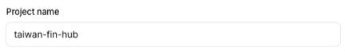

# 進階部署與更新

首次部署請從 [README 的免費部署步驟](../README.md#免費部署)開始。已有站台可直接看[版本更新](#版本更新)、[Access 驗證失敗](#access-驗證失敗)、[本機開發](#本機開發)或[從較早版本升級](#從較早版本升級)。

## 一鍵部署細節

### 1. 選擇加密金鑰

一般部署保留 `CONFIG_ENCRYPTION_KEY=auto`。首次部署會產生隨機金鑰，存入 `GENERATED_CONFIG_ENCRYPTION_KEY`，同一個 Worker 更新時沿用。

**若要自行備份金鑰、搬移 D1 或在本機解密資料，請在首次部署時自訂金鑰。** 可用以下指令產生並另存於密碼管理器。Cloudflare Secret 寫入後無法讀回。

```bash
openssl rand -hex 32
```

開始儲存加密資料後，請保留原本的模式與金鑰。金鑰遺失會使既有密文無法解密；若 D1 已有加密資料，部署程式會停止自動產生替代金鑰。

### 2. 執行 Deploy to Cloudflare

依 [README 的部署步驟](../README.md#免費部署)設定登入保護。確認 **Build command** 為 `npm run build`，**Deploy command** 為 `npm run deploy`。若部署後才要關閉分支預覽建置，到 **Worker → Settings → Builds → Branch control** 修改。



- **建立第二個站台**時，請使用新的 **Project name**。每個新 Worker 會取得專屬的 D1 和 Queue；首次部署中斷後，重試會沿用已分配的資源。每個 Queue 只能綁定一個 consumer Worker。
- **更新已有的站台**時，部署程式沿用正式流量所使用的 D1、Queue 與金鑰。無法讀取綁定或分流版本指向不同資源時，部署會在寫入前停止。本機部署可用 `npm run deploy -- --name <Worker 名稱>` 指定站台。
- **確認免費額度**時，留意所有需要瀏覽器的來源共用每日 Browser Run 額度。詳見 [Browser Run 計價](https://developers.cloudflare.com/browser-run/pricing/)。

### 首次部署計數

為了解有多少人部署本專案，部署 script 會在 Worker 首次部署成功後，下載一次上游 repository 的公開 Release 檔案 [`deploy-counter/first-deploy.txt`](https://github.com/TedLin1993/all-set-tw/releases/tag/deploy-counter)。維護者只能從 GitHub 看到這個檔案的累計下載次數。

- **觸發時機**：只在 Workers Builds（`WORKERS_CI=1`）中、Worker 尚未有 VAPID 金鑰且首次 `wrangler deploy` 成功後執行。之後的 build、版本更新與 Worker 執行期間都不會再發出請求。
- **送出內容**：一般的 HTTPS GET，不附加 ID、Worker 名稱、帳號、設定或金融資料。請求從 Cloudflare 的建置環境發出，不是使用者的瀏覽器或裝置。
- **失敗處理**：逾時（5 秒）或任何錯誤只會在 log 顯示 `[deploy] First-deployment count skipped.`，不影響部署。
- **關閉方式**：在首次 build 執行前，於 Workers Builds 的 **Build variables and secrets** 設定 `DEPLOY_COUNTER=false`。本機部署與 `--dry-run` 不會計數。

刪除 Worker 後重新部署，或手動刪除兩個 VAPID Secrets 後重新部署，會再計數一次。

## Cloudflare Access

### 自動設定登入保護

在 Workers Builds 使用 `npm run deploy` 時，Cloudflare 依部署表單建立 Access 登入保護。部署程式會驗證正式網址回傳的簽章 metadata，再將 Team domain 與 Application AUD 寫入 `TEAM_DOMAIN`、`POLICY_AUD` 兩個 Runtime Secrets。過程使用既有部署 token，無須另授 Access API 權限。

請選 **All traffic** 以保護正式網址。舊站若已有兩個 Secret，更新時會沿用；部署程式只檢查名稱，不會驗證既有值。

若 build 顯示找不到 metadata，請在 **Worker → Access → Worker policies → Worker Access** 啟用 **All traffic**，再重試 build。若登入保護已啟用、最後寫入驗證值的部署失敗，重試會重新取得驗證值並保留既有 VAPID 金鑰。無法取得或驗證 metadata 時，不會將其內容寫成 Runtime Secrets，可改用下方的手動設定。

自動化只在 **Workers Builds（`WORKERS_CI=1`）** 執行。本機部署、`--dry-run` 與已知 `DEMO_MODE=true` 的部署會略過 Access 自動化；預覽 build 使用 Cloudflare 預設的 preview command，不會執行 `npm run deploy`。

需要自行維護 Access 驗證值時，可在 **Settings → Builds → Build variables and secrets** 設定 `ACCESS_AUTO_SETUP=false`，再使用下方的手動設定。透過 Wrangler `vars` 或 `--secrets-file` 明確提供的手動 Access 驗證值應以手動流程維護。

### 部署成功但缺少 Access 驗證值

檢查 build log 的 **Executing user deploy command**。若為 `npx wrangler deploy`，Wrangler 會使用按鈕範本，跳過正式 Worker 設定、D1 與 Queue 分配、資料庫 migration 及金鑰設定。前往 **Worker → Settings → Builds**，將 **Deploy command** 改為 `npm run deploy`，再重試 build。首次 Access 自動設定成功時，log 會出現 `[deploy] TEAM_DOMAIN and POLICY_AUD configured automatically.`。

### 啟用登入保護

首次部署依 README 在部署頁開啟 **Protect with Cloudflare Access** 即可。以下適用已部署 Worker 或部署頁未顯示該選項的情況；啟用後重試 build 即可自動取得驗證值。若停用自動化，建立登入保護後需繼續[設定 Worker 的 Access 驗證值](#設定-worker-的-access-驗證值)。


1. 前往 **Workers & Pages** 並選擇部署完成的 Worker。
2. 開啟 **Access** 頁籤，在 **Worker policies → Worker Access** 點擊 **Enable access**（部分介面稱 Protect this Worker behind Access）；已啟用時開啟設定對話框。
3. **Scope** 選擇 **All traffic**，保護正式與預覽部署。
4. **Authentication policy** 選擇 **Cloudflare account**，限定該 Cloudflare 帳戶成員；已有相同規則的 **Cloudflare account members** policy 也可使用。
5. 點擊 **Apply Access**。

Cloudflare 在 [2026-08-14 改版](https://developers.cloudflare.com/changelog/post/2026-08-14-workers-access/)後，可直接保護整個 Worker，涵蓋 `workers.dev`、自訂網域、routes 與預覽網址。**Previews only 不涵蓋正式網址**。若只要保護特定 hostname，可在 Zero Trust 建立對應的 Self-hosted Application；完整操作與規則優先順序請參考 [Cloudflare Access for Workers](https://developers.cloudflare.com/workers/configuration/cloudflare-access/)。


### 設定 Worker 的 Access 驗證值

1. 前往 **Cloudflare One／Zero Trust → Access controls → Applications**，找到保護目前 Worker 的 Application。
2. 開啟 **Configure → Additional settings → AUD tag**，複製 **Application Audience (AUD) Tag** 作為 `POLICY_AUD`。不要使用 Authentication policy 的 ID、Application ID 或只保護預覽網址的 Application AUD。
3. 在 **Overview → Account details → Team domain** 複製同一 organization 的網域，補上 `https://` 作為 `TEAM_DOMAIN`，例如 `https://yourteam.cloudflareaccess.com`；若已有 `https://`，直接使用。若提供 JWKs URL，移除 `/cdn-cgi/access/certs`；不要填入 Worker 網址、裸 Team Name 或其他路徑。
4. 回到 Worker 的 **Settings → Runtime variables and secrets → Production → Add variable**（部分介面稱 Variables and secrets），新增這兩個 **Secret** 並儲存／部署使設定生效。


AUD 的官方取得方式請參考 [Get your AUD tag](https://developers.cloudflare.com/cloudflare-one/access-controls/applications/http-apps/authorization-cookie/validating-json/#get-your-aud-tag)。一般私人部署只需要加密金鑰與這兩個 Access 值：

| 參數                              | 一般私人部署                    | 用途                                           |
| --------------------------------- | ------------------------------- | ---------------------------------------------- |
| `CONFIG_ENCRYPTION_KEY`           | 保留 `auto`，或首次填入自訂金鑰 | 選擇自動模式，或直接提供加密金鑰               |
| `GENERATED_CONFIG_ENCRYPTION_KEY` | 部署 script 自動產生並保留      | `auto` 模式實際使用的加密金鑰                  |
| `TEAM_DOMAIN`                     | 雲端部署自動設定，亦可手動設定  | JWT issuer 與簽章公鑰來源                      |
| `POLICY_AUD`                      | 雲端部署自動設定，亦可手動設定  | 保護此 Worker 的 Application AUD               |
| `LOCAL_DEV_MODE`                  | 不需設定，預設關閉              | 本機開發範例設為 `true`，僅略過 localhost 驗證 |
| `VAPID_*`                         | 部署 script 自動產生並保留金鑰  | 本機測試推播時自行設定                         |

本專案仍由 Worker 驗證 Access JWT，因此需要 `TEAM_DOMAIN` 與 `POLICY_AUD`。Cloudflare 提供的 `ctx.access` 目前無法通過 Static Assets 的內部 router 傳入本專案的 Worker，詳見官方的 [`ctx.access` limitations](https://developers.cloudflare.com/workers/configuration/cloudflare-access/#ctxaccess-limitations)。

`DEMO_MODE`、`LOCAL_DEV_MODE` 在私人部署應為 `false` 或未設定。

### Access 驗證失敗

`Cloudflare Access JWT is invalid.` 是 Worker API 的登入驗證錯誤，發生於連接器執行之前；它不代表銀行或電子發票帳密有誤。這個訊息涵蓋簽章、公鑰取得、issuer、audience 與有效期限等失敗，不能僅憑此訊息判定是哪個值錯誤。

依序檢查：

1. Worker Access 是否已啟用，且 Scope 為 **All traffic**。
2. `POLICY_AUD` 是否為實際保護目前網址的 Application AUD。若同時有 hostname、Worker 與帳戶層級的 Access 規則，hostname 規則優先，其次是 Worker，再來才是帳戶規則。
3. `TEAM_DOMAIN` 是否屬於相同的 Zero Trust organization。`https://yourteam.cloudflareaccess.com` 是正確格式；簽章公鑰網址為其後加上 `/cdn-cgi/access/certs`。
4. 兩個值是否已存入 **Runtime variables and secrets** 並部署生效；Build variables 不會提供給 API runtime。
5. 若曾重建 Access Application 或改變保護範圍，重新複製 AUD，登出 Access 並重新登入以取得新 token。

程式會合併 `POLICY_AUD` 與 `POLICY_AUDS`，接受其中任一相符的 AUD。

### 使用 Cloudflare 帳號登入

Cloudflare Access 預設可能使用 Email OTP。如要限定 Cloudflare 帳號成員：

1. 前往 **Cloudflare One／Zero Trust → Integrations → Identity providers**。
2. 新增或開啟 **Cloudflare** Identity Provider，啟用 **Restrict to account members**。
3. 在 **Access controls → Applications** 找到保護此 Worker 的 Application，開啟 **Configure → Application details → Authentication → Identity**，將登入方式設為 Cloudflare。
4. 若只保留此登入方式，可啟用 **Apply instant authentication**。

### 延長登入期限

部署頁的 **Session duration** 最多可選 **7 days**。若要延長至一個月，部署完成後在 **Zero Trust → Access controls → Applications** 找到保護此 Worker 的 Application，再依下列方式調整：

若頁面顯示 **Finish your account setup**，先點擊 **Choose a plan**，完成 **Zero Trust Free** 方案設定。

1. 點擊該 Application 的 **Configure**，開啟 **Application details**。
2. 點擊頁面上方與 **All、Destinations、Policies** 同一排的 **Details** 按鈕，或直接向下捲到頁面最下方。
3. 在 **Details** 區塊的 **Name** 欄位旁，將 **Session Duration** 設為 **1 month** 並儲存。

**Access controls → Access settings → Global session duration** 決定重新向 identity provider 驗證的頻率，可依需求調整。既有 Application token 在自己的期限內仍有效，並非一律採用 Global 與 Application 中較短的期限。詳見官方[Session management](https://developers.cloudflare.com/cloudflare-one/access-controls/access-settings/session-management/)。

### 開放 AI 助理連線（MCP）

要讓 Codex、ChatGPT 等 AI 助理透過 `/mcp` 查詢資料，需在保護此 Worker 的 Application 開啟 **Managed OAuth**。開啟後，未登入的非瀏覽器請求會收到 `401` 而非轉址；網頁版登入方式不變。完整設定與各助理的連線步驟見 [AI 助理連線（MCP）](006-mcp.md)。

## 版本更新

一般部署只要在 Cloudflare 重新部署（Retry build）即可取得官方最新版本，GitHub repository 不需要任何變更。想每天自動更新，或修改過程式碼、需要保留修改的部署，可改用[同步 workflow](#同步-workflow選用)。

### 重新部署取得最新版本

Build command `npm run build` 執行 `scripts/cloudflare-build.mjs`。在 Workers Builds（`WORKERS_CI=1`）中，且 repository 沒有 `.github/workflows` 時，會：

1. 以 `git fetch --depth=1` 取得 `TedLin1993/all-set-tw` 的最新 `main`，並將這次 build 的 checkout 重設為該版本。只影響建置環境的暫存檔案，不會推送到部署 repository。
2. 保留部署 repository 的 Worker 名稱。部署時從該 Worker 的線上 bindings 取得 D1 與 Queue。
3. 依新版的 lockfile 重新執行 `npm ci`，再執行新版的 `npm run build:app`。後續的 Deploy command `npm run deploy` 也使用新版檔案，並套用新版的 D1 migrations。

有新版時，在網站的「更新紀錄」點 **前往 Cloudflare 更新**，即可前往產生目前版本的 Build Details。按 **Retry build**，等建置成功後重新整理網站。

網站以組建時間估算 Cloudflare 的 [90 天保留期限](https://developers.cloudflare.com/changelog/post/2026-10-28-workers-builds-90-day-retention/)。滿 90 天或缺少 `WORKERS_CI_BUILD_UUID` 時，按 **查看 Cloudflare 建置紀錄**，在最近一次正式分支的 build 右側點 **⋯ → Retry build**。若連結開啟 Workers & Pages 列表，先選擇 Worker，再開啟 **Deployments → View build history**。

首次一鍵部署可能無法重試。若所有建置都無法重試或紀錄已過期，可用 GitHub 網頁編輯部署 repository 的 README，將小修改提交到正式分支，觸發新的建置。若設過 Build watch paths，請選擇包含在監看範圍內的檔案。

取得官方版本失敗時 build 直接失敗，網站維持目前版本。Retry build 會重建同一個 commit，但 build 時仍會重新取得最新版本。

因此沒有安裝同步 workflow 時，部署 repository 只提供首次部署與 `wrangler.toml` 的部署設定，直接修改程式碼不會生效。repository 在首次部署後有新的 commit 時，build log 會提醒這件事。

下列情況使用 repository 目前的檔案建置，不切換版本：

- 本機或 GitHub Actions 等非 Workers Builds 環境。
- repository 有 `.github/workflows`：官方 repository、fork，或已安裝同步 workflow 的部署，由 repository 自己管理版本。

### 同步 workflow（選用）

Deploy to Cloudflare 建立的新 repository 不會包含本專案的 `.github/workflows`，需要一次性安裝同步 workflow。安裝後由 workflow 每天將上游合併至部署 repository，build 不會再另外取得官方版本。

要自行修改程式碼時，請先安裝並執行一次同步 workflow，再開始修改。首次同步的安全檢查會拒絕首次部署後已改過程式碼的 repository，避免覆蓋修改；之後的同步以三方合併保留修改。

安裝前先在 Worker 的 **Settings → Build → Build watch paths**，於排除路徑（exclude）加入 `.github/*` 並儲存。沒有 workflow 時，網站可能已透過重新部署更新，但部署 repository 的檔案仍是首次部署時的版本；只新增 workflow 的 commit 若觸發 build，會改用這些舊檔案建置，網站暫時退回舊版，直到同步 workflow 推送新版。加入排除路徑後，只改 `.github/` 的 commit 不會觸發 build，這個設定可以保留。安裝後請立即手動執行一次同步 workflow。

#### 從 GitHub 網頁安裝

1. 在部署 repository 開啟 [`deploy/github/sync-upstream.yml`](../deploy/github/sync-upstream.yml)，點擊 **Raw** 並複製內容。
2. 回到 repository 首頁，選擇 **Add file → Create new file**。
3. 建立 `.github/workflows/sync-upstream.yml`，貼上內容並 commit 至 `main`。
4. 前往 **Settings → Actions → General → Workflow permissions**，允許 GitHub Actions 寫入 repository。

#### 從本機安裝

```bash
mkdir -p .github/workflows
cp deploy/github/sync-upstream.yml .github/workflows/sync-upstream.yml
git add .github/workflows/sync-upstream.yml
git commit -m "啟用版本自動更新"
git push
```

安裝後立即從 **Actions → Sync Latest Version → Run workflow** 執行一次，之後也可隨時手動更新；workflow 每天台灣時間 **04:15** 會自動執行。

#### 同步如何運作

workflow 會：

1. 取得 `TedLin1993/all-set-tw` 的最新 `main`。
2. 以前次同步版本為基準進行三方合併。
3. 保留部署 repository 自己的 `.github/workflows`。
4. 有新版本時推送至 `main`，由 Workers Builds 重新部署。

首次同步若沒有共同 Git history，更新器只會在部署內容可對應到上游版本、且 workflows 以外沒有自行修改時接軌。同步前會建立 `backup-before-first-upstream-sync` branch；同名 branch 已存在時不會覆寫。

後續同步會在 commit message 記錄上游基準，不使用 force push。若本地修改與上游衝突，更新器會在推送前停止，保留目前內容供手動處理。

#### 同步故障排查

- **Workflow 沒有執行**：確認檔案位於 `.github/workflows/sync-upstream.yml`，並檢查 Actions 是否啟用。
- **無法推送更新**：確認 Workflow permissions 允許寫入 repository。
- **合併衝突**：從該次 Actions log 查看衝突檔案，手動合併後再重新執行。
- **`fatal: refusing to merge unrelated histories`**：部署 repository 仍在使用舊版 workflow，請重新複製最新的 [`deploy/github/sync-upstream.yml`](../deploy/github/sync-upstream.yml)。
- **資源權限錯誤**：確認 Workers Builds API token 具有該帳戶的 D1 Edit 與 Queues Edit 權限，並可讀取及部署該 Worker。

更新流程會保留部署 repository 目前安裝的 workflow，因此上游若修正更新流程，仍需手動替換 workflow 檔案。

## 發布版本與更新紀錄

版本從 `v1.0.0` 開始。維護者依使用者可見的改動決定發版時間與版號：相容的修正遞增 patch、新功能遞增 minor、不相容變更遞增 major。

1. 在根目錄 `releases.json` 的陣列最前方加入一筆紀錄，填入版號（例如 `1.0.1`）、發布日期（`YYYY-MM-DD`）與一至三條正體中文更新摘要。若改動來自社群 PR，在對應摘要的句號前加上「（感謝 @帳號 的貢獻）」，填入 PR 作者的 GitHub 帳號。保留所有歷史紀錄供前端查閱。
   需要示意圖時，把圖片放在 `images/releases/`，並在該筆紀錄加上 `images`：`change` 填圖片對應的摘要索引（從 0 起算）、`src` 填 repository 內的路徑、`alt` 填圖片的文字說明。圖片會顯示在「更新紀錄」與 GitHub Release 的對應摘要下方，請使用虛構資料截圖。各部署從上游追蹤分支載入圖片，較早的版本會略過 `images`，只顯示文字。
2. 開啟 PR 後，`.github/workflows/release.yml` 會驗證整份清單的格式。任一筆不符時，所有部署都會拒收上游紀錄，因此請在驗證通過後再合併至官方 `main`。版本紀錄合併後即公開，前端下次檢查即可取得公告。
3. 合併後，同一個 workflow 再驗證一次，讀取第一筆紀錄，在合併 commit 建立 `v1.0.1` 這類 Git tag 與 GitHub Release，並以更新摘要作為說明。連續合併多次發版時，各次發布會逐一執行，不會互相取消。

workflow 只在官方 repository 建立 Release，已發布的版號會略過。若同版號已有草稿 Release，或 tag 已存在但沒有對應的 Release，workflow 會停止，請確認後手動處理。修改已發布版本的摘要時，請一併編輯對應的 GitHub Release。

格式規則由 workflow 與前端 `apps/web/src/data/releases/queries.ts` 各自檢查，調整欄位或格式時兩處需一起修改。

重新部署與同步 workflow 都取得上游 `main`。兩次發版之間的部署顯示最近一次發版的版號，實際納入的上游程式碼可由 Commit 辨識。

## 組建版本資訊

桌面導覽與手機「更多」頁的「更新紀錄」可查閱所有版本的改動，有較新版時會顯示新版版號。「關於」頁顯示目前版本、`TedLin1993/all-set-tw` 的上游 Commit、追蹤分支 `main` 與本次部署的台灣組建時間（`Asia/Taipei`，UTC+8），並可一次複製診斷資訊。
`scripts/build-info.mjs` 在 Vite 組建時辨識採用的上游版本，再由 `apps/web/vite.config.ts` 寫入前端產物。

- 官方 repository 的 checkout 使用 `HEAD` 作為上游 Commit。
- 重新部署時 build 已切換到官方 commit，`HEAD` 位於上游歷史，直接使用該 Commit。
- 安裝同步 workflow 的部署只採用目前 `HEAD` 中更新器寫入的 `Taiwan-Fin-Hub-Upstream` 紀錄。
- 沒有紀錄的 fork／首次一鍵部署會在暫存 Git repository 取得官方 `main`；`HEAD` 本身位於上游歷史時使用該 Commit，沒有 parent 的首次匯入則以目前原始碼快照比對版本，忽略部署流程未複製的 `.github/workflows`。
- 使用者在同步後自行新增 commit 時，Commit 顯示「未知」；完整與淺層 checkout 採用相同規則，不沿用先前的同步紀錄、共同祖先或初始快照。

`updateMethod` 讀取 `cloudflare-build.mjs` 設定的 `TAIWAN_FIN_HUB_UPDATE_METHOD`：切換到官方版本建置時為 `cloudflare`，repository 有 `.github/workflows` 時為 `repository`，本機建置為 `null`。前端依此決定「更新紀錄」顯示的更新方式。

版本比對只讀取上游，不變更部署 repository。首次辨識需要連線 GitHub；無法辨識時 Commit 顯示「未知」。
本機 Vite dev server 的時間代表啟動時刻，正式組建則代表該次 Vite build 的時間；重新部署既有產物不會改變時間。

在 GitHub 建立「問題回報」Issue 前，請先從桌面「設定 → 關於」或手機「更多 → 關於」點選「複製診斷資訊」，
將完整內容貼到表單的「診斷資訊」欄位。若版本沒有「關於」頁或無法取得，請填「無法取得」並說明原因。

## 本機開發

建立私人設定檔並填入開發用 D1 Database ID 與加密金鑰：

```bash
cp apps/worker/wrangler.local.toml.example apps/worker/wrangler.local.toml
cp apps/worker/.dev.vars.example apps/worker/.dev.vars
npm install
npx wrangler login
npm run dev
```

範例設定中的 D1 與 Workers AI 使用 remote binding，會連到 Cloudflare 資源。請使用獨立的開發 D1，不要直接操作正式資料。

兆豐、台北富邦與加密貨幣交易所的對外請求，透過 `MegabankEgress`、`FubonEgress`、`CryptoBrowserEgress` 三個 SQLite Durable Object 代發。範例設定已包含 binding 與 migration，部署時由 Wrangler 建立，不需要額外 Secret。

本機 `apps/worker/.dev.vars.example` 保留手動金鑰設定；請填入開發用隨機金鑰。若需解密正式資料，正式部署也必須在最初自行提供並保存相同金鑰；公開部署範例的 `auto` 只會由部署 script 初始化。

SQL migrations 位於 `apps/worker/migrations/`。根目錄 `wrangler.app.toml` 的 `migrations_dir` 使用 `apps/worker/migrations`；`apps/worker/wrangler.local.toml` 使用相對於該設定檔的 `migrations`。

常用資料庫遷移指令：

```bash
npm run db:migrate:local -w @taiwan-fin-hub/worker
npm run db:migrate:remote -- --name example-worker
```

請將 `example-worker` 換成要遷移的 Worker 名稱。遠端 migration 會使用該 Worker 的線上 DB 綁定。根目錄與 Worker workspace 指令的行為相同。若要使用私人設定，請傳入 `--config` 並在 DB 綁定填寫 `database_id`。

中信行動銀行的 TLS endpoint 無法由 local workerd 直接連線，因此 `npm run dev` 會自動啟動只監聽 `127.0.0.1`、限制目的端點並使用單次隨機 token 的 Node relay；正式 Worker 不使用此 relay。

## Demo 模式

設定 `DEMO_MODE=true` 會略過 Cloudflare Access 登入、只允許唯讀 API，並停止背景排程同步，適合用來公開展示介面。
Demo 模式不開放 MCP 端點，`/mcp` 會回傳 `404`。

Demo 模式下任何人都能讀取該 Worker 綁定的 D1 資料，因此必須部署為獨立的 Worker，並綁定只含展示資料的 staging／demo D1；不要在儲存真實帳戶資料或連接器設定的部署啟用此模式。

## 部署至既有 D1

若要從本機部署至既有 D1，可在 repository 根目錄複製 `wrangler.app.toml` 為被忽略的 `wrangler.private.toml`，填入正確的 `database_id`，再執行：

```bash
XDG_CONFIG_HOME=.wrangler-config npx wrangler d1 migrations apply DB \
  --remote --config wrangler.private.toml
XDG_CONFIG_HOME=.wrangler-config node scripts/deploy-with-vapid.mjs \
  --config wrangler.private.toml
```

執行前請再次確認 `database_id`、Worker 名稱與所有 bindings 都指向預期環境。資料庫 migration 會修改遠端 schema，不要使用未確認的正式資料庫進行測試。

若既有 D1 已儲存加密資料，部署時必須沿用原本的實際金鑰。手動模式使用相同的 `CONFIG_ENCRYPTION_KEY`；自動模式需要原 Worker 的 `GENERATED_CONFIG_ENCRYPTION_KEY`，不能只在新 Worker 填入 `auto`。新的隨機金鑰無法解密既有資料，部署 script 也不會為已有加密資料的 D1 建立替代金鑰。

若自動金鑰遺失，需還原原本的 Secret；無法還原時，既有加密資料無法解密。

## 從較早版本升級

以下只適用於較早建立的部署或本機設定。

### Retry build 後版本沒有改變

較早的部署 repository 沒有 `cloudflare-build.mjs`，Retry build 只會重建原本的版本。在 Worker 的 **Settings → Builds** 將 **Build command** 改為下方指令並儲存，再 Retry build；之後保留這個 Build command，**Deploy command** 維持 `npm run deploy`。已安裝同步 workflow 的部署不需要切換。

```bash
curl -fsSL https://raw.githubusercontent.com/TedLin1993/all-set-tw/main/scripts/cloudflare-build.mjs -o /tmp/cloudflare-build.mjs && node /tmp/cloudflare-build.mjs
```

這個指令下載官方 `main` 的同一個 script 執行，行為與 `npm run build` 相同。

### Access 驗證值仍是暫填值

舊版部署範例會暫填 `TEAM_DOMAIN`、`POLICY_AUD` 與 `POLICY_AUDS`。可在 **Settings → Builds → Build variables and secrets** 暫時設定 `ACCESS_AUTO_SETUP=true` 並重試 build，重新取得正式網址的驗證值，成功後移除此變數；也可以依[設定 Worker 的 Access 驗證值](#設定-worker-的-access-驗證值)手動替換。只有單一 Application 時可刪除暫填的 `POLICY_AUDS`；殘留的 `POLICY_AUDS=temporary-placeholder` 不會覆蓋正確的 `POLICY_AUD`，但仍應清除。

### 手動金鑰部署

舊版以手動金鑰部署的站台沒有 `GENERATED_CONFIG_ENCRYPTION_KEY`，更新時仍使用原本的 `CONFIG_ENCRYPTION_KEY`，可以照常更新。

### 本機私人設定

較早建立的 `apps/worker/wrangler.local.toml` 需自行補上範例設定中的 `MEGABANK_EGRESS`、`FUBON_EGRESS`（migration tag `v2`）與 `CRYPTO_BROWSER_EGRESS`（migration tag `v3`）binding 及 SQLite migration，否則本機同步缺少 binding。既有的私人 Wrangler 設定也要依[本機開發](#本機開發)說明的路徑更新 migration 設定。

### 維護者注意

舊部署的 `cloudflare-build.mjs` 會在新版目錄執行 `npm run build:app`，並以 `TAIWAN_FIN_HUB_UPDATE_METHOD` 告知更新方式，因此往後版本必須保留 `build:app` script 與這個變數名稱。`cloudflare-build.mjs` 也可能以 curl 下載執行，只能 import Node 內建模組。
