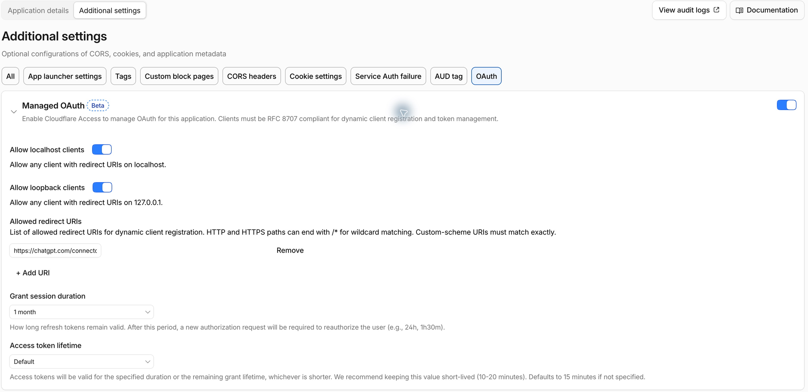
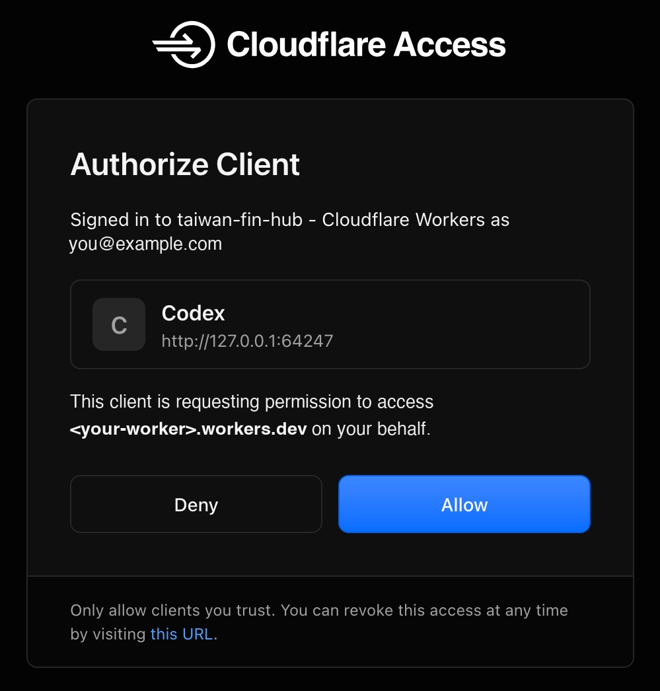
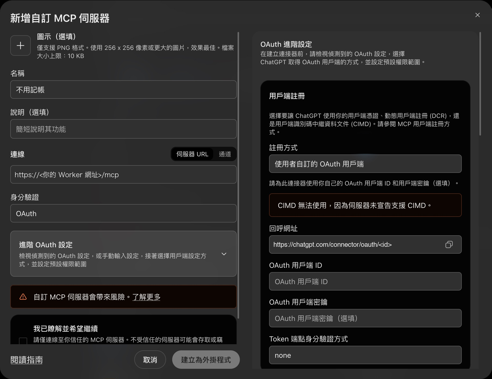
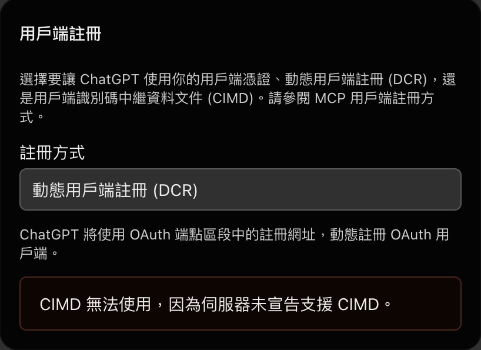

# AI 助理連線（MCP）

不用記帳提供 [Model Context Protocol](https://modelcontextprotocol.io/)（MCP）端點，讓 Codex、ChatGPT 等 AI 助理直接查詢你的淨資產、帳戶、持倉、收支與繳款提醒。例如：

- 「這個月餐飲花多少？跟上個月比呢？」
- 「最近有哪些信用卡要繳？扣款帳戶餘額夠嗎？」
- 「幫我找上個月在全聯的消費。」

MCP 端點位於 `https://<你的 Worker 網址>/mcp`，與網頁版共用同一個 Worker 與 Cloudflare Access 登入。本文件說明 Cloudflare 端的一次性設定、各 AI 助理的連線步驟與疑難排解；後端實作約定見[後端架構](002-backend-architecture.md)的 HTTP Request 流程。Cloudflare 與 AI 助理的介面名稱可能調整；若畫面不同，請以官方文件為準。

## 可用工具

所有工具都是唯讀的，AI 助理無法透過 MCP 觸發同步、修改分類、讀取或變更連接器設定。

| 工具                       | 內容                                                                                       |
| -------------------------- | ------------------------------------------------------------------------------------------ |
| `get_financial_overview`   | 淨資產、資產、信用卡欠款與貸款（新台幣），與總覽頁相同計算                                 |
| `list_accounts`            | 存款、信用卡、貸款帳戶的最新餘額（原幣別），以及手動記錄的其他資產                         |
| `list_investment_holdings` | 股票、ETF、基金與加密貨幣的最新持倉                                                        |
| `get_monthly_cash_flow`    | 指定月份的收入、支出與各分類金額，與活動頁相同計算（發票與刷卡不重複計入、排除統計不計入） |
| `search_activity`          | 以關鍵字搜尋銀行交易、刷卡與電子發票，最多回傳 30 筆                                       |
| `get_upcoming_payments`    | 5 天內到期、已逾期或扣款帳戶餘額不足的信用卡與貸款繳款提醒                                 |
| `whoami`                   | 目前登入的 Cloudflare Access 帳號，用於確認連線                                            |

### 隱私

透過 MCP 查到的資料會送到你使用的 AI 服務（例如 OpenAI）。工具只回傳回答問題所需的欄位：帳號只顯示末四碼，不包含內部 ID、原始回應與連接器設定；活動標題與 App 畫面相同，銀行未提供摘要時可能是交易備註。請只連接你信任的 AI 服務。

## 一次性設定：開啟 Managed OAuth

AI 助理不是瀏覽器，無法使用網頁版的 Access 登入轉址。Cloudflare Access 的 [Managed OAuth](https://developers.cloudflare.com/cloudflare-one/access-controls/applications/http-apps/managed-oauth/) 讓 AI 助理改用標準 OAuth 流程，開啟瀏覽器完成 Access 登入後取得存取權杖；Worker 端不需另外設定 Secret。

1. 前往 **Cloudflare One／Zero Trust → Access controls → Applications**，點擊保護此 Worker 的 Application 名稱（目的地為你的 Worker 網址，例如 `<name>.<subdomain>.workers.dev`）。
2. 切換到 **Additional settings**，點擊上方的 **OAuth** 篩選。
3. 開啟 **Managed OAuth**，並點擊標題展開設定：
   - **Allow localhost clients**、**Allow loopback clients**：開啟。Codex 等本機程式透過 `localhost`／`127.0.0.1` 接收登入結果。
   - **Allowed redirect URIs**：連接 ChatGPT 等網頁型助理時才需要，見下方各助理的步驟。
   - **Grant session duration**：登入後可持續使用多久，期滿需重新登入；最長可選 **1 month**。
   - **Access token lifetime**：維持 **Default**（15 分鐘）。到期時客戶端會自動換新，並重新檢查 Access policy。
4. 點擊 **Save**。



開啟後，未登入的非瀏覽器請求會收到 `401`，而不是轉址到登入頁；瀏覽器開啟網頁版仍會轉到 Access 登入頁。可用以下指令確認：

```bash
curl -s -o /dev/null -w '%{http_code}\n' -X POST https://<你的 Worker 網址>/mcp
```

回傳 `401` 表示設定生效；回傳 `302` 表示 Managed OAuth 尚未在保護此網址的 Application 開啟。

AI 助理取得的權杖與網頁版共用同一個 Access Application。MCP 只提供唯讀工具，但權杖本身與網頁版登入具有相同的存取範圍，請只在你信任的裝置與服務上授權。

## 連接 Codex

1. 新增 MCP 伺服器：

   ```bash
   codex mcp add all-set --url https://<你的 Worker 網址>/mcp
   ```

2. 登入：

   ```bash
   codex mcp login all-set
   ```

   瀏覽器會開啟 Cloudflare Access 的 **Authorize Client** 頁面，確認登入帳號與用戶端（Codex）後點擊 **Allow**。終端機顯示 `Successfully logged in to MCP server 'all-set'.` 即完成。

   

3. 在 Codex 詢問「用 all-set 的 whoami 看我是誰」，回傳你的 Access 帳號即表示連線成功。

Grant session 期滿後，重新執行 `codex mcp login all-set` 並點擊 **Allow** 即可。

## 連接 ChatGPT

ChatGPT 可在 **外掛程式** 頁面新增自訂 MCP 伺服器；使用工作區帳號時，可能需要管理員開放建立 MCP 外掛程式的權限。相關要求見 OpenAI 官方文件的 [Authentication](https://developers.openai.com/apps-sdk/build/auth/)。

1. 在 ChatGPT 開啟 **外掛程式**，點擊右上角 **新增 → 新增自訂 MCP 伺服器**，填入名稱與伺服器 URL `https://<你的 Worker 網址>/mcp`，身分驗證選擇 **OAuth**。
2. 展開 **進階 OAuth 設定**。回呼網址只在 **註冊方式** 為 **使用者自訂的 OAuth 用戶端** 時顯示：先切換到該選項，複製 **回呼網址**（格式為 `https://chatgpt.com/connector/oauth/<id>`）。

   

3. 回到 Cloudflare Access 的 Managed OAuth 設定，在 **Allowed redirect URIs** 點擊 **+ Add URI**，貼上回呼網址後 **Save**。
4. 回到 ChatGPT，將 **註冊方式** 改回 **動態用戶端註冊 (DCR)**（偵測到 Access 的註冊網址時預設即為此選項），不需填寫用戶端 ID 或密鑰。

   

5. 勾選 **我已瞭解並希望繼續**，點擊 **建立為外掛程式**。
6. 依提示完成 Access 登入，並在 **Authorize Client** 頁面點擊 **Allow**（畫面同上方 Codex 的步驟）。

## 撤銷授權

- **Authorize Client** 頁面下方提供撤銷存取的連結，可隨時撤銷已授權的用戶端。
- 從 Access policy 移除帳號後，客戶端最遲在下一次換發權杖（預設 15 分鐘）時失效。

## 本機測試

`npm run dev` 以 `apps/worker/.dev.vars` 的 `LOCAL_DEV_MODE=true` 略過 Access 登入，可直接以 MCP 客戶端連線 `http://localhost:8787/mcp`，例如：

```bash
npx @modelcontextprotocol/inspector
```

在 Inspector 選擇 Streamable HTTP 並填入上述網址。本機資料來自開發用 D1，請勿連接正式資料。

## 疑難排解

| 狀況                                                                              | 原因與處理                                                                                                                                                                          |
| --------------------------------------------------------------------------------- | ----------------------------------------------------------------------------------------------------------------------------------------------------------------------------------- |
| `codex mcp login` 顯示 `OAuth discovery redirect to non-same-origin URL rejected` | 保護此網址的 Access Application 尚未開啟 Managed OAuth。若同時有多個 Application（例如測試用 Worker），確認開啟的是目的地為正式網址的那一個；網址規則優先於 Worker 與帳戶層級規則。 |
| 登入頁出現 redirect URI 錯誤                                                      | 網頁型助理的回呼網址尚未加入 **Allowed redirect URIs**，或本機助理所需的 localhost／loopback 選項未開啟。                                                                           |
| `/mcp` 回傳 `404`                                                                 | 此部署啟用了 Demo 模式；Demo 模式不開放 MCP。                                                                                                                                       |
| `/mcp` 回傳 `403` 與 `Invalid Origin`                                             | 請求帶有其他網站的 `Origin` header；MCP 端點只接受同源或不帶 `Origin` 的請求。                                                                                                      |
| 工具回傳「讀取資料失敗，請稍後再試。」                                            | 查詢資料庫時發生錯誤；詳細原因已消毒後記錄於 Worker log（事件 `mcp_tool_failed`）。                                                                                                 |
| 網頁版在登入逾時後可能顯示讀取錯誤，而不是轉到登入頁                              | 開啟 Managed OAuth 後，未登入的 API 請求改回 `401`。重新整理頁面即可轉到 Access 登入頁。                                                                                            |
