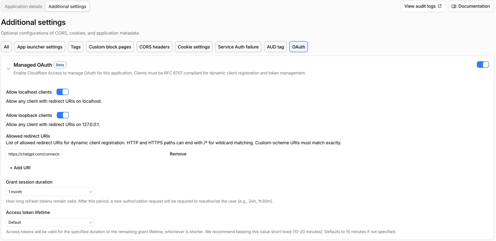
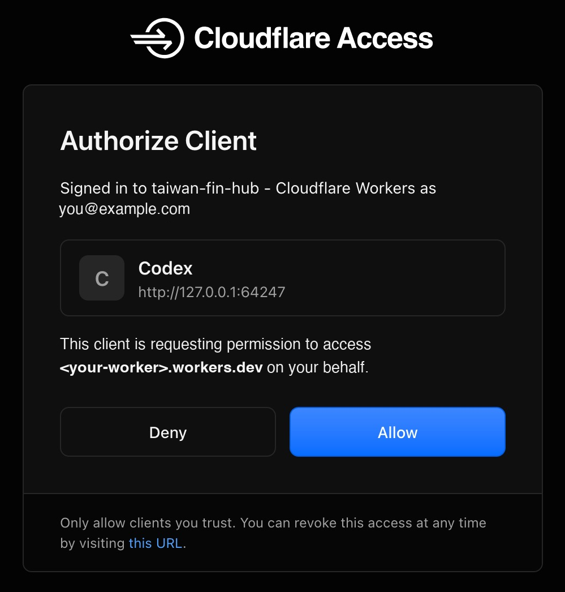
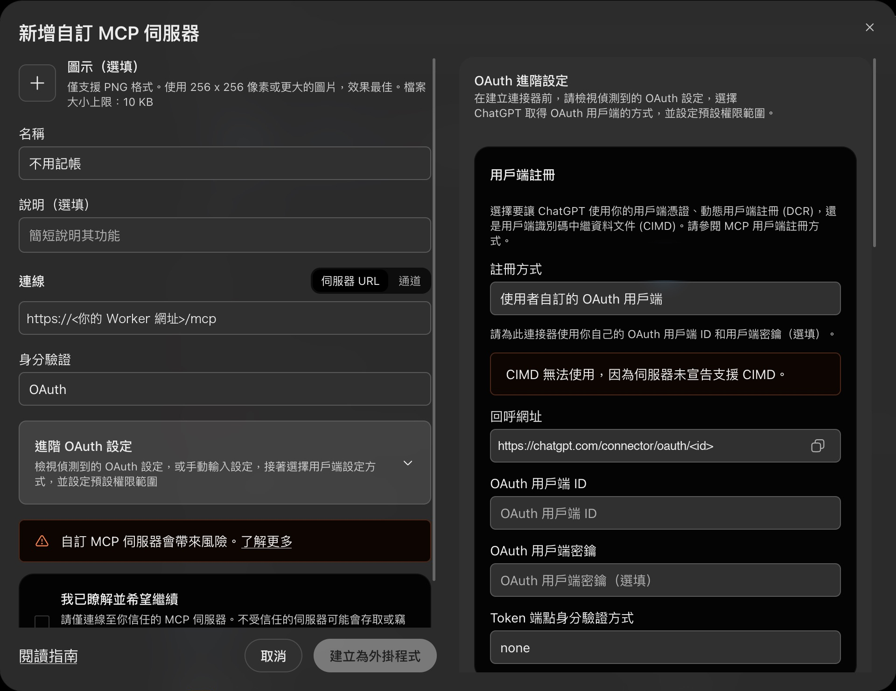
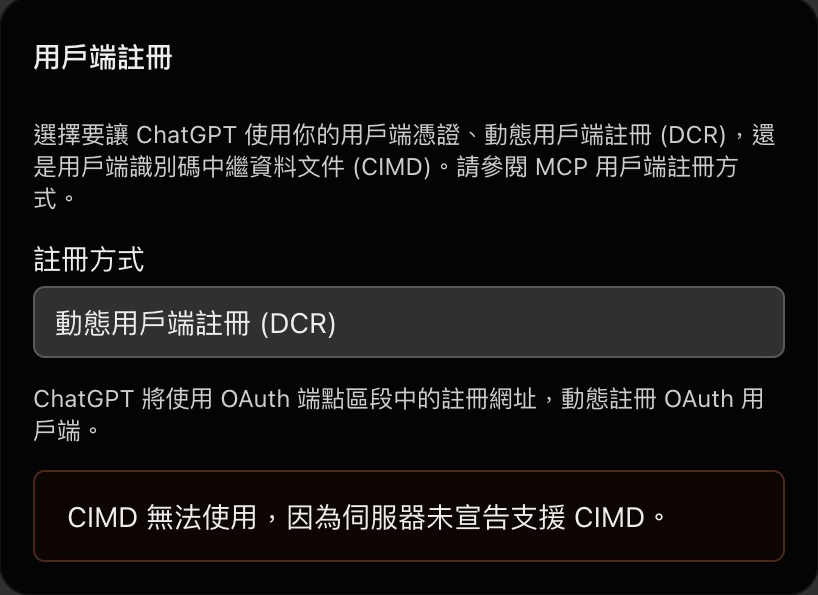

# AI 助理連線（MCP）

在「設定 → AI 助理」（手機為「更多 → AI 助理（MCP）」）選擇要連接的助理。頁面會檢查連線設定，並提供已填入本站網址的指令或操作步驟。

**授權範圍與隱私**　助理登入後擁有與網頁版相同的權限，可以查詢財務資料、編輯設定及觸發同步。查詢結果和交易備註會送到你使用的 AI 服務。摘要工具會遮蔽帳號，只顯示末四碼，通用 API 工具則會回傳網頁版的完整資料。若請助理代填銀行帳密，帳密也會經過該服務。請只授權你信任的服務。助理是否在變更資料前詢問，取決於該助理的設定。

首次使用請先開啟 Managed OAuth，再依下方步驟連接 [Codex](#連接-codex)、[Claude Code](#連接-claude-code) 或 [ChatGPT](#連接-chatgpt)。

## 一次性設定：開啟 Managed OAuth

1. 前往 [**Cloudflare One／Zero Trust → Access controls → Applications**](https://dash.cloudflare.com/?to=/:account/one/access-controls/apps)，點擊保護此 Worker 的 Application 名稱（目的地為你的 Worker 網址，例如 `<name>.<subdomain>.workers.dev`）。
2. 切換到 **Additional settings**，點擊上方的 **OAuth** 篩選。
3. 開啟 **Managed OAuth**，並點擊標題展開設定：
   - **Allow localhost clients**、**Allow loopback clients**：開啟。Codex 等本機程式透過 `localhost`／`127.0.0.1` 接收登入結果。
   - **Allowed redirect URIs**：連接 ChatGPT 等網頁型助理時才需要，見下方各助理的步驟。
   - **Grant session duration**：登入後可持續使用多久，期滿需重新登入；最長可選 **1 month**。
   - **Access token lifetime**：維持 **Default**（15 分鐘）。到期時客戶端會自動換新，並重新檢查 Access policy。
4. 點擊 **Save**。



## 連接 Codex

從網頁版複製設定提示詞並貼給 Codex，即可跟著提示登入。也可以手動設定。

1. 新增 MCP 伺服器：

   ```bash
   codex mcp add all-set --url https://<你的 Worker 網址>/mcp
   ```

2. 登入：

   ```bash
   codex mcp login all-set
   ```

   瀏覽器會開啟 Cloudflare Access 的 **Authorize Client** 頁面，確認登入帳號與用戶端（Codex）後點擊 **Allow**。終端機顯示 `Successfully logged in to MCP server 'all-set'.` 即完成。

   

3. 在 Codex 詢問「用 all-set 的 whoami 看我是誰」，回傳你的 Access 帳號即表示連線成功。

Grant session 期滿後，重新執行 `codex mcp login all-set` 並點擊 **Allow** 即可。

## 連接 Claude Code

從網頁版複製設定提示詞並貼給 Claude Code，新增伺服器後從下方第 2 步登入。手動設定請從第 1 步開始。

1. 新增 MCP 伺服器；`--scope user` 讓所有專案都能使用：

   ```bash
   claude mcp add --transport http --scope user all-set https://<你的 Worker 網址>/mcp
   ```

2. 在 Claude Code 輸入 `/mcp`，選擇 `all-set` 後選 **Authenticate**。瀏覽器會開啟 **Authorize Client** 頁面，點擊 **Allow**（畫面同上方 Codex 的步驟）。
3. 詢問「用 all-set 的 whoami 看我是誰」，回傳你的 Access 帳號即表示連線成功。

## 連接 ChatGPT

ChatGPT 可在 **外掛程式** 頁面新增自訂 MCP 伺服器；使用工作區帳號時，可能需要管理員開放建立 MCP 外掛程式的權限。相關要求見 OpenAI 官方文件的 [Authentication](https://developers.openai.com/apps-sdk/build/auth/)。

1. 在 ChatGPT 開啟 **外掛程式**，點擊右上角 **新增 → 新增自訂 MCP 伺服器**，填入名稱與伺服器 URL `https://<你的 Worker 網址>/mcp`，身分驗證選擇 **OAuth**。
2. 展開 **進階 OAuth 設定**。回呼網址只在 **註冊方式** 為 **使用者自訂的 OAuth 用戶端** 時顯示：先切換到該選項，複製 **回呼網址**（格式為 `https://chatgpt.com/connector/oauth/<id>`）。

   

3. 回到 Cloudflare Access 的 Managed OAuth 設定，在 **Allowed redirect URIs** 點擊 **+ Add URI**，貼上回呼網址後 **Save**。
4. 回到 ChatGPT，將 **註冊方式** 改回 **動態用戶端註冊 (DCR)**（偵測到 Access 的註冊網址時預設即為此選項），不需填寫用戶端 ID 或密鑰。

   

5. 勾選 **我已瞭解並希望繼續**，點擊 **建立為外掛程式**。
6. 依提示完成 Access 登入，並在 **Authorize Client** 頁面點擊 **Allow**（畫面同上方 Codex 的步驟）。

## 連線後可以做什麼

可以直接這樣問：

- 「這個月餐飲花多少？跟上個月比呢？」
- 「這個月餐飲花在哪些地方？最近半年的趨勢呢？」
- 「最近有哪些信用卡要繳？扣款帳戶餘額夠嗎？」
- 「整理這期信用卡和貸款的繳款清單，已繳和會自動扣款的打勾。」
- 「幫我找上個月在全聯的消費。」
- 「上個月有哪些轉帳我備註了代墊？」
- 「把含有『全聯』的交易都歸到餐飲，然後同步一次玉山。」
- 「昨天夜市花了 350，今天領了 3000，幫我記一下。」

- **查收支與帳單**　信用卡可以查已繳帳單，貸款是否已扣款則需自行確認。
- **同步資料**　告訴助理要同步哪些來源。同步會在背景逐一執行，瀏覽器型來源與排程共用每日 Browser Run 額度。若需要 OTP 或裝置驗證，請到網頁版「資料來源」完成。
- **記錄現金**　直接說「昨天夜市花了 350 元」或傳收據照片。現金收支以台幣記錄，餘額計入淨資產。初次使用或核對餘額時，可以告訴助理「我現在有 2,300 元現金」，餘額調整不計入收支。記錯時可請助理更正，也可在網頁版活動明細刪除。

提款時可以說「今天從銀行領了 3,000 元放進錢包」。同日同額的銀行提款會與這筆現金移動配對，之後實際花掉的金額才計入支出。日期或金額對不上時，可在銀行提款明細勾選「排除統計計算」。同日同額的手動現金支出也會與載具發票合併。

## 撤銷授權

- **Authorize Client** 頁面下方提供撤銷存取的連結，可隨時撤銷已授權的用戶端。
- 從 Access policy 移除帳號後，客戶端最遲在下一次換發權杖（預設 15 分鐘）時失效。

## 疑難排解

| 狀況                                                                              | 原因與處理                                                                                                                                                                          |
| --------------------------------------------------------------------------------- | ----------------------------------------------------------------------------------------------------------------------------------------------------------------------------------- |
| `codex mcp login` 顯示 `OAuth discovery redirect to non-same-origin URL rejected` | 保護此網址的 Access Application 尚未開啟 Managed OAuth。若同時有多個 Application（例如測試用 Worker），確認開啟的是目的地為正式網址的那一個；網址規則優先於 Worker 與帳戶層級規則。 |
| 登入頁出現 redirect URI 錯誤                                                      | 網頁型助理的回呼網址尚未加入 **Allowed redirect URIs**，或本機助理所需的 localhost／loopback 選項未開啟。                                                                           |
| `/mcp` 回傳 `404`                                                                 | 此部署啟用了 Demo 模式；Demo 模式不開放 MCP。                                                                                                                                       |
| `/mcp` 回傳 `403` 與 `Invalid Origin`                                             | 請求帶有其他網站的 `Origin` header；MCP 端點只接受同源或不帶 `Origin` 的請求。                                                                                                      |
| 工具回傳「讀取資料失敗，請稍後再試。」                                            | 查詢資料庫時發生錯誤；詳細原因已消毒後記錄於 Worker log（事件 `mcp_tool_failed`）。                                                                                                 |
| 網頁版在登入逾時後可能顯示讀取錯誤，而不是轉到登入頁                              | 開啟 Managed OAuth 後，未登入的 API 請求改回 `401`。重新整理頁面即可轉到 Access 登入頁。                                                                                            |

若網頁版無法確認 Managed OAuth 狀態，可用終端機檢查：

```bash
curl -s -w '\nHTTP %{http_code}\n' -X POST https://<你的 Worker 網址>/mcp
```

- 最後一行為 `HTTP 401`，且上方內容不是 Worker 回傳的 `{"success":false,"error":{"code":"UNAUTHORIZED",…}}`：設定生效。
- `HTTP 401` 且內容含 `"UNAUTHORIZED"`：請求沒有經過 Access，由 Worker 自己拒絕，表示沒有 Access Application 保護此網址；請確認 Application 的目的地涵蓋此網域。
- `HTTP 302`：Managed OAuth 尚未在保護此網址的 Application 開啟。

## 本機測試

`npm run dev` 以 `apps/worker/.dev.vars` 的 `LOCAL_DEV_MODE=true` 略過 Access 登入，可直接以 MCP 客戶端連線 `http://localhost:8787/mcp`，例如：

```bash
npx @modelcontextprotocol/inspector
```

在 Inspector 選擇 Streamable HTTP 並填入上述網址。另以 Vite 開發前端時，`http://localhost:5173/mcp` 也會轉到同一個端點，與 AI 助理頁顯示的網址一致。本機資料來自開發用 D1，請勿連接正式資料。

## 可用工具

| 工具                         | 內容                                                                                                                             |
| ---------------------------- | -------------------------------------------------------------------------------------------------------------------------------- |
| `get_financial_overview`     | 淨資產、資產、信用卡欠款與貸款（新台幣），與總覽頁相同計算                                                                       |
| `list_accounts`              | 存款、信用卡、貸款帳戶的最新餘額（原幣別），以及手動記錄的其他資產                                                               |
| `list_investment_holdings`   | 股票、ETF、基金與加密貨幣的最新持倉；沒有持倉的來源不列出                                                                        |
| `get_monthly_cash_flow`      | 指定月份的收入、支出與各分類金額，與活動頁相同計算（發票與刷卡不重複計入、排除統計不計入）；可一次查詢最多 12 個月，用於跨月比較 |
| `search_activity`            | 搜尋交易與發票，可按備註、發票品名、分類或日期篩選；命中品名會附數量、單價與品項小計，每頁最多 30 筆，以 `cursor` 翻頁           |
| `get_upcoming_payments`      | 3 天內到期或已逾期、尚未付清的信用卡與貸款款項；扣款帳戶餘額足夠的標示為 `covered`，已繳清的帳單不列入                           |
| `get_sync_status`            | 已設定資料來源的同步狀態與最近一次同步結果                                                                                       |
| `sync_sources`               | 把指定的資料來源排入背景同步，自動處理登入與驗證碼                                                                               |
| `record_manual_transactions` | 記錄你告知的現金收支與現金移動，並維護現金帳戶餘額                                                                               |
| `list_api_endpoints`         | 列出 `query_api`、`call_api` 可用的端點；以 `resource` 指定類別時回傳用途與 body 格式，`connectors` 另含資料來源 ID 與帳密欄位   |
| `query_api`                  | 以 GET 讀取網頁版 API，例如交易、發票、帳單、分類規則、排程與同步狀態；回應超過 6 萬字元時不回傳內容                             |
| `call_api`                   | 以 POST、PUT、PATCH、DELETE 呼叫網頁版 API：編輯分類與規則、手動資產、扣款帳戶、排程、通知與資料來源設定                         |
| `whoami`                     | 目前登入的 Cloudflare Access 帳號，用於確認連線                                                                                  |
